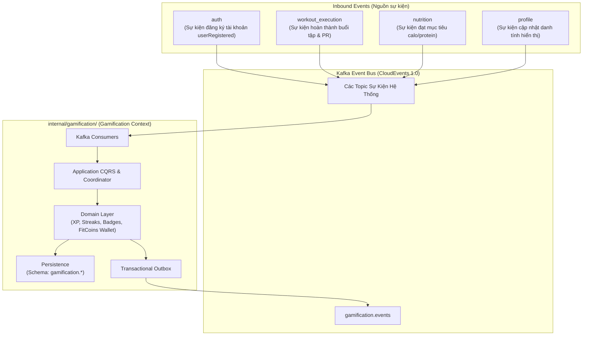

# Kiến Trúc Module Gamification (Architecture Specification)

Tài liệu này đặc tả kiến trúc tổng thể, ranh giới Bounded Context và các tầng kiến trúc của module **Gamification** trong hệ thống FITAI.

---

## 1. Vị Trí Trong Hệ Thống Modular Monolith

FITAI được xây dựng theo mô hình **Domain-Encapsulated Modular Monolith**. Mỗi Bounded Context được cô lập thành một thư mục độc lập dưới `/internal/<module_name>/`.

Module **Gamification** đóng vai trò là phân hệ bổ trợ (**Supporting Domain**), tiếp nhận các sự kiện nghiệp vụ từ hệ thống để vận hành cơ chế tích lũy kinh nghiệm (XP & Cấp độ), chuỗi ngày tập luyện (Streaks), bảng xếp hạng toàn hệ thống (Leaderboards), hệ thống huy hiệu/thành tựu (Badges & Achievements), và ví ảo FitCoins kèm sổ cái bất biến (FitCoins & Immutable Ledger):



---

## 2. Kiến Trúc Hexagonal (Ports & Adapters)

Module Gamification tuân thủ mô hình **Ports & Adapters**, giữ tầng Domain hoàn toàn sạch và độc lập ở mức high-level:

```text
internal/gamification/
├── domain/                      # LÕI NGHIỆP VỤ (Pure Go - Không phụ thuộc DB, Framework)
│   ├── aggregate/               # Quản lý trạng thái và quy tắc nghiệp vụ UserXp, UserStreak, UserBadge, UserWallet
│   ├── entity/                  # Các thực thể nghiệp vụ (XpHistoryEntry, StreakHistoryEntry, CoinLedgerEntry, LeaderboardEntry)
│   ├── vo/                      # Value Objects (LevelCalculator, BadgeCatalog, CoinTransactionReason)
│   ├── event/                   # Domain Events nội bộ
│   └── repository/              # Port Interfaces (Định nghĩa hợp đồng lưu trữ)
│
├── application/                 # TẦNG ĐIỀU PHỐI (Use Cases)
│   ├── command/                 # Xử lý các tác vụ ghi (XP, Streak, EvaluateBadges, AwardCoins, SpendCoins, AdminAdjustCoins)
│   ├── query/                   # Xử lý các tác vụ đọc (XP, Streak, Leaderboard, Badges, Wallet, LedgerTransactions)
│   ├── service/                 # ActivityIngestionCoordinator điều phối nguyên tử In-Memory Event Pipeline
│   └── port/                    # Ports giao tiếp (TransactionManager, OutboxWriter, WalletRewarder)
│
├── infrastructure/              # TẦNG KỸ THUẬT (Driven Adapters)
│   ├── event/                   # OutboxWriter đóng gói CloudEvents 1.0 Protobuf JSON (+1µs monotonic offset)
│   ├── kafka/                   # Kafka Publisher
│   ├── persistence/             # Hiện thực hóa lưu trữ (PostgreSQL GORM)
│   └── worker/                  # Outbox Worker quét đẩy sự kiện ra Kafka (Dead-Letter Poison Pill Guard)
│
└── transport/                   # TẦNG GIAO DIỆN (Driving Adapters)
    ├── grpc/                    # ConnectRPC Service Handlers (GamificationServiceHandler)
    └── consumer/                # Kafka Message Consumers
        ├── cloudevent.go                       # Shared Idempotent CloudEvent Loop & Poison Pill Commit
        ├── user_registered_consumer.go         # Khởi tạo tức thì hồ sơ game hóa khi đăng ký
        ├── workout_event_consumer.go           # Consumer hoàn thành buổi tập (gọi Coordinator)
        ├── personal_record_consumer.go         # Consumer phá kỷ lục cá nhân (PR)
        ├── nutrition_event_consumer.go         # Consumer đạt mục tiêu dinh dưỡng
        └── user_identity_updated_consumer.go   # Đồng bộ tên/ảnh đại diện cho Leaderboard
```

---

## 3. Ranh Giới Dữ Liệu & Giao Tiếp

* **Schema Isolation**: Toàn bộ dữ liệu của Gamification được cô lập trong PostgreSQL schema riêng (`gamification.*`). Không thực hiện truy vấn `JOIN` chéo sang schema của các module khác.
* **Transactional Outbox Pattern**: Mọi sự kiện phát sinh từ Gamification đều được lưu trữ cùng transaction với dữ liệu nghiệp vụ và đẩy bất đồng bộ ra Kafka topic `gamification.events`.
* **Idempotency**: Các Consumer và Command Handlers luôn kiểm tra tính lũy đẳng (qua khóa duy nhất nghiệp vụ hoặc `outbox_log`) bên trong khóa dòng bi quan để đảm bảo không xử lý lặp lại sự kiện.
* **Manual Offset Commit (At-Least-Once Delivery)**: Toàn bộ Kafka Consumers sử dụng cơ chế Manual Commit: `FetchMessage` -> `ProcessMessage` -> `CommitMessages`. Offset chỉ được commit khi xử lý thành công hoặc sau khi đã ghi nhận lỗi vĩnh viễn vào `outbox_log`.

---

## 4. Chuẩn Transactional Outbox Dùng Chung (Module-wide Outbox - SSOT)

> [!IMPORTANT]
> Mục 4 này là **Nguồn Chân Lý Duy Nhất (Single Source of Truth - SSOT)** cho hạ tầng Transactional Outbox Pattern của toàn bộ module Gamification. Tất cả các tài liệu tính năng con (`features/*/02-design.md`) dẫn chiếu trực tiếp về đây.

### 4.1 Schema DDL Chuẩn (`gamification.outbox` & `gamification.outbox_log`)

```sql
CREATE TABLE IF NOT EXISTS gamification.outbox (
    id UUID PRIMARY KEY DEFAULT gen_random_uuid(),
    event_id UUID NOT NULL UNIQUE,
    aggregate_type VARCHAR(255),
    aggregate_id VARCHAR(255),
    event_type VARCHAR(255) NOT NULL,
    payload JSONB NOT NULL,
    partition_key VARCHAR(255) NOT NULL,
    published BOOLEAN NOT NULL DEFAULT FALSE,
    published_at TIMESTAMPTZ,
    created_at TIMESTAMPTZ NOT NULL DEFAULT NOW(),
    status VARCHAR(50) NOT NULL DEFAULT 'PENDING',
    retry_count INT NOT NULL DEFAULT 0,
    max_retries INT NOT NULL DEFAULT 5,
    last_error TEXT,
    locked_until TIMESTAMPTZ
);

CREATE INDEX IF NOT EXISTS idx_gamification_outbox_unprocessed
    ON gamification.outbox (created_at ASC)
    WHERE published = FALSE AND status != 'DEAD_LETTER';

CREATE TABLE IF NOT EXISTS gamification.outbox_log (
    id UUID PRIMARY KEY DEFAULT gen_random_uuid(),
    event_id UUID NOT NULL,
    event_type VARCHAR(255) NOT NULL,
    payload JSONB NOT NULL,
    partition_key VARCHAR(255) NOT NULL,
    processed_at TIMESTAMPTZ NOT NULL DEFAULT NOW(),
    status VARCHAR(50) NOT NULL,
    error_message TEXT
);

CREATE INDEX IF NOT EXISTS idx_gamification_outbox_log_event_status
    ON gamification.outbox_log (event_id, status);

CREATE UNIQUE INDEX IF NOT EXISTS ux_gamification_outbox_log_event_id
    ON gamification.outbox_log (event_id);
```

### 4.2 Cơ Chế Worker & Quét Khóa (`SELECT ... FOR UPDATE SKIP LOCKED`)

Background Worker (`internal/gamification/infrastructure/worker/outbox_worker.go`) vận hành theo chu kỳ:
1. **Claim Batch**: Quét các bản ghi chưa xuất bản bằng câu lệnh `SELECT ... FOR UPDATE SKIP LOCKED`.
2. **Locking Window**: Đánh dấu `status = 'PROCESSING'` kèm thời hạn `locked_until = NOW() + 30s`.
3. **Kafka Publish**: Đẩy mẻ sự kiện sang Kafka topic `gamification.events` với Partition Key = `partition_key` (`user_id`).
4. **Mark Published**: Đánh dấu `published = TRUE`, `status = 'PUBLISHED'`.
5. **Cơ chế chống Poison Pill**: Nếu publish thất bại, tăng `retry_count += 1` và cập nhật `last_error`. Nếu `retry_count >= max_retries`, chuyển `status = 'DEAD_LETTER'`.

### 4.3 Chuẩn CloudEvents Envelope (CloudEvents 1.0 JSON)

Mọi bản ghi `payload` trong `gamification.outbox` đều đóng gói chuẩn CloudEvents 1.0 JSON và sử dụng các contract tại `proto/contracts/supporting/gamification/v1/event/*.proto`:
```json
{
  "specversion": "1.0",
  "id": "evt_01JABC1234XYZ...",
  "source": "services/gamification-service",
  "type": "contracts.supporting.gamification.v1.xpEarned",
  "datacontenttype": "application/json",
  "time": "2026-10-11T12:00:00Z",
  "data": {
    "userId": "usr_9988-7766-5544",
    "deltaXp": 100,
    "newXp": 1500,
    "newLevel": 6
  }
}
```

### 4.4 Danh Mục Sự Kiện

#### Sự Kiện Module Gamification Phát Sinh (`gamification.events`)
Tất cả các sự kiện bên dưới được định nghĩa tách riêng mỗi sự kiện 1 file trong `proto/contracts/supporting/gamification/v1/event/`:

| Tên Sự Kiện (`event_type`) | Tệp Protobuf | Mục Đích & Module Lắng Nghe |
| :--- | :--- | :--- |
| `contracts.supporting.gamification.v1.xpEarned` | `xp_earned.proto` | Ghi nhận tích lũy XP. `analytics`, `notification`. |
| `contracts.supporting.gamification.v1.userLeveledUp` | `user_leveled_up.proto` | Người dùng thăng cấp. `notification`, `profile`, `social`. |
| `contracts.supporting.gamification.v1.streakAdvanced` | `streak_advanced.proto` | Tăng chuỗi ngày. `notification`. |
| `contracts.supporting.gamification.v1.streakReset` | `streak_reset.proto` | Đứt chuỗi ngày sau ngày nghỉ. `notification`. |
| `contracts.supporting.gamification.v1.streakMilestoneReached` | `streak_milestone_reached.proto` | Chạm mốc chuỗi kỷ luật (7, 14, 30, 50, 100, 365 ngày). `notification`, `social`. |
| `contracts.supporting.gamification.v1.badgeUnlocked` | `badge_unlocked.proto` | Người dùng mở khóa huy hiệu mới. `notification`, `social`. |
| `contracts.supporting.gamification.v1.coinsEarned` | `coins_earned.proto` | Người dùng nhận thưởng FitCoins. `notification`, `analytics`. |
| `contracts.supporting.gamification.v1.coinsSpent` | `coins_spent.proto` | Người dùng chi tiêu FitCoins. `notification`, `analytics`. |

#### Sự Kiện Ngoại Vi Lắng Nghe (Inbound Events)
| Tên Sự Kiện | Module Phát | Xử Lý Phía Gamification |
| :--- | :--- | :--- |
| `contracts.generic.auth.v1.userRegistered` | `auth` | Khởi tạo tức thì bộ hồ sơ Gamification (`user_xp = 0, level = 1`, `user_streak = 0`, `user_wallet = 0`) và snapshot (`display_name`, `avatar_url`). |
| `contracts.core.workout_execution.v1.event.WorkoutSessionCompleted` | `workout_execution` | Điều phối qua `ActivityIngestionCoordinator` để cập nhật Streak, cộng XP, mở khóa Badges và thưởng FitCoins. |
| `contracts.core.workout_execution.v1.event.NewPersonalRecordAchieved` | `workout_execution` | Thưởng thêm PR Bonus (+25 XP), huy hiệu `PR_BREAKER` và FitCoins (+20 xu PR, +15 xu huy hiệu). |
| `contracts.core.nutrition.v1.event.DailyNutritionGoalAchieved` | `nutrition` | Duy trì Streak dinh dưỡng, thưởng $+30$ XP và $+3$ FitCoins (kèm thưởng cột mốc Streak nếu có). |

---

## 5. Chuẩn Hóa Xử Lý Bất Đồng Bộ Đa Aggregate & Khử Deadlock (Activity Ingestion Coordinator)

### 5.1 Vấn Đề Khi Nhận Sự Kiện Hoàn Thành Buổi Tập (`WorkoutSessionCompleted`)
Khi một buổi tập kết thúc, sự kiện tác động đồng thời lên **4 Aggregate trong module Gamification**:
1. `UserStreak`: Cập nhật chuỗi ngày kỷ luật tập luyện liên tục.
2. `UserXp`: Tính toán và cộng điểm kinh nghiệm XP (với Streak Multiplier mới nhất), nâng cấp level.
3. `UserBadge`: Đánh giá và mở khóa các huy hiệu thành tựu (`FIRST_WORKOUT`, `PR_BREAKER`, `STREAK_*`, `LEVEL_*`).
4. `UserWallet`: Cộng thưởng FitCoins (`EARN_WORKOUT`, `EARN_PR`, `EARN_STREAK_MILESTONE`, `EARN_BADGE`) và ghi sổ cái `coin_ledger`.

### 5.2 Khử Triệt Để Deadlock & Đảm Bảo Tính Toàn Vẹn ACID: Single Atomic Transaction
- **Giải Pháp Chuẩn Hóa (Single Atomic Transaction với In-Memory Event Pipeline & DAG Lock Ordering)**:
  - `ActivityIngestionCoordinator` bọc toàn bộ chuỗi tiến trình (`Streak -> XP -> Badges -> Wallet`) trong **1 Database Transaction duy nhất** thông qua `SQLTransactionManager.WithTransaction` (hỗ trợ transaction tái nhập / re-entrant).
  - Áp dụng **Thứ tự khóa đơn điệu nghiêm ngặt (Monotonic Lock Ordering)**:
    $$\texttt{user\_streak} \longrightarrow \texttt{user\_xp} \longrightarrow \texttt{user\_badges} \longrightarrow \texttt{user\_wallet}$$
  - **Chứng minh 0% Deadlock**:
    - Mọi luồng đa bảng (`IngestWorkoutSession`, `IngestNutritionActivity`, `IngestPersonalRecord`, `InitUserGamificationHandler`) đều khóa theo đúng chiều từ trái sang phải, trong đó `user_wallet` luôn là bảng được khóa cuối cùng.
    - Các luồng giao dịch ví độc lập (`SpendCoins`, `AdminAdjustCoins`) chỉ khóa duy nhất bảng `user_wallet`.
    - Đồ thị phụ thuộc khóa là một **Đồ thị có hướng không chu trình (DAG)** $\Rightarrow$ Điều kiện chờ vòng (**Circular Wait**) không thể xảy ra $\Rightarrow$ **0% Deadlock** mà không cần tách tiến trình qua Kafka nội bộ (tránh được độ trễ 5–10 giây của `OutboxWorker`).

```text
SINGLE ATOMIC TRANSACTION (In-Memory Event Pipeline + Batch Execution):
  BEGIN;
    -- Bước 1: Khóa và cập nhật Streak (Deterministic Lock #1)
    SELECT * FROM gamification.user_streak WHERE user_id = $1 FOR UPDATE;
    --> Cập nhật chuỗi ngày liên tục (UserStreak) & emit StreakAdvanced / StreakMilestoneReached

    -- Bước 2: Khóa và cập nhật XP (Deterministic Lock #2)
    SELECT * FROM gamification.user_xp WHERE user_id = $1 FOR UPDATE;
    --> Cập nhật điểm XP theo Streak Multiplier mới nhất & emit XpEarned / UserLeveledUp

    -- Bước 3: Đánh giá & Mở khóa Badges theo mẻ (Deterministic Lock #3)
    --> Batch INSERT INTO gamification.user_badges ON CONFLICT DO NOTHING RETURNING badge_code
    --> Chỉ emit BadgeUnlocked cho các huy hiệu thực sự vừa ghi mới vào DB

    -- Bước 4: Khóa và thưởng FitCoins qua Batch Port WalletRewarder (Deterministic Lock #4)
    SELECT * FROM gamification.user_wallet WHERE user_id = $1 FOR UPDATE;
    --> Kiểm tra Idempotency Key & O(1) Daily Cap ngay trên bộ nhớ trước khi hit DB
    --> Cập nhật user_wallet, Batch INSERT gamification.coin_ledger & emit CoinsEarned
  COMMIT;
```

---

## 6. Khởi Tạo Hồ Sơ Game Hóa Tức Thì (Eager Initialization via UserRegistered)

Gamification triển khai `UserRegisteredConsumer` lắng nghe sự kiện `contracts.generic.auth.v1.userRegistered` từ topic `auth.events` (Consumer Group: `gamification-user-registered-group`):
- Ngay khi tài khoản được tạo ở Auth, `InitUserGamificationHandler` thực thi 1 Local Database Transaction khởi tạo đồng thời theo đúng thứ tự khóa:
  1. `gamification.user_streak`: `current_streak = 0`, `longest_streak = 0`
  2. `gamification.user_xp`: `xp = 0`, `level = 1`
  3. `gamification.user_wallet`: `balance = 0`
  4. `gamification.user_snapshots`: `display_name = full_name`, `avatar_url = avatar_url`
- Song song đó, `FindByIDForUpdate` tại tất cả các Repository (`user_streak`, `user_xp`, `user_wallet`) đều áp dụng cơ chế **Fast-Path `SELECT ... FOR UPDATE` + Fallback Seed (`ON CONFLICT DO NOTHING`)**, đảm bảo khóa dòng vật lý luôn hoạt động tin cậy 100% ngay cả khi sự kiện tập luyện đến trước sự kiện đăng ký người dùng.
