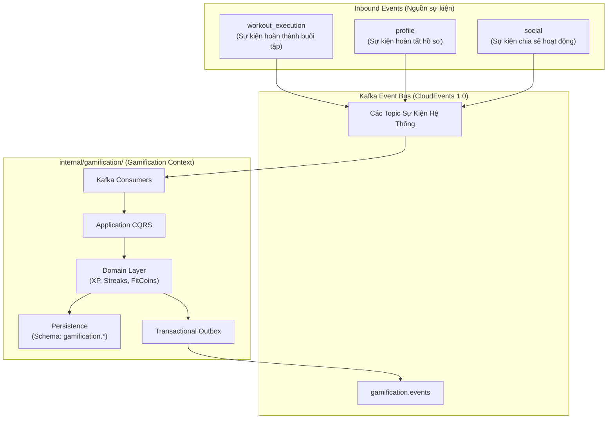

# Kiến Trúc Module Gamification (Architecture Specification)

Tài liệu này đặc tả kiến trúc tổng thể, ranh giới Bounded Context và các tầng kiến trúc của module **Gamification** trong hệ thống FITAI.

---

## 1. Vị Trí Trong Hệ Thống Modular Monolith

FITAI được xây dựng theo mô hình **Domain-Encapsulated Modular Monolith**. Mỗi Bounded Context được cô lập thành một thư mục độc lập dưới `/internal/<module_name>/`.

Module **Gamification** đóng vai trò là phân hệ bổ trợ (**Supporting Domain**), tiếp nhận các sự kiện nghiệp vụ từ hệ thống để vận hành cơ chế tích lũy kinh nghiệm (XP & Cấp độ), chuỗi ngày tập luyện (Streaks), bảng xếp hạng (Leaderboards) và quản lý tiền tệ thể thao (FitCoins):



---

## 2. Kiến Trúc Hexagonal (Ports & Adapters)

Module Gamification tuân thủ mô hình **Ports & Adapters**, giữ tầng Domain hoàn toàn sạch và độc lập ở mức high-level:

```text
internal/gamification/
├── domain/                      # LÕI NGHIỆP VỤ (Pure Go - Không phụ thuộc DB, Framework)
│   ├── aggregate/               # Quản lý trạng thái và quy tắc nghiệp vụ XP, Streak, Ví tiền
│   ├── entity/                  # Các thực thể nghiệp vụ (Dòng sổ cái, Lịch sử điểm)
│   ├── vo/                      # Value Objects (Bậc hạng, Loại giao dịch, Danh mục)
│   ├── event/                   # Domain Events nội bộ
│   └── repository/              # Port Interfaces (Định nghĩa hợp đồng lưu trữ)
│
├── application/                 # TẦNG ĐIỀU PHỐI (Use Cases)
│   ├── command/                 # Xử lý các tác vụ ghi (Cộng XP, Điểm danh Streak, Đổi quà)
│   ├── query/                   # Xử lý các tác vụ đọc (Thông tin ví, Bảng xếp hạng)
│   └── port/                    # Output Ports giao tiếp ngoài (Transaction, Cross-module reader)
│
├── infrastructure/              # TẦNG KỸ THUẬT (Driven Adapters)
│   ├── persistence/             # Hiện thực hóa lưu trữ (PostgreSQL GORM)
│   ├── event/                   # Outbox Writer (Đóng gói CloudEvents)
│   └── worker/                  # Outbox Worker quét đẩy sự kiện ra Kafka
│
└── transport/                   # TẦNG GIAO DIỆN (Driving Adapters)
    ├── grpc/                    # ConnectRPC Service Handlers
    └── consumer/                # Kafka Message Consumers
```

---

## 3. Ranh Giới Dữ Liệu & Giao Tiếp

* **Schema Isolation**: Toàn bộ dữ liệu của Gamification được cô lập trong PostgreSQL schema riêng (`gamification.*`). Không thực hiện truy vấn `JOIN` chéo sang schema của các module khác.
* **Transactional Outbox Pattern**: Mọi sự kiện phát sinh từ Gamification đều được lưu trữ cùng transaction với dữ liệu nghiệp vụ và đẩy bất đồng bộ ra Kafka topic `gamification.events`.
* **Idempotency**: Các Consumer phía tiếp nhận dữ liệu luôn kiểm tra tính lũy đẳng (Idempotent Consumer qua khóa duy nhất nghiệp vụ hoặc Ledger Guard) để đảm bảo không xử lý lặp lại sự kiện.

---

## 4. Chuẩn Transactional Outbox Dùng Chung (Module-wide Outbox - SSOT)

> [!IMPORTANT]
> Mục 4 này là **Nguồn Chân Lý Duy Nhất (Single Source of Truth - SSOT)** cho hạ tầng Transactional Outbox Pattern của toàn bộ module Gamification. Tất cả các tài liệu tính năng con (`features/*/02-design.md`, `03-plan.md`) không được định nghĩa lại bảng DDL hay worker lặp lại, mà phải dẫn chiếu trực tiếp về đây.

Nhằm đảm bảo tính tin cậy tuyệt đối (At-Least-Once Delivery), loại trừ triệt để nguy cơ Dual-Write lỗi giữa Database và Kafka broker lúc mạng chập chờn, toàn bộ các tính năng con trong `internal/gamification/` đều chia sẻ chung một hạ tầng Transactional Outbox tại PostgreSQL schema `gamification.*`.

### 4.1 Schema DDL Chuẩn (`gamification.outbox` & `gamification.outbox_log`)

```sql
-- Bảng Outbox chính: Lưu trữ tạm thời các Domain Events cùng Transaction nghiệp vụ
CREATE TABLE IF NOT EXISTS gamification.outbox (
    id UUID PRIMARY KEY DEFAULT gen_random_uuid(),
    event_id UUID NOT NULL UNIQUE,
    aggregate_type VARCHAR(255),
    aggregate_id VARCHAR(255),
    event_type VARCHAR(255) NOT NULL,
    payload JSONB NOT NULL,
    partition_key VARCHAR(255) NOT NULL,             -- Khóa phân vùng Kafka (= user_id)
    published BOOLEAN NOT NULL DEFAULT FALSE,
    published_at TIMESTAMPTZ,
    created_at TIMESTAMPTZ NOT NULL DEFAULT NOW(),
    status VARCHAR(50) NOT NULL DEFAULT 'PENDING',  -- PENDING | PROCESSING | PUBLISHED | FAILED
    locked_until TIMESTAMPTZ
);

-- Chỉ mục tối ưu cho Worker quét batch hiệu năng cao
CREATE INDEX IF NOT EXISTS idx_gamification_outbox_claim
    ON gamification.outbox (published, status, locked_until, created_at);

-- Bảng Outbox Log: Lưu vết lịch sử xuất bản phục vụ Audit và Idempotent Consumer
CREATE TABLE IF NOT EXISTS gamification.outbox_log (
    id UUID PRIMARY KEY DEFAULT gen_random_uuid(),
    event_id UUID NOT NULL,
    event_type VARCHAR(255) NOT NULL,
    payload JSONB NOT NULL,
    partition_key VARCHAR(255) NOT NULL,
    processed_at TIMESTAMPTZ NOT NULL DEFAULT NOW(),
    status VARCHAR(50) NOT NULL,                     -- PUBLISHED | FAILED
    error_message TEXT
);

CREATE INDEX IF NOT EXISTS idx_gamification_outbox_log_event_status
    ON gamification.outbox_log (event_id, status);

CREATE UNIQUE INDEX IF NOT EXISTS ux_gamification_outbox_log_event_id
    ON gamification.outbox_log (event_id);
```

### 4.2 Cơ Chế Worker & Quét Khóa (`SELECT ... FOR UPDATE SKIP LOCKED`)

Background Worker (`internal/gamification/infrastructure/worker/outbox_worker.go`) vận hành theo chu kỳ:
1. **Claim Batch**: Quét các bản ghi chưa xuất bản (`published = FALSE`) bằng câu lệnh non-blocking:
   ```sql
   SELECT id, event_id, event_type, payload, partition_key 
   FROM gamification.outbox
   WHERE published = FALSE AND (status = 'PENDING' OR locked_until < NOW())
   ORDER BY created_at ASC
   LIMIT 100
   FOR UPDATE SKIP LOCKED;
   ```
2. **Locking Window**: Đánh dấu `status = 'PROCESSING'` kèm thời hạn `locked_until = NOW() + 30s`.
3. **Kafka Publish**: Đẩy mẻ sự kiện sang Kafka topic `gamification.events` với Partition Key = `partition_key` (luôn là `user_id` để bảo toàn thứ tự).
4. **Mark Published & Archiving**: Đánh dấu `published = TRUE`, `status = 'PUBLISHED'` và ghi nhật ký vào `gamification.outbox_log`.

### 4.3 Chuẩn CloudEvents Envelope (CloudEvents 1.0 JSON)

Mọi bản ghi `payload` trong `gamification.outbox` đều đóng gói chuẩn CloudEvents và sử dụng contract hợp nhất tại `proto/contracts/supporting/gamification/v1/event/gamification_events.proto`:
```json
{
  "specversion": "1.0",
  "id": "evt_01JABC1234XYZ...",
  "source": "fitai.gamification",
  "type": "contracts.supporting.gamification.v1.XpEarned",
  "datacontenttype": "application/json",
  "time": "2026-10-11T12:00:00Z",
  "partitionkey": "usr_9988-7766-5544",
  "data": {
    "userId": "usr_9988-7766-5544",
    "amount": 100
  }
}
```

### 4.4 Danh Mục Sự Kiện Module Gamification Phát Sinh

Tất cả các sự kiện bên dưới được định nghĩa trong contract tập trung duy nhất: `proto/contracts/supporting/gamification/v1/event/gamification_events.proto`.

| Tên Sự Kiện (`event_type`) | Bounded Context Phát Sinh | Mục Đích & Module Lắng Nghe |
| :--- | :--- | :--- |
| `contracts.supporting.gamification.v1.XpEarned` | `xp-and-levels` | Ghi nhận tích lũy XP. `analytics`, `notification`. |
| `contracts.supporting.gamification.v1.UserLeveledUp` | `xp-and-levels` | Người dùng thăng cấp. `notification` (Push/Popup), `profile` (Cập nhật huy hiệu cấp độ), `social` (Đăng bài tự động). |
| `contracts.supporting.gamification.v1.CoinsEarned` | `fitcoins-and-ledger` | Biến động nạp coin. `notification`, `analytics` (Giám sát lạm phát). |
| `contracts.supporting.gamification.v1.CoinsSpent` | `fitcoins-and-ledger` | Biến động tiêu coin. `notification`, `analytics`. |
| `contracts.supporting.gamification.v1.StreakAdvanced` | `streaks-and-habits` | Tăng chuỗi ngày. `notification`. |
| `contracts.supporting.gamification.v1.StreakReset` | `streaks-and-habits` | Đứt chuỗi ngày sau ngày nghỉ. `notification`. |

---

## 5. Chuẩn Hóa Xử Lý Bất Đồng Bộ Đa Aggregate & Khử Deadlock (Activity Ingestion Coordinator)

### 5.1 Vấn Đề Khi Nhận Sự Kiện Hoàn Thành Buổi Tập (`WorkoutSessionCompleted`)
Khi một buổi tập kết thúc, hệ thống phát ra CloudEvent `contracts.core.workout_execution.v1.WorkoutSessionCompleted`. Trong module Gamification, sự kiện này tác động đồng thời lên **3 Aggregate độc lập**:
1. `UserXp`: Tính toán và cộng điểm kinh nghiệm XP, nâng cấp level.
2. `UserStreak`: Cập nhật chuỗi ngày kỷ luật tập luyện liên tục.
3. `UserWallet`: Thưởng FitCoins tương ứng cho nỗ lực tập luyện.

### 5.2 Khử Triệt Để Deadlock: 1 Coordinator Duy Nhất Thay Vì 3 Consumers Song Song
- **Rủi ro nếu dùng 3 Kafka Consumers độc lập**:
  Nếu triển khai 3 Consumer riêng lẻ cùng lắng nghe sự kiện này cho cùng một `userId`:
  - 3 Consumer sẽ tranh chấp khóa dòng (`SELECT ... FOR UPDATE`) giữa các bảng liên quan hoặc mở 3 Database Transactions riêng biệt, gây lãng phí kết nối DB pool.
  - Trong trường hợp mở rộng nghiệp vụ có phụ thuộc chéo (ví dụ: đạt cột mốc Streak thưởng thêm FitCoins hoặc bonus XP), việc lấy khóa không theo thứ tự cố định sẽ dẫn đến **Deadlock** ở tầng PostgreSQL.
- **Giải Pháp Chuẩn Hóa (Activity Ingestion Coordinator)**:
  - Gamification triển khai **1 Kafka Consumer duy nhất** lắng nghe `WorkoutSessionCompleted`.
  - Consumer chuyển giao payload vào **1 Application Service điều phối**: `ActivityIngestionCoordinator` (hoặc `WorkoutActivityCoordinator`).
  - Toàn bộ tác vụ chạy gói gọn trong **1 Database Transaction duy nhất** thông qua `TransactionManager.WithTransaction(ctx, ...)`.

### 5.3 Quy Tắc Thứ Tự Khóa Bi Quan Cố Định (Strict Locking Hierarchy)
Để triệt tiêu 100% nguy cơ Deadlock, mọi Use Case tác động lên nhiều Aggregate trong `internal/gamification/` bắt buộc phải khóa các dòng theo **thứ tự cố định đơn hướng**:

`gamification.user_xp` $\longrightarrow$ `gamification.user_streak` $\longrightarrow$ `gamification.user_wallet`

```text
BƯỚC 1: SELECT * FROM gamification.user_xp WHERE user_id = $1 FOR UPDATE
        --> Thực thi logic XP & Level (Domain Aggregate UserXp)

BƯỚC 2: SELECT * FROM gamification.user_streak WHERE user_id = $1 FOR UPDATE
        --> Thực thi logic duy trì Chuỗi ngày (Domain Aggregate UserStreak)

BƯỚC 3: SELECT * FROM gamification.user_wallet WHERE user_id = $1 FOR UPDATE
        --> Thực thi logic FitCoins & Ledger (Domain Aggregate UserWallet)

BƯỚC 4: Ghi nhận tất cả Domain Events phát sinh (XpEarned, StreakAdvanced, CoinsEarned)
        vào bảng gamification.outbox trong cùng Transaction.

BƯỚC 5: COMMIT Transaction (đồng thời nhả toàn bộ khóa an toàn).
```

Nhờ thứ tự khóa tuần tự này, không bao giờ phát sinh đồ thị phụ thuộc vòng (circular wait condition), bảo đảm tính toàn vẹn và an toàn tuyệt đối ở tải cao.

