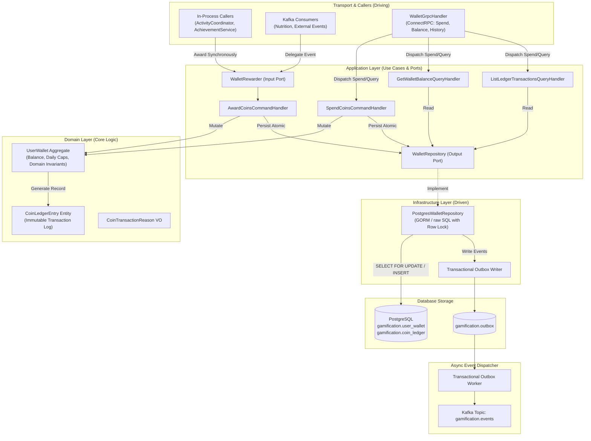
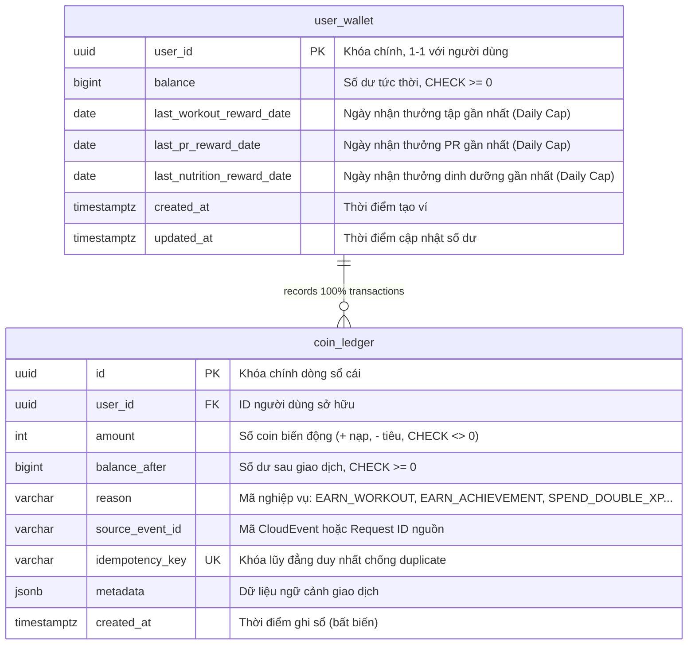
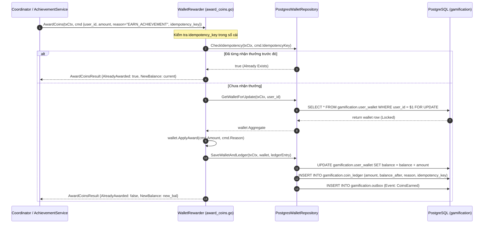
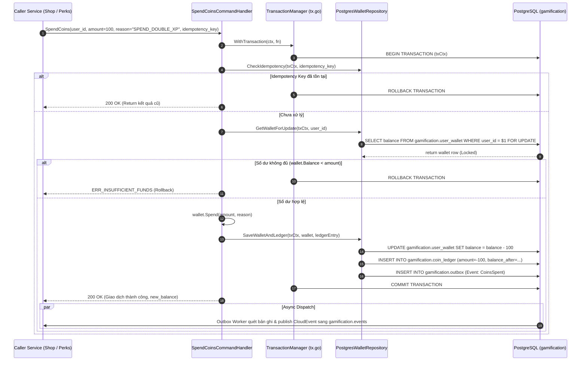

# Thiết Kế Kỹ Thuật: Tiền Tệ Ảo FitCoins & Sổ Cái Bất Biến (FitCoins & Immutable Ledger)

## 1. Kiến Trúc Hexagonal (Ports & Adapters)

Phân hệ FitCoins vận hành như một **Micro-Ledger Engine** khép kín, hỗ trợ cả 2 cổng tiếp nhận nạp tiền: In-Process Call nội bộ trong cùng tiến trình/transaction và Kafka Consumers bất đồng bộ từ các module phân tán:



### Ranh giới & Trách nhiệm các tầng:
1. **Domain Layer**:
   - `UserWallet`: Quản lý số dư, thực thi nghiệp vụ tích lũy theo từng trường hợp (Level Up, Workout, PR, Nutrition, Streak, Onboarding, Achievement) và kiểm tra bất biến `Balance >= Amount`.
   - `CoinLedgerEntry`: Biểu diễn bản ghi sổ cái bất biến, tính toán phương trình cân bằng `BalanceAfter = BalanceBefore + Amount`.
2. **Application Layer**:
   - `WalletRewarder`: Input Port nội bộ cung cấp giao thức thưởng coin đồng bộ trong cùng tiến trình (ADR-0004).
   - Điều phối transaction ACID, kiểm tra Idempotency Key, nạp và lưu trữ Aggregate qua Output Port `WalletRepository`.
3. **Infrastructure Layer**:
   - Hiện thực hóa `PostgresWalletRepository`: Sử dụng khóa dòng bi quan `SELECT ... FOR UPDATE` trên bảng `user_wallet`, lưu đồng thời ví và sổ cái trong 1 transaction cục bộ.
4. **Transport Layer**:
   - Kafka Consumers: Chuyển đổi các CloudEvents từ domain ngoài thành lời gọi `WalletRewarder.AwardCoins(...)`.
   - ConnectRPC Server: Cung cấp API tra cứu số dư, lịch sử giao dịch và cổng chi tiêu `SpendCoins`.

---

## 2. Quyết Định Kiến Trúc (Architecture Decision Records)

- [ADR-0001: Kiến Trúc Ví Số Dư & Sổ Cái Kiểm Toán Bất Biến](./adr/ADR-0001-immutable-audit-ledger-and-wallet-architecture.md)
- [ADR-0002: Kiểm Soát Trần Thu Nhập Ngày & Cơ Chế Chống Gian Lận](./adr/ADR-0002-daily-earning-caps-and-anti-cheat-enforcement.md)
- [ADR-0003: Cổng Chi Tiêu Mở Tách Rời Phân Hệ Cửa Hàng](./adr/ADR-0003-generic-spending-seam-and-decoupling-from-shop.md)
- [ADR-0004: Kết Hợp Cổng Thưởng Nội Bộ Đồng Bộ Với Lắng Nghe Sự Kiện Bất Đồng Bộ](./adr/ADR-0004-in-process-wallet-rewarder-port.md)

---

## 3. Thiết Kế Cơ Sở Dữ Liệu & Ràng Buộc ACID (Database & DDL)

### 3.1. Sơ Đồ Quan Hệ Dữ Liệu (ERD)



### 3.2. DDL PostgreSQL Schema `gamification.*`

```sql
-- 1. Bảng Ví Người Dùng (User Wallet)
CREATE TABLE IF NOT EXISTS gamification.user_wallet (
    user_id UUID PRIMARY KEY,
    balance BIGINT NOT NULL DEFAULT 0,
    last_workout_reward_date DATE,
    last_pr_reward_date DATE,
    last_nutrition_reward_date DATE,
    created_at TIMESTAMPTZ NOT NULL DEFAULT NOW(),
    updated_at TIMESTAMPTZ NOT NULL DEFAULT NOW(),
    CONSTRAINT chk_user_wallet_balance_non_negative CHECK (balance >= 0)
);

-- 2. Bảng Sổ Cái Kiểm Toán Bất Biến (Coin Ledger - Append Only)
CREATE TABLE IF NOT EXISTS gamification.coin_ledger (
    id UUID PRIMARY KEY DEFAULT gen_random_uuid(),
    user_id UUID NOT NULL,
    amount INT NOT NULL,
    balance_after BIGINT NOT NULL,
    reason VARCHAR(64) NOT NULL, -- EARN_LEVEL_UP, EARN_WORKOUT, EARN_PR, EARN_NUTRITION, EARN_STREAK_MILESTONE, EARN_ONBOARDING, EARN_ACHIEVEMENT, SPEND_...
    source_event_id VARCHAR(128),
    idempotency_key VARCHAR(128) NOT NULL,
    metadata JSONB DEFAULT '{}'::jsonb,
    created_at TIMESTAMPTZ NOT NULL DEFAULT NOW(),
    CONSTRAINT chk_coin_ledger_amount_nonzero CHECK (amount <> 0),
    CONSTRAINT chk_coin_ledger_balance_after_non_negative CHECK (balance_after >= 0),
    CONSTRAINT uq_coin_ledger_idempotency_key UNIQUE (idempotency_key)
);

-- 3. Chỉ mục tối ưu hóa hiệu năng
CREATE INDEX IF NOT EXISTS idx_coin_ledger_user_created 
ON gamification.coin_ledger (user_id, created_at DESC);
```

---

## 4. Luồng Xử Lý Nghiệp Vụ (Sequence Diagrams)

### 4.1. Luồng Thưởng Coin Đồng Bộ Trong Cùng Transaction (In-Process Rewarder Flow)



### 4.2. Luồng Chi Tiêu Coin (Spending Outflow & Double-Spending Guard)



---

## 5. Hợp Đồng Giao Diện API (Protobuf ConnectRPC)

Tệp hợp đồng dịch vụ: `proto/contracts/supporting/gamification/v1/service/gamification_service.proto`  
Tệp thông điệp: `proto/contracts/supporting/gamification/v1/message/gamification_messages.proto`

```protobuf
syntax = "proto3";

package contracts.supporting.gamification.v1.service;

import "google/api/annotations.proto";
import "protoc-gen-openapiv2/options/annotations.proto";
import "contracts/supporting/gamification/v1/message/gamification_messages.proto";

option go_package = "github.com/viethung213/gym-companion/internal/gen/go/contracts/supporting/gamification/v1/service;gamificationservicev1";

service GamificationService {
  // Tra cứu số dư ví hiện tại
  rpc GetWallet(contracts.supporting.gamification.v1.message.GetWalletRequest) 
      returns (contracts.supporting.gamification.v1.message.GetWalletResponse) {
    option (google.api.http) = {
      get: "/api/v1/gamification/wallet"
    };
  }

  // Tra cứu lịch sử biến động sổ cái phân trang
  rpc ListLedgerTransactions(contracts.supporting.gamification.v1.message.ListLedgerTransactionsRequest) 
      returns (contracts.supporting.gamification.v1.message.ListLedgerTransactionsResponse) {
    option (google.api.http) = {
      get: "/api/v1/gamification/wallet/transactions"
    };
  }

  // Cổng chi tiêu coin (Generic Spending Seam)
  rpc SpendCoins(contracts.supporting.gamification.v1.message.SpendCoinsRequest) 
      returns (contracts.supporting.gamification.v1.message.SpendCoinsResponse) {
    option (google.api.http) = {
      post: "/api/v1/gamification/wallet/spend"
      body: "*"
    };
  }
}
```

---

## 6. Tổ Chức Thư Mục Mã Nguồn Triển Khai (Package Tree)

> Cấu trúc tổng thể của toàn module tuân thủ theo [architecture.md#2](../../architecture.md#2-kiến-trúc-hexagonal-ports--adapters). Các thành phần triển khai cho tính năng Tiền Tệ FitCoins & Sổ Cái:

```text
internal/gamification/
├── domain/
│   ├── aggregate/
│   │   ├── user_wallet.go                # Aggregate Root: Balance, Daily Caps, Invariants
│   │   └── user_wallet_test.go           # Unit Test TDD: Kiểm tra âm tiền, trần nạp
│   ├── entity/
│   │   ├── coin_ledger_entry.go          # Entity bản ghi sổ cái bất biến (Append-only)
│   │   └── coin_ledger_entry_test.go     # Unit Test kiểm toán cân bằng sổ cái
│   └── vo/
│       ├── coin_transaction_reason.go    # Reason Enum: EARN_*, SPEND_*
│       └── transaction_idempotency_key.go# Value Object xác thực định dạng khóa
├── application/
│   ├── command/
│   │   ├── award_coins.go                # Use Case thưởng coin (triển khai WalletRewarder)
│   │   └── spend_coins.go                # Use Case trừ coin (bọc TransactionManager)
│   ├── query/
│   │   ├── get_wallet_balance.go         # Use Case đọc số dư tức thời
│   │   └── list_ledger_transactions.go   # Use Case đọc lịch sử sổ cái phân trang
│   └── port/
│       ├── wallet_rewarder.go            # Input Port thưởng coin đồng bộ trong tiến trình
│       └── wallet_repository.go          # Output Port: GetWalletForUpdate, SaveWalletAndLedger
├── infrastructure/
│   └── persistence/postgres/
│       └── wallet_repository.go          # Postgres implementation với SELECT FOR UPDATE
└── transport/
    ├── grpc/
    │   └── wallet_handler.go             # ConnectRPC Server Handler
    └── consumer/                         # Consumers cho các sự kiện độc lập
```

---

## 7. Đặc Tả Sự Kiện CloudEvents (`proto/contracts/supporting/gamification/v1/event/gamification_events.proto`)

> [!NOTE]
> Toàn bộ hạ tầng xuất bản sự kiện bất đồng bộ qua Transactional Outbox Pattern tuân thủ chặt chẽ theo đặc tả dùng chung duy nhất (SSOT) tại [architecture.md#4](../../architecture.md#4-chuẩn-transactional-outbox-dùng-chung-module-wide-outbox---ssot).

```protobuf
syntax = "proto3";

package contracts.supporting.gamification.v1.event;

import "google/protobuf/timestamp.proto";

option go_package = "github.com/viethung213/gym-companion/internal/gen/go/contracts/supporting/gamification/v1/event;gamificationeventv1";

// Sự kiện phát sinh khi người dùng tích lũy FitCoins thành công
message CoinsEarned {
  string user_id = 1;
  int64 amount = 2;              // Số coin được thưởng (> 0)
  int64 balance_after = 3;       // Số dư ví sau khi cộng
  string reason = 4;             // EARN_LEVEL_UP, EARN_WORKOUT, EARN_PR, EARN_ACHIEVEMENT, etc.
  string source_ref_id = 5;      // Mã tham chiếu (level, session_id, achievement_id)
  google.protobuf.Timestamp occurred_at = 6;
}

// Sự kiện phát sinh khi người dùng chi tiêu FitCoins thành công
message CoinsSpent {
  string user_id = 1;
  int64 amount = 2;              // Số coin đã tiêu (> 0)
  int64 balance_after = 3;       // Số dư ví sau khi trừ
  string reason = 4;             // SPEND_DOUBLE_XP, SPEND_VOUCHER, etc.
  string idempotency_key = 5;    // Khóa chống trừ trùng lặp
  google.protobuf.Timestamp occurred_at = 6;
}
```
