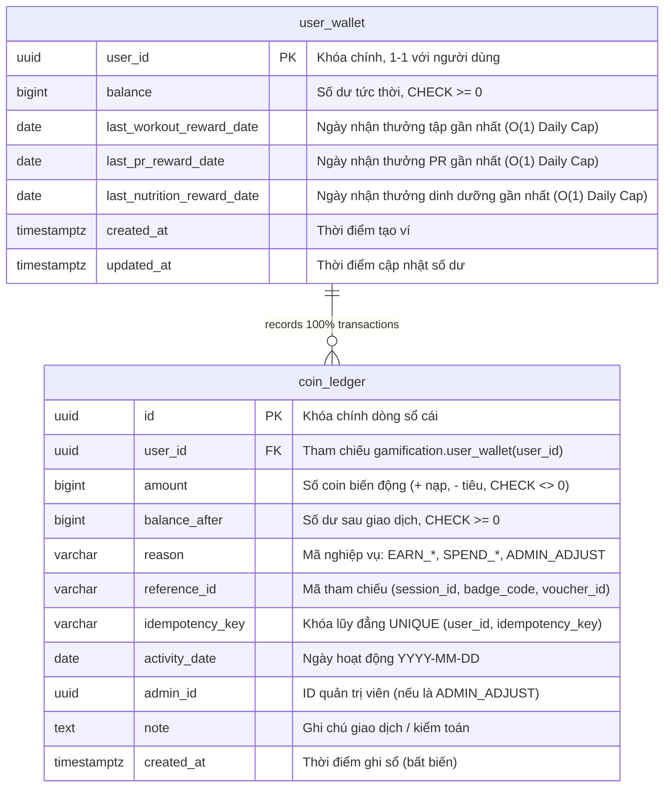
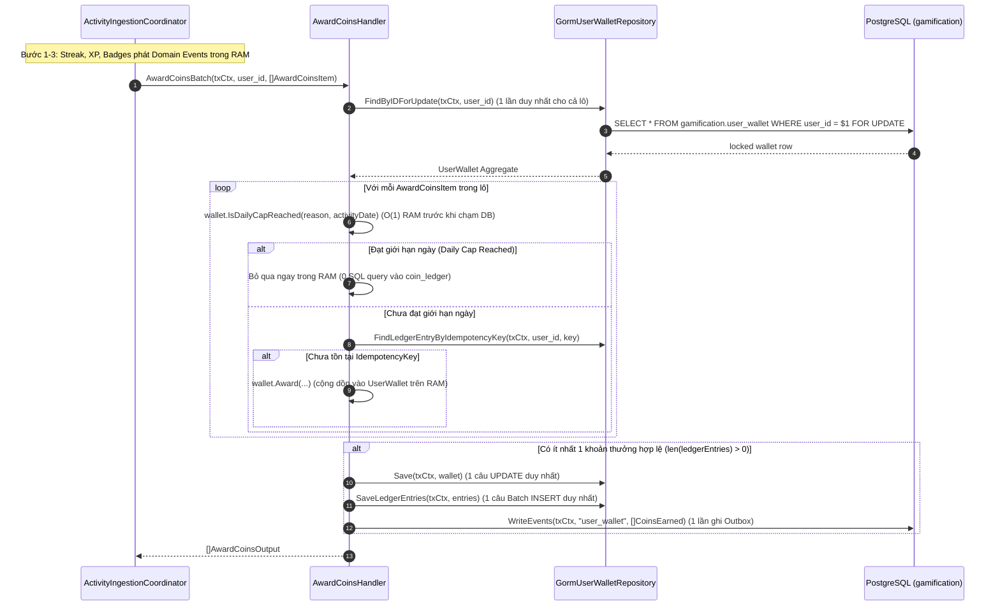
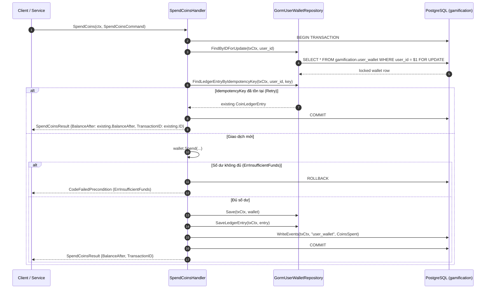

# Thiết Kế Kỹ Thuật: Tiền Tệ Ảo FitCoins & Sổ Cái Bất Biến (FitCoins & Immutable Ledger)

## 1. Kiến Trúc Hexagonal (Ports & Adapters)

Phân hệ FitCoins vận hành như một **Micro-Ledger Engine** khép kín bên trong module `gamification`, sử dụng cổng nội bộ `WalletRewarder` để cộng thưởng đồng bộ trong cùng transaction với `ActivityIngestionCoordinator` và các Command Handlers:

```mermaid
flowchart TD
    subgraph DrivingAdapters["Transport & Callers (Driving)"]
        IN_PROC["In-Process Callers<br/>(ActivityIngestionCoordinator,<br/>ProcessNutritionActivityHandler,<br/>ProcessPersonalRecordHandler)"]
        GRPC["Handler (ConnectRPC)<br/>(GetWallet, ListTransactions,<br/>SpendCoins, AdminAdjustCoins)"]
    end

    subgraph ApplicationLayer["Application Layer (Use Cases & Ports)"]
        PORT_REWARD["WalletRewarder (In-Process Port)"]
        CMD_EARN["AwardCoinsHandler"]
        CMD_SPEND["SpendCoinsHandler"]
        CMD_ADMIN["AdminAdjustCoinsHandler"]
        QRY_BAL["GetWalletHandler"]
        QRY_TX["ListTransactionsHandler"]
        PORT_REPO["UserWalletRepository (Domain Port)"]
    end

    subgraph DomainLayer["Domain Layer (Core Logic)"]
        AGG["UserWallet Aggregate<br/>(Balance, O(1) Daily Caps, Invariants)"]
        ENTITY["CoinLedgerEntry Entity<br/>(Immutable Transaction Log)"]
        VO["CoinTransactionReason VO"]
    end

    subgraph DrivenAdapters["Infrastructure Layer (Driven)"]
        REPO_IMPL["GormUserWalletRepository<br/>(Fast-Path FOR UPDATE + Seed Fallback)"]
        OUTBOX["OutboxWriter (CloudEvents 1.0)"]
    end

    subgraph Storage["Database Storage"]
        DB[(PostgreSQL<br/>gamification.user_wallet<br/>gamification.coin_ledger)]
        DB_OUTBOX[(gamification.outbox)]
    end

    IN_PROC -->|AwardCoinsBatch(txCtx)| PORT_REWARD --> CMD_EARN
    GRPC --> CMD_SPEND & CMD_ADMIN & QRY_BAL & QRY_TX
    CMD_EARN & CMD_SPEND & CMD_ADMIN -->|Mutate| AGG
    AGG -->|Create| ENTITY
    CMD_EARN & CMD_SPEND & CMD_ADMIN -->|Persist Atomic| PORT_REPO
    QRY_BAL & QRY_TX -->|Read| PORT_REPO
    PORT_REPO -.->|Implement| REPO_IMPL
    REPO_IMPL -->|SELECT FOR UPDATE / INSERT| DB
    CMD_EARN & CMD_SPEND & CMD_ADMIN -->|WriteEvents| OUTBOX --> DB_OUTBOX
```

---

## 2. Quyết Định Kiến Trúc (Architecture Decision Records)

- [ADR-0001: Kiến Trúc Ví Số Dư & Sổ Cái Kiểm Toán Bất Biến](./adr/ADR-0001-immutable-audit-ledger-and-wallet-architecture.md)
- [ADR-0002: Kiểm Soát Trần Thu Nhập Ngày & Cơ Chế Chống Gian Lận](./adr/ADR-0002-daily-earning-caps-and-anti-cheat-enforcement.md)
- [ADR-0003: Cổng Chi Tiêu Mở Tách Rời Phân Hệ Cửa Hàng](./adr/ADR-0003-generic-spending-seam-and-decoupling-from-shop.md)
- [ADR-0004: Kết Hợp Cổng Thưởng Nội Bộ Đồng Bộ Với Lắng Nghe Sự Kiện Bất Đồng Bộ](./adr/ADR-0004-in-process-wallet-rewarder-port.md)

---

## 3. Thiết Kế Cơ Sở Dữ Liệu & Ràng Buộc ACID (Database & DDL)

### 3.1. Sơ Đồ Quan Hệ Dữ Liệu (ERD)



### 3.2. DDL PostgreSQL Schema `gamification.*` (`13-create-gamification-tables.sql`)

```sql
CREATE TABLE IF NOT EXISTS gamification.user_wallet (
    user_id UUID PRIMARY KEY,
    balance BIGINT NOT NULL DEFAULT 0,
    last_workout_reward_date DATE,
    last_pr_reward_date DATE,
    last_nutrition_reward_date DATE,
    created_at TIMESTAMPTZ NOT NULL DEFAULT NOW(),
    updated_at TIMESTAMPTZ NOT NULL DEFAULT NOW(),
    CONSTRAINT chk_user_wallet_balance_non_negative CHECK (balance >= 0)
);

CREATE TABLE IF NOT EXISTS gamification.coin_ledger (
    id UUID PRIMARY KEY DEFAULT gen_random_uuid(),
    user_id UUID NOT NULL REFERENCES gamification.user_wallet(user_id) ON DELETE CASCADE,
    amount BIGINT NOT NULL,
    balance_after BIGINT NOT NULL,
    reason VARCHAR(50) NOT NULL,
    reference_id VARCHAR(100),
    idempotency_key VARCHAR(150) NOT NULL,
    activity_date DATE NOT NULL DEFAULT CURRENT_DATE,
    admin_id UUID,
    note TEXT,
    created_at TIMESTAMPTZ NOT NULL DEFAULT NOW(),
    CONSTRAINT chk_coin_ledger_amount_non_zero CHECK (amount <> 0),
    CONSTRAINT chk_coin_ledger_balance_after_non_negative CHECK (balance_after >= 0),
    CONSTRAINT uq_coin_ledger_user_idempotency UNIQUE (user_id, idempotency_key)
);

CREATE INDEX IF NOT EXISTS idx_coin_ledger_user_created
    ON gamification.coin_ledger (user_id, created_at DESC, id DESC);

CREATE UNIQUE INDEX IF NOT EXISTS uq_coin_ledger_daily_cap
    ON gamification.coin_ledger (user_id, reason, activity_date)
    WHERE reason IN ('EARN_WORKOUT', 'EARN_PR', 'EARN_NUTRITION');
```

---

## 4. Luồng Xử Lý Nghiệp Vụ (Sequence Diagrams)

### 4.1. Luồng Thưởng Coin Theo Lô Qua In-Memory Domain Event Pipeline (`AwardCoinsBatch`)



### 4.2. Luồng Chi Tiêu Coin (`SpendCoins` & Idempotent Replay)



---

## 5. Hợp Đồng Giao Diện API (Protobuf ConnectRPC)

- Tệp dịch vụ: `proto/contracts/supporting/gamification/v1/service/gamification_service.proto`
- Tệp thông điệp: `proto/contracts/supporting/gamification/v1/message/gamification_messages.proto`

Các RPC được bổ sung vào `GamificationService`:
- `GetWallet` (`GET /api/v1/gamification/wallet/me`)
- `ListTransactions` (`GET /api/v1/gamification/wallet/transactions`)
- `SpendCoins` (`POST /api/v1/gamification/wallet/spend`)
- `AdminAdjustCoins` (`POST /api/v1/gamification/admin/wallet/adjust`)

---

## 6. Tổ Chức Thư Mục Mã Nguồn Triển Khai

```text
internal/gamification/
├── domain/
│   ├── aggregate/
│   │   ├── user_wallet.go                 # Aggregate Root: Balance, O(1) Daily Caps, Invariants
│   │   └── user_wallet_test.go            # Unit Tests cho UserWallet Aggregate
│   ├── entity/
│   │   └── coin_ledger_entry.go           # Entity bản ghi sổ cái bất biến (Append-only)
│   ├── event/
│   │   └── events.go                      # Bổ sung CoinsEarned, CoinsSpent & In-Memory Seed Events
│   ├── repository/
│   │   └── user_wallet_repository.go      # Output Port: UserWalletRepository
│   └── vo/
│       └── coin_transaction_reason.go     # Enum CoinTransactionReason & hằng số mức thưởng
├── application/
│   ├── command/
│   │   ├── award_coins.go                 # Hiện thực hóa WalletRewarder Port (AwardCoinsBatch & HandleEvents)
│   │   ├── evaluate_badges.go             # Handler độc lập đánh giá & mở khóa huy hiệu từ []event.Event
│   │   ├── spend_coins.go                 # Use Case trừ xu (Idempotent Replay)
│   │   └── admin_adjust_coins.go          # Use Case điều chỉnh số dư bởi Admin
│   ├── query/
│   │   ├── get_wallet.go                  # Use Case đọc số dư ví
│   │   └── list_transactions.go           # Use Case phân trang Cursor sổ cái
│   ├── port/
│   │   └── wallet_rewarder.go             # Input Port thưởng xu đồng bộ trong tiến trình
│   └── service/
│       └── activity_ingestion_coordinator.go # Điều phối In-Memory Event Pipeline chung cho Workout, Nutrition, PR
├── infrastructure/
│   ├── event/
│   │   └── outbox_writer.go               # Ánh xạ CoinsEarned & CoinsSpent sang Protobuf (Batch Outbox)
│   └── persistence/
│       ├── models.go                      # UserWalletModel & CoinLedgerModel
│       └── user_wallet_repository.go      # GORM implementation với Fast-Path FOR UPDATE, Batch Insert & Keyset Cursor
└── transport/
    └── grpc/
        └── handler.go                     # ConnectRPC Handlers: GetWallet, ListTransactions, SpendCoins, AdminAdjustCoins
```

---

## 7. Đặc Tả Sự Kiện CloudEvents (`proto/contracts/supporting/gamification/v1/event/`)

- `coins_earned.proto`: `contracts.supporting.gamification.v1.coinsEarned` (`user_id`, `amount`, `balance_after`, `reason`, `reference_id`, `earned_at`).
- `coins_spent.proto`: `contracts.supporting.gamification.v1.coinsSpent` (`user_id`, `amount`, `balance_after`, `reason`, `reference_id`, `spent_at`).
