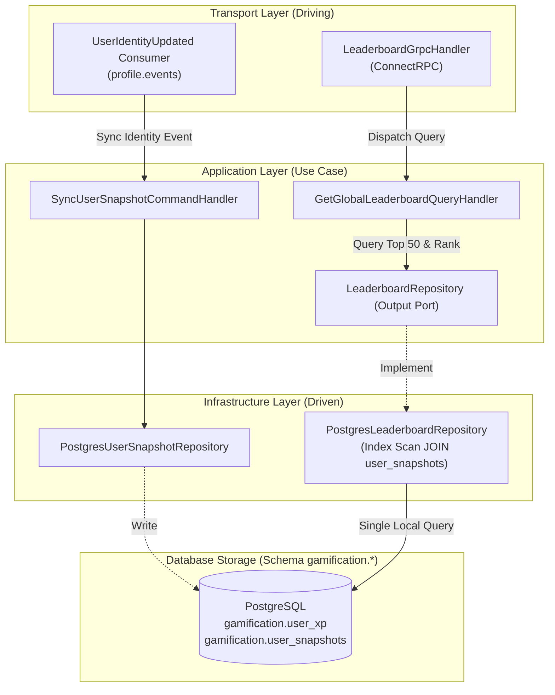
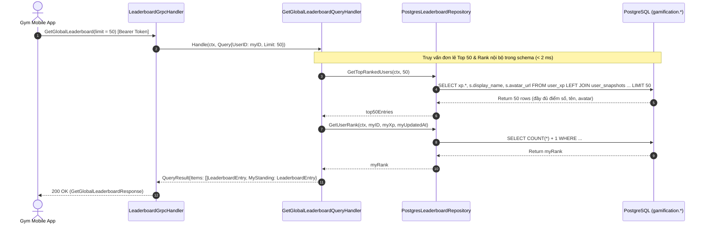

# Thiết Kế Kỹ Thuật: Bảng Xếp Hạng Toàn Hệ Thống Theo Điểm XP (XP Leaderboard)

## 1. Kiến Trúc Hexagonal (Ports & Adapters)

Tính năng **Bảng Xếp Hạng Toàn Hệ Thống (XP Leaderboard)** là một Use Case thuần đọc (**Read-Only Query Use Case**), tuân thủ nghiêm ngặt mô hình Ports & Adapters:



### Ranh giới trách nhiệm giữa các tầng:
1. **Transport Layer**:
   - `LeaderboardGrpcHandler`: Tiếp nhận request ConnectRPC `GetGlobalLeaderboard`, xác thực Bearer Token, trích xuất `user_id` và chuyển giao cho Application Query Handler.
   - `UserIdentityUpdated Consumer`: Lắng nghe sự kiện đổi tên/ảnh đại diện từ `profile.events` để cập nhật bảng `user_snapshots` bất đồng bộ.
2. **Application Layer**:
   - `GetGlobalLeaderboardQueryHandler`: Thực thi use case tra cứu Top 50 và thứ hạng cá nhân thuần túy qua `LeaderboardRepository`. Hoàn toàn không phụ thuộc thời gian chạy (Zero Runtime Coupling) vào module `profile`.
3. **Infrastructure Layer**:
   - `PostgresLeaderboardRepository`: Thực thi câu lệnh SQL tối ưu hóa `user_xp LEFT JOIN user_snapshots` bằng Index Scan trong $< 2\text{ ms}$.

---

## 2. Thiết Kế Cơ Sở Dữ Liệu & Chỉ Mục (Database & Index DDL)

Hệ thống kết hợp dữ liệu điểm số `gamification.user_xp` và bảng bản sao hiển thị `gamification.user_snapshots` trong cùng PostgreSQL schema:

```sql
-- 1. Bảng User Snapshot cục bộ: Lưu trữ tên hiển thị và avatar đồng bộ qua Kafka
CREATE TABLE IF NOT EXISTS gamification.user_snapshots (
    user_id UUID PRIMARY KEY,
    display_name VARCHAR(100) NOT NULL DEFAULT 'Gymer',
    avatar_url TEXT NOT NULL DEFAULT '',
    updated_at TIMESTAMPTZ NOT NULL DEFAULT NOW()
);

-- 2. Chỉ mục Composite B-Tree phục vụ truy vấn Bảng Xếp Hạng
CREATE INDEX IF NOT EXISTS idx_user_xp_leaderboard 
ON gamification.user_xp (xp DESC, updated_at ASC);
```

### Phân tích cơ chế truy vấn vật lý (Physical Query Mechanics):

#### Truy vấn 1: Lấy danh sách Top 50 dẫn đầu kèm tên và ảnh đại diện
```sql
SELECT 
    xp.user_id, 
    COALESCE(s.display_name, 'Gymer') AS display_name, 
    COALESCE(s.avatar_url, '') AS avatar_url, 
    xp.xp, 
    xp.level, 
    xp.updated_at
FROM gamification.user_xp xp
LEFT JOIN gamification.user_snapshots s ON xp.user_id = s.user_id
ORDER BY xp.xp DESC, xp.updated_at ASC
LIMIT 50;
```
* **Kế hoạch thực thi (Execution Plan)**: PostgreSQL sử dụng **Index Scan** trên `idx_user_xp_leaderboard` để lấy 50 dòng đầu tiên, sau đó thực hiện **Index Scan** trên khóa chính của `user_snapshots`. Toàn bộ quá trình diễn ra nội bộ trong database engine.
* **Thời gian thực thi**: $< 2\text{ ms}$.

#### Truy vấn 2: Xác định vị trí người dùng gọi API (`my_rank`)
Nếu người dùng hiện tại nằm trong Top 50, vị trí chính là `index + 1` của mảng kết quả ($O(1)$).
Nếu người dùng nằm ngoài Top 50, thực thi câu lệnh đếm có chỉ mục:
```sql
SELECT COUNT(*) + 1 AS my_rank
FROM gamification.user_xp
WHERE xp > :my_xp 
   OR (xp = :my_xp AND updated_at < :my_updated_at)
   OR (xp = :my_xp AND updated_at = :my_updated_at AND user_id < :my_user_id);
```
* **Kế hoạch thực thi**: Nhờ index trên `(xp DESC, updated_at ASC)`, engine thực hiện **Index Only Scan** để đếm số lượng bản ghi thỏa mãn điều kiện.
* **Thời gian thực thi**: P99 $< 20\text{ ms}$ (áp dụng trong giai đoạn MVP $< 50,000$ users theo ADR-0001).

### 2.3 Chiến Lược Hiệu Năng Phân Tầng Theo Quy Mô (Tiered Scaling Strategy)
Nhằm kiểm soát rủi ro "The 3 AM Test" khi số lượng người dùng vượt mốc MVP:
* **Giai đoạn 1 (MVP, $< 50,000$ users)**: Truy vấn trực tiếp PostgreSQL `COUNT(*) + 1` qua B-tree index `idx_user_xp_leaderboard`.
* **Giai đoạn 2 (Growth, $50,000\text{–}500,000$ users)**: Top 50 vẫn quét B-tree index ($< 2\text{ ms}$). Vị trí ngoài Top 50 (`my_rank`) chuyển sang đọc từ **Materialized View** (`leaderboard_ranks_mv`) được refresh định kỳ mỗi 5–15 phút.
* **Giai đoạn 3 (Scale, $> 500,000$ users)**: Chuyển `LeaderboardRepository` sang **Redis Sorted Set (`ZREVRANK`)**, đồng bộ bất đồng bộ qua Transactional Outbox Worker.

---

## 3. Luồng Xử Lý Nghiệp Vụ (Sequence Diagram)

### Luồng Tra Cứu Bảng Xếp Hạng (Leaderboard Query Sequence):



---

## 4. Hợp Đồng Giao Diện API (Protobuf ConnectRPC)

Tệp hợp đồng dịch vụ: `proto/contracts/supporting/gamification/v1/service/gamification_service.proto`
Tệp thông điệp: `proto/contracts/supporting/gamification/v1/message/gamification_messages.proto`

```protobuf
syntax = "proto3";

package contracts.supporting.gamification.v1.service;

import "google/api/annotations.proto";
import "protoc-gen-openapiv2/options/annotations.proto";
import "contracts/supporting/gamification/v1/message/gamification_messages.proto";

option go_package = "github.com/viethung213/gym-companion/internal/gen/go/contracts/supporting/gamification/v1/service;gamificationservicev1";

service GamificationService {
  // Tra cứu bảng vàng Top 50 và thứ hạng cá nhân theo thời gian thực
  rpc GetGlobalLeaderboard(contracts.supporting.gamification.v1.message.GetGlobalLeaderboardRequest) 
      returns (contracts.supporting.gamification.v1.message.GetGlobalLeaderboardResponse) {
    option (google.api.http) = {
      get: "/api/v1/gamification/leaderboard"
    };
  }
}
```

```protobuf
syntax = "proto3";

package contracts.supporting.gamification.v1.message;

option go_package = "github.com/viethung213/gym-companion/internal/gen/go/contracts/supporting/gamification/v1/message;gamificationmessagev1";

message GetGlobalLeaderboardRequest {
  // Số lượng thành viên tối đa cần lấy (Mặc định: 50, Tối đa: 100)
  int32 limit = 1;
}

message LeaderboardEntry {
  // Vị trí thứ hạng (Bắt đầu từ 1)
  int64 rank = 1;
  // ID định danh người dùng
  string user_id = 2;
  // Tên hiển thị công khai (Lấy từ bảng user_snapshots)
  string display_name = 3;
  // Đường dẫn ảnh đại diện (Lấy từ bảng user_snapshots)
  string avatar_url = 4;
  // Tổng điểm kinh nghiệm tích lũy trọn đời
  int64 xp = 5;
  // Cấp độ trọn đời hiện tại (Level 1-100)
  int32 level = 6;
}

message GetGlobalLeaderboardResponse {
  // Danh sách Top người dùng dẫn đầu hệ thống (Sắp xếp theo rank tăng dần)
  repeated LeaderboardEntry items = 1;
  // Vị trí và thành tích của chính người dùng đang gọi API
  LeaderboardEntry my_standing = 2;
}
```

---

## 5. Cấu Trúc Mã Nguồn (Code Organization)

> Leaderboard là một **CQRS Read Model / Query Service** của phân hệ XP, truy vấn trực tiếp trên bảng `gamification.user_xp` và `gamification.user_snapshots`. Cấu trúc tổng thể của toàn module xem tại [architecture.md#2](../../architecture.md#2-kiến-trúc-hexagonal-ports--adapters).

```text
internal/gamification/
├── application/
│   ├── port/
│   │   ├── leaderboard_repository.go         # Output Port truy vấn DB user_xp & user_snapshots
│   │   └── user_snapshot_repository.go       # Output Port lưu trữ user snapshot
│   └── query/
│       ├── get_global_leaderboard.go         # Query DTO & Handler chính
│       └── get_global_leaderboard_test.go    # Unit tests với mock repository
├── infrastructure/
│   └── persistence/
│       ├── leaderboard_repository.go         # GORM implementation đọc user_xp LEFT JOIN user_snapshots
│       └── user_snapshot_repository.go       # GORM implementation lưu user_snapshots
└── transport/
    ├── grpc/
    │   └── leaderboard_handler.go            # ConnectRPC Server Handler
    └── consumer/
        ├── user_registered_consumer.go       # Khởi tạo snapshot và tài khoản khi đăng ký
        └── user_identity_updated_consumer.go # Đồng bộ tên/avatar từ profile.events
```
