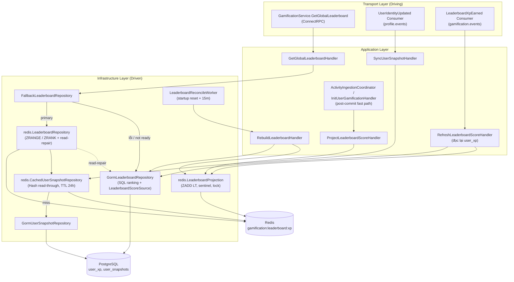
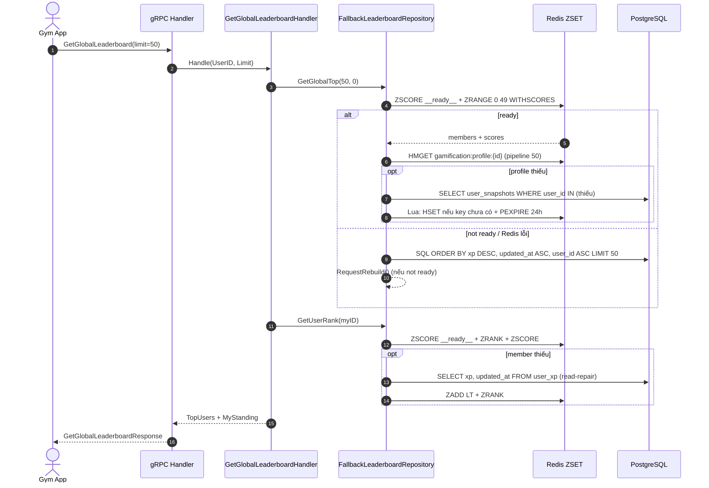

# Thiết Kế Kỹ Thuật: Bảng Xếp Hạng Toàn Hệ Thống Theo Điểm XP (XP Leaderboard)

> Từ 2026-11-27 bảng xếp hạng được phục vụ từ **Redis Sorted Set (read model)**; PostgreSQL vẫn là nguồn sự thật và là đường dự phòng. Quyết định và phân tích rủi ro: [ADR-0003](./adr/ADR-0003-redis-zset-leaderboard-read-model.md) (thay thế ADR-0001).

## 1. Kiến Trúc Hexagonal (Ports & Adapters)



### Ranh giới trách nhiệm giữa các tầng:
1. **Transport Layer**:
   - gRPC handler chỉ ánh xạ request/response, gọi `GetGlobalLeaderboardHandler`.
   - `UserIdentityUpdated Consumer` đồng bộ tên/avatar vào `user_snapshots`.
   - `LeaderboardXpEarned Consumer` (group `gamification-leaderboard-group`) chỉ parse `user_id` của `XpEarned` → `RefreshLeaderboardScoreCommand` (điểm đọc lại từ `user_xp`, user không còn tồn tại bị bỏ qua).
2. **Application Layer**:
   - `GetGlobalLeaderboardHandler`: use case đọc thuần qua port `LeaderboardRepository` (không biết Redis tồn tại).
   - `ProjectLeaderboardScoreHandler`: chiếu `(user_id, xp tuyệt đối, updated_at)` vào read model; `ProjectBestEffort` dùng cho đường nhanh sau commit (lỗi chỉ log WARN).
   - `RebuildLeaderboardHandler`: khóa → (Reset) → duyệt `user_xp` theo keyset → `UpsertScores` → `MarkReady`.
   - Ports: `repository.LeaderboardRepository`, `repository.UserSnapshotRepository`, `port.LeaderboardProjection`, `port.LeaderboardScoreSource`.
3. **Infrastructure Layer**:
   - `infrastructure/redis`: codec score, projection, read repository, fallback decorator.
   - `infrastructure/persistence`: SQL ranking (nguồn sự thật, dự phòng), score source cho rebuild/read-repair, snapshot repository.
   - `infrastructure/worker/LeaderboardReconcileWorker`: reset khi khởi động (thử lại tới khi thành công), reconcile định kỳ, chạy sớm khi đọc thấy not-ready.

Chế độ Redis chỉ bật khi có **cả** Redis client và Kafka reader; thiếu một trong hai → module chạy PostgreSQL-only như trước (log `Leaderboard read model: postgres only`).

---

## 2. Thiết Kế Cơ Sở Dữ Liệu & Chỉ Mục (Database & Index DDL)

Hệ thống kết hợp dữ liệu điểm số `gamification.user_xp` và bảng bản sao hiển thị `gamification.user_snapshots` trong cùng PostgreSQL schema:

```sql
-- 1. Bảng User Snapshot cục bộ: Lưu trữ tên hiển thị và avatar đồng bộ qua Kafka
CREATE TABLE IF NOT EXISTS gamification.user_snapshots (
    user_id UUID PRIMARY KEY,
    display_name VARCHAR(100) NOT NULL DEFAULT 'Gymer',
    avatar_url TEXT NOT NULL DEFAULT '',
    updated_at TIMESTAMPTZ NOT NULL DEFAULT NOW()
);

-- 2. Chỉ mục Composite B-Tree phục vụ truy vấn Bảng Xếp Hạng
CREATE INDEX IF NOT EXISTS idx_user_xp_leaderboard 
ON gamification.user_xp (xp DESC, updated_at ASC);
```

### Phân tích cơ chế truy vấn vật lý (Physical Query Mechanics):

#### Truy vấn 1: Lấy danh sách Top 50 dẫn đầu kèm tên và ảnh đại diện
```sql
SELECT 
    xp.user_id, 
    COALESCE(s.display_name, 'Gymer') AS display_name, 
    COALESCE(s.avatar_url, '') AS avatar_url, 
    xp.xp, 
    xp.level, 
    xp.updated_at
FROM gamification.user_xp xp
LEFT JOIN gamification.user_snapshots s ON xp.user_id = s.user_id
ORDER BY xp.xp DESC, xp.updated_at ASC
LIMIT 50;
```
* **Kế hoạch thực thi (Execution Plan)**: PostgreSQL sử dụng **Index Scan** trên `idx_user_xp_leaderboard` để lấy 50 dòng đầu tiên, sau đó thực hiện **Index Scan** trên khóa chính của `user_snapshots`. Toàn bộ quá trình diễn ra nội bộ trong database engine.
* **Thời gian thực thi**: $< 2\text{ ms}$.

#### Truy vấn 2: Xác định vị trí người dùng gọi API (`my_rank`)
Nếu người dùng hiện tại nằm trong Top 50, vị trí chính là `index + 1` của mảng kết quả ($O(1)$).
Nếu người dùng nằm ngoài Top 50, thực thi câu lệnh đếm có chỉ mục:
```sql
SELECT COUNT(*) + 1 AS my_rank
FROM gamification.user_xp
WHERE xp > :my_xp 
   OR (xp = :my_xp AND updated_at < :my_updated_at)
   OR (xp = :my_xp AND updated_at = :my_updated_at AND user_id < :my_user_id);
```
* **Kế hoạch thực thi**: Nhờ index trên `(xp DESC, updated_at ASC)`, engine thực hiện **Index Only Scan** để đếm số lượng bản ghi thỏa mãn điều kiện.
* **Thời gian thực thi**: P99 $< 20\text{ ms}$ (áp dụng trong giai đoạn MVP $< 50,000$ users theo ADR-0001).

### 2.3 Redis Read Model (ADR-0003)

Các truy vấn SQL ở trên vẫn được giữ nguyên làm **nguồn sự thật** và **đường dự phòng**. Đường chính:

| Key | Kiểu | Nội dung |
| :--- | :--- | :--- |
| `gamification:leaderboard:xp` | ZSET | member = `user_id`; score = `-(xp << 31 \| (2^31-1 - giây kể từ 2020-01-01Z))`; thêm member `__ready__` score `+inf` khi rebuild xong |
| `gamification:leaderboard:xp:rebuild_lock` | STRING | node ID, `SET NX EX 120`, gia hạn mỗi batch và giải phóng bằng Lua compare-and-delete; marker `__building__:<node>` + MarkReady có fencing |
| `gamification:profile:{user_id}` | HASH | `display_name`, `avatar_url`, `updated_at`; đọc xuyên + TTL 24h; đổi tên ghi đè (write-through), reader chỉ ghi khi key chưa có; write-through lỗi ⇒ flush toàn bộ profile khi Redis hồi phục |

* **Top N**: `ZSCORE __ready__` + `ZRANGE offset offset+N-1 WITHSCORES` (1 pipeline) → lọc sentinel → giải mã xp/updated_at → `GetSnapshots` (1 query `IN`).
* **My rank**: `ZSCORE __ready__` + `ZRANK` + `ZSCORE` (1 pipeline). Thiếu member → read-repair từ `user_xp`.
* **Thứ tự**: score âm + `ZRANGE` tăng dần ⇒ `xp DESC, updated_at ASC (giây), user_id ASC` — trùng thứ tự SQL (sai khác duy nhất: hòa XP trong cùng một giây).
* **Ghi**: luôn `ZADD LT` với XP tuyệt đối ⇒ idempotent, không bao giờ lùi điểm.
* **Đồng bộ ba lớp**: đường nhanh sau commit → Kafka consumer → reconcile 15 phút (`LEADERBOARD_RECONCILE_INTERVAL`).

---

## 3. Luồng Xử Lý Nghiệp Vụ (Sequence Diagram)

### 3.1 Tra cứu bảng xếp hạng



### 3.2 Cập nhật điểm

```mermaid
sequenceDiagram
    autonumber
    participant C as Coordinator / InitUser
    participant PG as PostgreSQL (tx)
    participant P as ProjectLeaderboardScoreHandler
    participant R as Redis ZSET
    participant K as Kafka gamification.events
    participant LC as LeaderboardXpEarned Consumer

    C->>PG: UserXp + outbox (XpEarned) — COMMIT
    C->>P: ProjectBestEffort(NewXp, EarnedAt)
    P->>R: ZADD LT (lỗi → WARN, không fail command)
    PG-->>K: OutboxWorker publish (≤ 5s)
    K->>LC: XpEarned
    LC->>PG: Refresh: SELECT xp, updated_at FROM user_xp WHERE user_id = ?
    LC->>R: ZADD LT (idempotent; bỏ qua nếu user không tồn tại)
```

---

## 4. Hợp Đồng Giao Diện API (Protobuf ConnectRPC)

Tệp hợp đồng dịch vụ: `proto/contracts/supporting/gamification/v1/service/gamification_service.proto`
Tệp thông điệp: `proto/contracts/supporting/gamification/v1/message/gamification_messages.proto`

```protobuf
syntax = "proto3";

package contracts.supporting.gamification.v1.service;

import "google/api/annotations.proto";
import "protoc-gen-openapiv2/options/annotations.proto";
import "contracts/supporting/gamification/v1/message/gamification_messages.proto";

option go_package = "github.com/viethung213/gym-companion/internal/gen/go/contracts/supporting/gamification/v1/service;gamificationservicev1";

service GamificationService {
  // Tra cứu bảng vàng Top 50 và thứ hạng cá nhân theo thời gian thực
  rpc GetGlobalLeaderboard(contracts.supporting.gamification.v1.message.GetGlobalLeaderboardRequest) 
      returns (contracts.supporting.gamification.v1.message.GetGlobalLeaderboardResponse) {
    option (google.api.http) = {
      get: "/api/v1/gamification/leaderboard"
    };
  }
}
```

```protobuf
syntax = "proto3";

package contracts.supporting.gamification.v1.message;

option go_package = "github.com/viethung213/gym-companion/internal/gen/go/contracts/supporting/gamification/v1/message;gamificationmessagev1";

message GetGlobalLeaderboardRequest {
  // Số lượng thành viên tối đa cần lấy (Mặc định: 50, Tối đa: 100)
  int32 limit = 1;
}

message LeaderboardEntry {
  // Vị trí thứ hạng (Bắt đầu từ 1)
  int64 rank = 1;
  // ID định danh người dùng
  string user_id = 2;
  // Tên hiển thị công khai (Lấy từ bảng user_snapshots)
  string display_name = 3;
  // Đường dẫn ảnh đại diện (Lấy từ bảng user_snapshots)
  string avatar_url = 4;
  // Tổng điểm kinh nghiệm tích lũy trọn đời
  int64 xp = 5;
  // Cấp độ trọn đời hiện tại (Level 1-100)
  int32 level = 6;
}

message GetGlobalLeaderboardResponse {
  // Danh sách Top người dùng dẫn đầu hệ thống (Sắp xếp theo rank tăng dần)
  repeated LeaderboardEntry items = 1;
  // Vị trí và thành tích của chính người dùng đang gọi API
  LeaderboardEntry my_standing = 2;
}
```

---

## 5. Cấu Trúc Mã Nguồn (Code Organization)

> Cấu trúc tổng thể của toàn module xem tại [architecture.md#2](../../architecture.md#2-kiến-trúc-hexagonal-ports--adapters).

```text
internal/gamification/
├── leaderboard_read_model.go                     # Wiring: Redis mode khi có Redis + Kafka, ngược lại PostgreSQL-only
├── domain/
│   ├── entity/leaderboard.go                     # LeaderboardUser, LeaderboardScore, UserSnapshot, DisplayNameOrDefault
│   └── repository/
│       ├── leaderboard_repository.go             # Port xếp hạng (GetGlobalTop, GetUserRank)
│       └── user_snapshot_repository.go           # Port snapshot (SaveSnapshot, GetSnapshot, GetSnapshots)
├── application/
│   ├── port/leaderboard.go                       # LeaderboardProjection, LeaderboardScoreSource
│   ├── command/
│   │   ├── project_leaderboard_score.go          # Chiếu điểm + ProjectBestEffort + XpEarnedProjections
│   │   ├── rebuild_leaderboard.go                # Rebuild/reconcile từ nguồn sự thật
│   │   ├── init_user_gamification.go             # Lưu snapshot + chiếu điểm sau commit
│   │   └── sync_user_snapshot.go
│   ├── service/activity_ingestion_coordinator.go # Chiếu XpEarned sau commit (đường nhanh)
│   └── query/get_global_leaderboard.go
├── infrastructure/
│   ├── persistence/
│   │   ├── leaderboard_repository.go             # SQL ranking + ListScores/GetScore
│   │   └── user_snapshot_repository.go
│   ├── redis/
│   │   ├── keys.go                               # Key, sentinel, lock TTL
│   │   ├── score_codec.go                        # Mã hóa/giải mã score 53 bit
│   │   ├── leaderboard_projection.go             # ZADD LT, Reset, MarkReady, lock
│   │   ├── leaderboard_repository.go             # Đọc ZSET + read-repair
│   │   ├── fallback_leaderboard_repository.go    # Redis → PostgreSQL khi lỗi/not ready
│   │   └── cached_user_snapshot_repository.go    # Cache tên/avatar (Hash, read-through, write-through)
│   └── worker/leaderboard_reconcile_worker.go
├── transport/consumer/leaderboard_xp_earned_consumer.go
└── test/
    ├── leaderboard_parity_test.go                # Redis == PostgreSQL (SQLite + miniredis)
    └── leaderboard_parity_postgres_integration_test.go # `-tags integration`, TEST_DATABASE_URL [, TEST_REDIS_ADDR]
```
