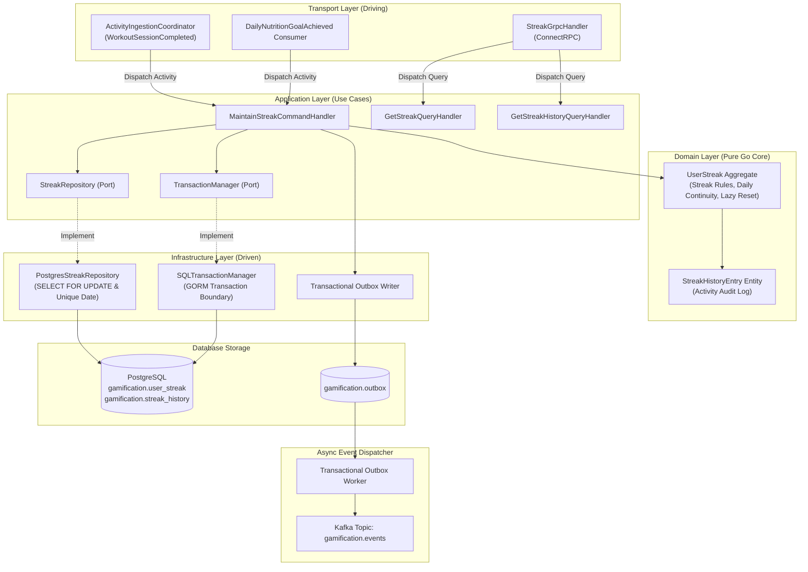
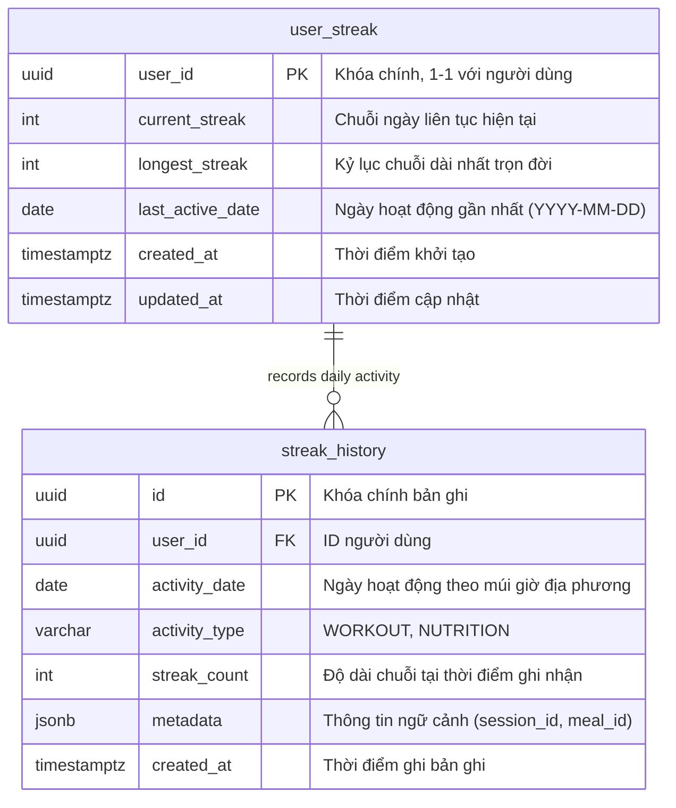
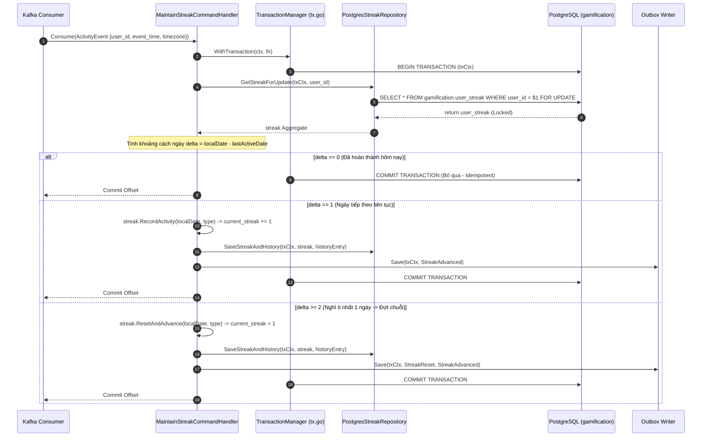
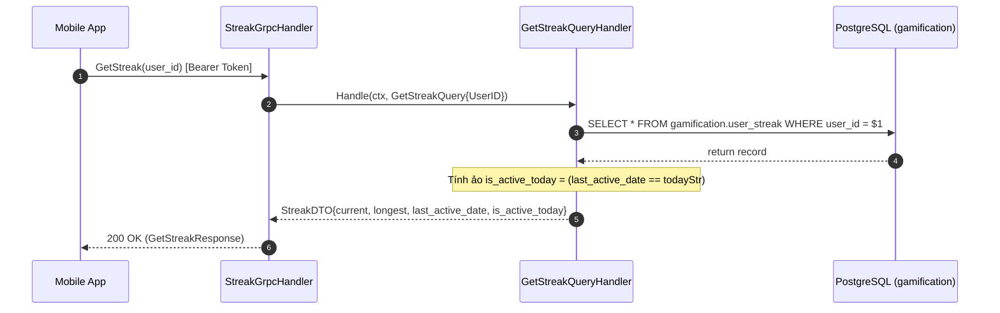

# Thiết Kế Kỹ Thuật: Chuỗi Ngày Kỷ Luật (Streaks Engine)

## ADR References
- [ADR-0001: Đánh Giá Chuỗi Lười Theo Sự Kiện (Event-Driven Lazy Streak Evaluation $O(1)$)](./adr/ADR-0001-lazy-streak-evaluation-and-freeze-mechanics.md)
- [ADR-0002: Duy Trì Chuỗi Thói Quen Kép (Tập Luyện & Dinh Dưỡng) Bảo Vệ Phục Hồi Sinh Học](./adr/ADR-0002-dual-activity-streak-maintenance-workout-and-nutrition.md)

---

## 1. Kiến Trúc Hexagonal (Ports & Adapters)

Phân hệ Chuỗi Ngày (Streaks) vận hành như một **Habit Tracking Engine** thuần túy trong module Gamification:



### Ranh giới trách nhiệm các tầng:
1. **Domain Layer**:
   - `UserStreak`: Aggregate kiểm soát toàn bộ quy tắc tăng chuỗi, duy trì chuỗi theo ngày liên tục và tự động phát hiện đứt chuỗi khi có ngày nghỉ (Lazy Evaluation $O(1)$).
   - `StreakHistoryEntry`: Ghi nhận nhật ký từng ngày hoạt động kèm loại hình (`WORKOUT`, `NUTRITION`).
2. **Application Layer**:
   - `MaintainStreakCommandHandler`: Nhận sự kiện, xác định ngày địa phương theo timezone, điều phối qua `TransactionManager.WithTransaction`, kiểm tra và cập nhật `UserStreak`.
   - `GetStreakQueryHandler`: Truy vấn chỉ đọc, tính toán ảo cờ `is_active_today`.
3. **Infrastructure Layer**:
   - `PostgresStreakRepository`: Hiện thực hóa truy vấn với khóa dòng bi quan `SELECT ... FOR UPDATE` trên bảng `gamification.user_streak` và bảo vệ lũy đẳng qua unique index `uq_streak_history_user_date`.
4. **Transport Layer**:
   - `ActivityIngestionCoordinator`: Điều phối bước ghi nhận Streak trong chuỗi xử lý sự kiện `WorkoutSessionCompleted`.
   - `DailyNutritionGoalAchieved` Consumer: Lắng nghe sự kiện hoàn thành mục tiêu dinh dưỡng từ domain `nutrition`.
   - ConnectRPC Handlers cung cấp API `GetStreak` và `GetStreakHistory`.

---

## 2. Thiết Kế Cơ Sở Dữ Liệu & Ràng Buộc DDL (`gamification.*`)

### 2.1 Sơ Đồ Quan Hệ Dữ Liệu (ERD)



### 2.2 Đặc Tả Schema PostgreSQL DDL

```sql
-- 1. Bảng Trạng Thái Chuỗi Người Dùng
CREATE TABLE IF NOT EXISTS gamification.user_streak (
    user_id UUID PRIMARY KEY,
    current_streak INT NOT NULL DEFAULT 0 CHECK (current_streak >= 0),
    longest_streak INT NOT NULL DEFAULT 0 CHECK (longest_streak >= 0),
    last_active_date DATE,
    created_at TIMESTAMPTZ NOT NULL DEFAULT NOW(),
    updated_at TIMESTAMPTZ NOT NULL DEFAULT NOW()
);

-- 2. Bảng Lịch Sử Hoạt Động Chuỗi (Heatmap & Audit Log)
CREATE TABLE IF NOT EXISTS gamification.streak_history (
    id UUID PRIMARY KEY DEFAULT gen_random_uuid(),
    user_id UUID NOT NULL REFERENCES gamification.user_streak(user_id) ON DELETE CASCADE,
    activity_date DATE NOT NULL,
    activity_type VARCHAR(32) NOT NULL, -- 'WORKOUT' | 'NUTRITION'
    streak_count INT NOT NULL,
    metadata JSONB DEFAULT '{}'::jsonb,
    created_at TIMESTAMPTZ NOT NULL DEFAULT NOW(),
    CONSTRAINT uq_streak_history_user_date UNIQUE (user_id, activity_date)
);

CREATE INDEX IF NOT EXISTS idx_streak_history_user_date 
ON gamification.streak_history (user_id, activity_date DESC);
```

---

## 3. Luồng Xử Lý Nghiệp Vụ (Sequence Diagrams)

### 3.1 Luồng Duy Trì Chuỗi Hàng Ngày (Activity Earning & Lazy Reset Evaluation)



### 3.2 Luồng Tra Cứu Trạng Thái Chuỗi (UC-ST-04)



---

## 4. Hợp Đồng Giao Diện API (Protobuf ConnectRPC)

Tệp hợp đồng dịch vụ: `proto/contracts/supporting/gamification/v1/service/gamification_service.proto`
Tệp thông điệp: `proto/contracts/supporting/gamification/v1/message/gamification_messages.proto`

```protobuf
syntax = "proto3";

package contracts.supporting.gamification.v1.service;

import "google/api/annotations.proto";
import "protoc-gen-openapiv2/options/annotations.proto";
import "contracts/supporting/gamification/v1/message/gamification_messages.proto";

option go_package = "github.com/viethung213/gym-companion/internal/gen/go/contracts/supporting/gamification/v1/service;gamificationservicev1";

service GamificationService {
  // Tra cứu trạng thái chuỗi ngày hiện tại
  rpc GetStreak(contracts.supporting.gamification.v1.message.GetStreakRequest) 
      returns (contracts.supporting.gamification.v1.message.GetStreakResponse) {
    option (google.api.http) = {
      get: "/api/v1/gamification/users/{user_id}/streak"
    };
  }

  // Tra cứu lịch sử bản đồ nhiệt chuỗi ngày (Heatmap)
  rpc GetStreakHistory(contracts.supporting.gamification.v1.message.GetStreakHistoryRequest) 
      returns (contracts.supporting.gamification.v1.message.GetStreakHistoryResponse) {
    option (google.api.http) = {
      get: "/api/v1/gamification/users/{user_id}/streak/history"
    };
  }
}
```

```protobuf
syntax = "proto3";

package contracts.supporting.gamification.v1.message;

import "google/protobuf/timestamp.proto";

option go_package = "github.com/viethung213/gym-companion/internal/gen/go/contracts/supporting/gamification/v1/message;gamificationmessagev1";

message GetStreakRequest {
  string user_id = 1;
}

message GetStreakResponse {
  string user_id = 1;
  int32 current_streak = 2;
  int32 longest_streak = 3;
  string last_active_date = 4; // "YYYY-MM-DD"
  bool is_active_today = 5;
  google.protobuf.Timestamp updated_at = 6;
}

message GetStreakHistoryRequest {
  string user_id = 1;
  int32 year = 2; // Ví dụ: 2026
}

message StreakHistoryDay {
  string date = 1; // "YYYY-MM-DD"
  string activity_type = 2; // "WORKOUT" | "NUTRITION"
  int32 streak_count = 3;
}

message GetStreakHistoryResponse {
  repeated StreakHistoryDay days = 1;
}
```

### 4.2 Đặc Tả Sự Kiện CloudEvents (`proto/contracts/supporting/gamification/v1/event/gamification_events.proto`)

> [!NOTE]
> Toàn bộ hạ tầng xuất bản sự kiện bất đồng bộ qua Transactional Outbox Pattern tuân thủ chặt chẽ theo đặc tả dùng chung duy nhất (SSOT) tại [architecture.md#4](../../architecture.md#4-chuẩn-transactional-outbox-dùng-chung-module-wide-outbox---ssot).

```protobuf
syntax = "proto3";

package contracts.supporting.gamification.v1.event;

import "google/protobuf/timestamp.proto";

option go_package = "github.com/viethung213/gym-companion/internal/gen/go/contracts/supporting/gamification/v1/event;gamificationeventv1";

message StreakAdvanced {
  string user_id = 1;
  int32 new_streak = 2;
  string activity_date = 3;
  string activity_type = 4; // "WORKOUT" | "NUTRITION"
  google.protobuf.Timestamp occurred_at = 5;
}

message StreakReset {
  string user_id = 1;
  int32 previous_streak = 2;
  string reset_date = 3;
  google.protobuf.Timestamp occurred_at = 4;
}

message StreakMilestoneReached {
  string user_id = 1;
  int32 milestone_days = 2; // 7, 14, 30, 50, 100, 365
  int64 bonus_coins = 3;
  google.protobuf.Timestamp occurred_at = 4;
}
```

---

## 5. Cấu Trúc Mã Nguồn (Code Organization)

> [!NOTE]
> Cấu trúc module tổng thể và cơ chế điều phối dùng chung được quy định tại [architecture.md#2](../../architecture.md#2-cấu-trúc-thư-mục-và-tổ-chức-mã-nguồn---hexagonal-modular-monolith). Cây thư mục dưới đây chỉ thể hiện các thành phần thuộc Bounded Context Streaks.

```text
internal/gamification/
├── domain/
│   ├── aggregate/
│   │   ├── user_streak.go                # Aggregate UserStreak & Invariants (Daily Continuity, Lazy Reset)
│   │   └── user_streak_test.go           # Unit tests nghiệp vụ chuỗi
│   └── entity/
│       └── streak_history_entry.go       # Entity dòng lịch sử hoạt động
│
├── application/
│   ├── command/
│   │   ├── maintain_streak.go            # Use Case duy trì chuỗi (bọc trong txManager)
│   │   └── maintain_streak_test.go       # Unit tests duy trì chuỗi
│   ├── query/
│   │   ├── get_streak.go                 # Use Case đọc trạng thái chuỗi
│   │   └── get_streak_history.go         # Use Case đọc Heatmap
│   └── port/
│       ├── tx.go                         # Output Port TransactionManager
│       ├── streak_repository.go          # Output Port giao tiếp DB
│       └── outbox_repository.go          # Output Port ghi nhận sự kiện Outbox
│
├── infrastructure/
│   ├── persistence/
│   │   ├── streak_repository.go          # GORM / SQL implementation with Row Lock
│   │   ├── tx_manager.go                 # SQLTransactionManager (*gorm.DB)
│   │   └── streak_repository_test.go     # Integration test tương tranh PostgreSQL
│   └── event/
│       └── streak_outbox_writer.go       # Đóng gói CloudEvents sang gamification.outbox
│
├── transport/
│   ├── grpc/
│   │   └── streak_handler.go             # ConnectRPC Server Handler
│   └── consumer/
│       └── nutrition_streak_consumer.go  # Consumer nutrition.events (buổi tập do ActivityIngestionCoordinator điều phối)
│
└── module.go                             # Khởi tạo module (Initialize func, không dùng Wire)
```
