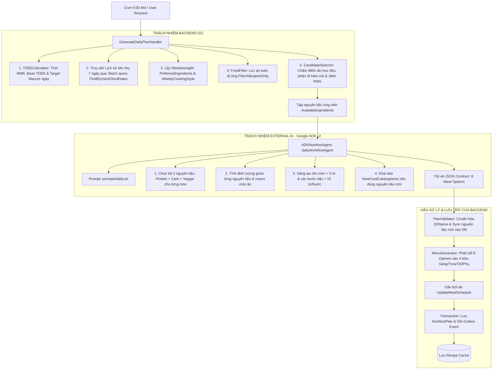
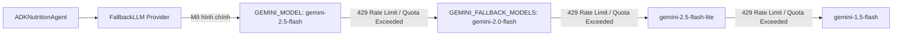

# Kiến Trúc Sinh Thực Đơn: Phối Hợp Backend Go & External AI (Google ADK v2)

Tài liệu này mô tả chi tiết kiến trúc và phân định trách nhiệm kỹ thuật giữa **Backend Go** và **External AI Service** trong quy trình sinh thực đơn cá nhân hóa của module **Nutrition** (`internal/nutrition`).

Mọi nội dung trong tài liệu này phản ánh **100% mã nguồn thực tế** đang triển khai trong codebase.

---

## 1. Phân Định Trách Nhiệm Kỹ Thuật (Backend Go vs External AI)

---

## 2. Chi Tiết Trách Nhiệm Của Từng Thành Phần

### 2.1. Backend Go Đảm Nhiệm Những Gì?

Backend Go đóng vai trò là **Bộ Điều Phối & Lọc Quy Tắc Nghiệp Vụ (Orchestrator & Business Rule Guard)**:

1. **Tính toán Chỉ tiêu Dinh dưỡng (Target Macros)**:
   - Dùng `TDEECalculator` tính BMR theo công thức Mifflin-St Jeor dựa trên cân nặng, chiều cao, tuổi, giới tính và hệ số hoạt động (`ActivityFactor`).
   - Căn cứ vào mục tiêu (`GoalCutting`, `GoalBulking`, `GoalMaintenance`) để tính Target Calories, Protein, Carb, Fat theo chuẩn khoa học.
   - Áp dụng ràng buộc an toàn **BR-NU-01**: Target Calories luôn $\ge 1200\text{ kcal/ngày}$.
   - Chia tỷ lệ calo chuẩn cho 4 bữa: Sáng (25%), Trưa (35%), Tối (30%), Bữa phụ (10%).

2. **Thu Thập & Trích Xuất Lịch Sử Ăn Thực Tế (`HistoricalConsumption`)**:
   - Truy vấn `MealHistoryRepository` trong 7 ngày gần nhất để xác định các ngày người dùng thực sự ghi nhận bữa ăn.
   - Dùng Batch Query `NutritionPlanRepository.FindByUserIDAndDates` để lấy đúng kế hoạch của các ngày có log (tránh truy vấn dư thừa).
   - Đi thẳng vào đúng bữa (`MealType`) tương ứng để trích xuất danh sách nguyên liệu thực tế `Ingredients []string`.

3. **Thu Thập Sở Thích & Thói Quen Tuần Trước (`WeeklyInsight`)**:
   - Truy vấn `WeeklyInsightRepository.GetLatestByUserID`.
   - Kiểm tra điều kiện hiệu lực: Khoảng cách giữa ngày lập kế hoạch (`PlanDate`) và ngày kết thúc đánh giá (`EndDate`) không quá 8 ngày.
   - Trích xuất danh sách nguyên liệu yêu thích (`PreferredIngredients`) và phong cách nấu ăn dự đoán (`WeeklyCookingStyle`).

4. **Lọc Dị Ứng Tinh Giản (`FoodFilter.FilterAllergensOnly`)**:
   - Quét danh mục thực phẩm hoạt động (`activeCatalog`).
   - Loại bỏ các nguyên liệu có tên (`Name`) trùng hoặc chứa từ khóa dị ứng của người dùng (`UserRestrictions`), đảm bảo an toàn sức khỏe nhưng không lọc nhầm do quét lan sang danh mục cha.

5. **Chấm Điểm & Tuyển Chọn Ứng Viên Nguyên Liệu (`CandidateSelector` - BR-NU-02)**:
   - Thay vì khóa cứng (hard lockout) làm cạn kiệt nguyên liệu, hệ thống tính điểm mềm đa tiêu chí:
     $$S(i, u, t) = w_n \cdot N_i + w_p \cdot P_{iu} - w_r \cdot R_{it} - w_c \cdot C_i + \text{jitter}$$
   - **Mật độ dinh dưỡng ($N_i$)**: Tỷ lệ đạm/calo có lợi.
   - **Sở thích ($P_{iu}$)**: Ưu tiên các nguyên liệu nằm trong `PreferredIngredients`.
   - **Phạt ăn lại gần đây ($R_{it}$ - Exponential Decay)**:
     $$R(i) = \sum_{k} s(i, i_k) \cdot e^{-\Delta t_k / \tau} \quad (\tau = 48\text{h})$$
     với $s(i, i_k)$ là độ tương đồng so khớp trực tiếp với danh sách nguyên liệu bữa ăn cũ.
   - **Phạt ngân sách ($C_i$)**: Phạt nếu món vượt quá mức chi trả (`targetBudget`). Không phạt ($0.0$) nếu người dùng không thiết lập ngân sách.
   - **Tie-Breaker (`DeterministicRNG`)**: Dùng hash `UserID + PlanDate` tạo jitter $\pm 0.05$ để phân định các món ngang điểm, đảm bảo tính nhất quán (idempotent) khi chạy lại trong ngày.

6. **Hậu Xử Lý, Thẩm Định & Lưu Trữ**:
   - Gọi AI **1 lần duy nhất** (`DAILY_PLAN`) cho cả ngày để tiết kiệm thời gian phản hồi và hạn ngạch API.
   - Chạy `planValidator`: Khớp `ProteinFoodID`, `CarbFoodID`, `VeggieFoodID` với catalog hoặc tự động lưu `NewFoodCatalogItems` vào DB `foodRepo`.
   - Ghép 8 options do AI trả về vào 4 bữa ăn (`Breakfast`, `Lunch`, `Dinner`, `Snack`), mỗi bữa 2 lựa chọn.
   - Cập nhật khung giờ ăn cá nhân hóa (`UpdateMealSchedule`).
   - Lưu `NutritionPlan` và ghi Outbox Event `NutritionPlanGenerated` trong 1 transaction CSDL.
   - Lưu công thức vào `RecipeCacheRepository` phục vụ tra cứu sau này.

---

### 2.2. External AI (Google ADK v2) Đảm Nhiệm Những Gì?

External AI nhận ngữ cảnh đã được Backend chuẩn bị kỹ lưỡng (`AIMenuPromptContext`) và thực thi quy trình **Sáng Tạo & Cân Bằng Dinh Dưỡng Thực Tế**:

1. **Lựa Chọn Bộ 3 Nguyên Liệu Cho Từng Món (Ingredient Trio Selection)**:
   - Từ danh sách `available_ingredients` do Backend cung cấp, AI tự chọn tổ hợp: 1 Nguồn đạm (Protein) + 1 Nguồn tinh bột (Carb) + 1 Nguồn chất xơ (Veggie).
   - Đảm bảo tính đa dạng: Option 1 và Option 2 trong cùng 1 bữa phải dùng bộ 3 nguyên liệu hoàn toàn khác nhau.
   - Đảm bảo đặc tính bữa ăn:
     - **Sáng (25%)**: Nhẹ nhàng, dễ tiêu (trứng, bánh mì nguyên cám, yến mạch, sữa chua, hoa quả).
     - **Trưa (35%)**: Giàu năng lượng và đạm chính (ức gà, bò, cá hồi, cơm lứt, khoai, bông cải xanh).
     - **Tối (30%)**: Thanh đạm, dễ tiêu (tôm, cá, thịt nạc, bún lứt, nấm, rau xanh).
     - **Bữa phụ (10%)**: Đồ ăn nhẹ (các loại hạt, sữa chua, hoa quả, trứng luộc), cấm sinh món ăn chính nặng bụng.

2. **Tính Toán Định Lượng Gram & Macros Của Từng Món**:
   - AI tự phân bổ số lượng gram của từng thành phần trong món ăn (`gram`).
   - AI tự tính toán tổng lượng Calo, Protein, Carb, Fat thực tế của từng món ăn (`total_protein_grams`, `total_carb_grams`, `total_fat_grams`) sao cho bám sát target của từng bữa ăn do Backend yêu cầu.

3. **Sáng Tạo Tên Món & Hướng Dẫn Chế Biến Thực Tế**:
   - `recipe_name`: Ngắn gọn, súc tích, **dưới 5 từ** (< 5 words).
   - `cooking_steps`: Các bước thực tế, dễ làm; **mỗi bước dưới 15 từ** (< 15 words/bước), không giới hạn số bước nhưng không được thêm văn phong rườm rà.

4. **Cá Nhân Hóa Phong Cách Nấu Ăn (Weekly Cooking Style)**:
   - Tuân thủ tỷ lệ:
     - **70% Habitual Style (~5-6 options)**: Bám theo phong cách nấu quen thuộc của user tuần trước (`weekly_cooking_style`).
     - **30% Novelty Style (~2-3 options)**: Đổi mới phương pháp chế biến (nướng, hấp, áp chảo, nấu canh...) để chống ngán.

5. **Tự Động Mở Rộng Danh Mục Nguyên Liệu (`NewFoodCatalogItems`)**:
   - Khi cần gia vị hoặc nguyên liệu mới chưa có trong danh sách Backend gửi sang (đặc biệt khi xử lý tủ lạnh `pantry`), AI tự khai báo thông tin dinh dưỡng ước tính per 100g để Backend tự động thêm vào danh mục hệ thống.

---

## 3. Cơ Chế Chịu Lỗi & Failover Của Hạ Tầng AI

Hệ thống tích hợp wrapper `FallbackLLM` để đảm bảo sinh thực đơn không bị gián đoạn:

- **Nhúng Prompt Tĩnh (`//go:embed prompts/*.txt`)**:
  - Toàn bộ prompt nghiệp vụ (`daily.txt`, `pantry.txt`, `post_workout.txt`, `adhoc.txt`, `estimate_nutrient.txt`, `nutrition_insight.txt`) được đóng gói trực tiếp vào Go binary lúc compile, độc lập tuyệt đối với thư mục làm việc và loại bỏ hoàn toàn lỗi đọc file lúc runtime.

---

## 4. Tóm Tắt So Sánh Trách Nhiệm

| Hạng mục công việc | Backend Go | External AI (Google ADK v2) |
| :--- | :---: | :---: |
| **Tính toán BMR, Base TDEE & Target Calo/Macros tổng** | **Chịu trách nhiệm 100%** (`TDEECalculator`) | Nhận chỉ tiêu từ Backend |
| **Lọc dị ứng của người dùng** | **Chịu trách nhiệm 100%** (`FoodFilter`) | Kiểm tra lại trong prompt |
| **Quản lý lịch sử ăn & Phân rã hàm mũ Recency Decay** | **Chịu trách nhiệm 100%** (`CandidateSelector`) | Không quản lý |
| **Chọn danh sách nguyên liệu ứng viên khả thi** | **Chịu trách nhiệm 100%** (`CandidateSelector`) | Nhận danh sách từ Backend |
| **Ghép bộ 3 nguyên liệu (Protein + Carb + Veggie)** | Không can thiệp | **Chịu trách nhiệm 100%** |
| **Tính số gram từng nguyên liệu & macro từng món** | Không can thiệp | **Chịu trách nhiệm 100%** |
| **Sáng tạo tên món ăn & các bước chế biến** | Không can thiệp | **Chịu trách nhiệm 100%** |
| **Phân bổ món vào 4 bữa ăn & Gán lịch ăn** | **Chịu trách nhiệm 100%** (`MenuGenerator`) | Chỉ trả mảng 8 options |
| **Lưu trữ CSDL, Outbox Event & Recipe Cache** | **Chịu trách nhiệm 100%** (`PlanRepo`, `TxManager`) | Không can thiệp |
