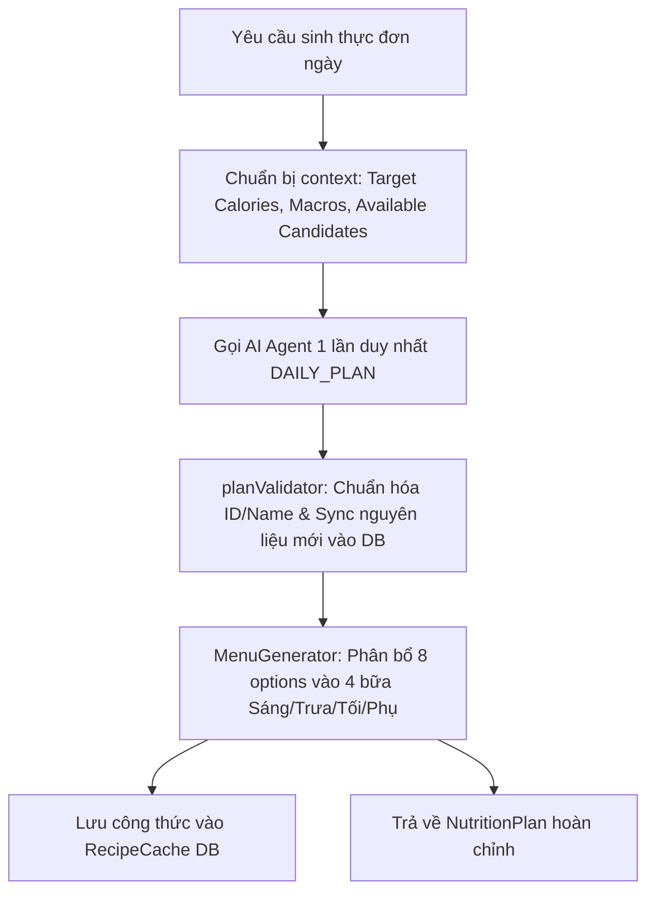

# Đặc Tả Server Rule-Based Engine: Thuật Toán & Quy Tắc Nghiệp Vụ Go Backend

Tài liệu đặc tả kỹ thuật chi tiết dành cho các kỹ sư triển khai tầng **Domain & Application** của module **Nutrition / NutiFood** (`internal/nutrition`). 

Tài liệu tập trung vào kiến trúc **Server-Heavy Rule Engine** thuần Go, quy tắc tính toán ma trận tổ hợp nguyên liệu, lọc cách ly an toàn dị ứng, thuật toán chấm điểm ứng viên đa mục tiêu với phân rã hàm mũ (Soft Scoring & Exponential Decay), thuật toán căn chỉnh định lượng gram tự động và cơ chế Recipe Caching.

---

## 1. Cấu Trúc Thành Phần Rule-Based Engine Trong Domain Layer

```
internal/nutrition/
├── domain/
│   ├── aggregate/
│   │   ├── food_item.go           # Aggregate: FoodItem catalog & approval
│   │   ├── meal_history.go        # Aggregate: MealHistory & MealLog
│   │   └── nutrition_plan.go      # Aggregate: NutritionPlan & 4 Meal Slots
│   ├── repository/
│   │   ├── ai_service.go          # Port Interface: AIService (SelectCreativeMealOptions, EstimateNutrient, GenerateNutritionInsight)
│   │   ├── food_item_repository.go
│   │   ├── meal_history_repository.go
│   │   ├── nutrition_plan_repository.go # Batch query FindByUserIDAndDates
│   │   ├── recipe_cache_repository.go
│   │   └── profile_client.go
│   ├── service/
│   │   ├── tdee_calculator.go      # Domain Service: Mifflin-St Jeor TDEE & Workout Surplus (BR-NU-01 & BR-NU-04)
│   │   ├── food_filter.go          # Domain Service: FilterAllergensOnly (Lọc an toàn dị ứng tinh giản)
│   │   ├── candidate_selector.go   # Domain Service: CandidateSelector (Chấm điểm đa mục tiêu, phân rã hàm mũ, tie-break RNG)
│   │   ├── pantry_selector.go      # Domain Service: PantrySelector (Khớp nguyên liệu tủ lạnh & cờ Novel Cooking)
│   │   ├── sampling.go             # Domain Service: DeterministicRNG & Reservoir Sampling
│   │   └── menu_generator.go       # Domain Service: MenuGenerator (Rule Engine Orchestrator, AI Call & Recipe Cache)
│   └── vo/
│       ├── calorie_allocation.go   # Value Object: CalorieAllocation & Target Macros
│       ├── historical_consumption.go # Value Object: HistoricalConsumption (MealName, Ingredients, ConsumedAt)
│       └── food_nutrient.go        # Value Object: FoodNutrient per 100g (kèm PricePer100g, CostTier)
└── infrastructure/ai/adk/
    ├── agent.go                   # ADKNutritionAgent implements repository.AIService
    ├── fallback_llm.go            # FallbackLLM (Auto Quota Failover GEMINI_MODEL & GEMINI_FALLBACK_MODELS)
    ├── build_agents.go            # Multi-Agent Workflow setup + //go:embed prompts/*.txt
    └── tools.go                   # ADK Function Tools (fetch_food_catalog, calculate_macro_gram, suggest_nutifood)
```

---

## 2. Đặc Tả Chi Tiết Các Thành Phần Thuật Toán

### 2.1. Bộ Tính Toán TDEE & Phân Bổ Macro Linh Hoạt (`tdee_calculator.go`)

#### 1. Công thức Mifflin-St Jeor chuẩn:
$$\text{BMR}_{\text{Nam}} = 10 \times \text{weight (kg)} + 6.25 \times \text{height (cm)} - 5 \times \text{age} + 5$$
$$\text{BMR}_{\text{Nữ}} = 10 \times \text{weight (kg)} + 6.25 \times \text{height (cm)} - 5 \times \text{age} - 161$$
$$\text{Base TDEE} = \text{BMR} \times \text{ActivityFactor}$$

#### 2. Ràng buộc An toàn (Invariant BR-NU-01):
```go
if targetCalories < 1200.0 {
    targetCalories = 1200.0 // Bắt buộc tối thiểu 1200 kcal/ngày vì an toàn sức khỏe
}
```

#### 3. Điều chỉnh linh hoạt theo Calo tập luyện (BR-NU-04):
$$\text{Target Calories Mới} = \text{Base TDEE} + \text{WorkoutCaloriesBurned}$$
- Phân bổ Tỷ lệ Macro Chuẩn (VD: 30% Protein, 40% Carb, 30% Fat):
  - $\text{Protein (g)} = \frac{\text{Target Calories} \times 0.30}{4}$
  - $\text{Carb (g)} = \frac{\text{Target Calories} \times 0.40}{4}$
  - $\text{Fat (g)} = \frac{\text{Target Calories} \times 0.30}{9}$

---

### 2.2. Bộ Lọc An Toàn Dị Ứng & Chấm Điểm Ứng Viên Nguyên Liệu (`food_filter.go` & `candidate_selector.go`)

#### 1. Bộ Lọc Dị Ứng Tinh Giản (`FilterAllergensOnly`):
- Để đảm bảo an toàn tuyệt đối nhưng không gây lọc nhầm (false-positive), hệ thống chỉ kiểm tra dị ứng trực tiếp trên tên nguyên liệu (`FoodNutrient.Name`):
  ```go
  func FilterAllergensOnly(catalog []FoodNutrient, allergies []string) []FoodNutrient {
      if len(allergies) == 0 {
          return catalog
      }
      var filtered []FoodNutrient
  itemLoop:
      for _, item := range catalog {
          itemName := strings.ToLower(item.Name)
          for _, allergy := range allergies {
              cleanAllergy := strings.ToLower(strings.TrimSpace(allergy))
              if cleanAllergy != "" && strings.Contains(itemName, cleanAllergy) {
                  continue itemLoop // Loại bỏ ngay nếu tên nguyên liệu chứa chất gây dị ứng
              }
          }
          filtered = append(filtered, item)
      }
      return filtered
  }
  ```
- Không quét lan sang `Category`, `ProteinSource`, `CarbSource` để tránh việc một quả trứng bị loại bỏ oan uổng chỉ vì phân loại chung.

#### 2. Thuật Toán Chấm Điểm Ứng Viên Đa Mục Tiêu (Candidate Soft Scoring & Exponential Decay):
Thay thế cơ chế khóa cứng (Hard Lockout 7/5/3 ngày) gây cạn kiệt nguyên liệu, hệ thống sử dụng thuật toán chấm điểm mềm đa tiêu chí:
$$S(i, u, t) = w_n \cdot N_i + w_p \cdot P_{iu} - w_r \cdot R_{it} - w_c \cdot C_i + \text{jitter}$$

Trong đó:
- **$N_i$ (Nutrient Density Score)**: Tỷ trọng đạm/vi chất có lợi đối với calo.
- **$P_{iu}$ (User Preference Score)**: Mức độ yêu thích của user với nguyên liệu $i$ (mặc định $0.5$, tăng nếu nằm trong `PreferredIngredients` từ insight tuần trước).
- **$R_{it}$ (Recency Penalty - Phân rã hàm mũ theo thời gian)**:
  $$R(i) = \sum_{k} s(i, i_k) \cdot e^{-\Delta t_k / \tau}$$
  với $\tau = 48\text{h}$, $\Delta t_k$ là số giờ tính từ khi tiêu thụ nguyên liệu $i_k$ đến hiện tại.
  - $s(i, i_k)$: Độ tương đồng giữa nguyên liệu $i$ và nguyên liệu đã ăn trong bữa ăn quá khứ.
  - Dữ liệu `HistoricalConsumption` lưu danh sách nguyên liệu `Ingredients []string` được trích xuất từ các kế hoạch bữa ăn cũ (`NutritionPlan`) thông qua Batch Query `FindByUserIDAndDates`.
- **$C_i$ (Cost / Budget Penalty)**: Phạt nếu nguyên liệu thuộc phân khúc vượt quá mức chi trả (`targetBudget`). Nếu user không cấu hình budget (`targetBudget == ""`), $C_i = 0.0$ (không phạt bất kỳ món nào).
- **$\text{jitter}$**: Giá trị ngẫu nhiên nhỏ $\pm 0.05$ sinh ra từ `DeterministicRNG(UserID, PlanDate)` đóng vai trò phá vỡ thế cân bằng (tie-breaker) giữa các món có điểm số xấp xỉ nhau.

#### 3. Tận Dụng Nguyên Liệu Tủ Lạnh (`PantrySelector`):
- Khi người dùng gửi danh sách nguyên liệu có sẵn trong tủ lạnh:
  - Nếu nguyên liệu đã ăn gần đây ($R_{it} > 0.5$): Hệ thống **vẫn cho phép sử dụng** nhằm chống lãng phí thực phẩm, nhưng gán cờ `RequiresNovelCookingStyle = true` để AI Creative Chef đổi mới phương pháp chế biến và nêm nếm gia vị.
  - Nếu nguyên liệu chưa ăn gần đây: Được chấm điểm ưu tiên cao nhất để đưa vào các bữa ăn còn lại trong ngày.

---

### 2.3. Điều Phối Sinh Thực Đơn & Recipe Cache (`menu_generator.go`)



#### Quy Trình Xử Lý Chi Tiết:
1. **Bước 1 (Chuẩn Bị Ngữ Cảnh Dinh Dưỡng & Ứng Viên)**:
   - Backend tính Target Calories & Macros ngày từ `TDEECalculator`.
   - Lọc dị ứng và chấm điểm ứng viên (`CandidateSelector`) để chọn danh sách `available_ingredients`.
   - Gắn thêm sở thích `preferred_ingredients` và phong cách nấu `weekly_cooking_style` từ `WeeklyInsight`.
2. **Bước 2 (Ủy Thác AI Sinh Options)**:
   - Gọi External AI Service 1 lần duy nhất cho toàn bộ 4 bữa ăn (`DAILY_PLAN`) để nhận về 8 options (mỗi bữa 2 options).
   - AI chịu trách nhiệm chọn bộ 3 nguyên liệu, tính gram cụ thể, tính macro món và viết hướng dẫn nấu.
3. **Bước 3 (Thẩm Định, Phân Bổ Bữa Ăn & Lưu Cache)**: 
   - `planValidator` tự động khớp ID/tên nguyên liệu với catalog và lưu các nguyên liệu mới (`NewFoodCatalogItems`) vào DB `nutrition.food_items`.
   - `MenuGenerator` phân bổ 8 options vào 4 bữa ăn (`Breakfast` 25%, `Lunch` 35%, `Dinner` 30%, `Snack` 10%).
   - Lưu công thức chế biến vào `nutrition.recipes` (Recipe Cache DB).

---

### 2.5. Quy Tắc Tối Ưu Sinh 3 Options Mỗi Bữa (`BR-NU-05.1` & `BR-NU-03`)

Mỗi bữa ăn (Sáng, Trưa, Tối, Phụ) bắt buộc phải chứa **3 Lựa chọn (`MealOption`)**:
- **Option A (Tự nấu chuẩn)**: Tổ hợp nguyên liệu chính tự nấu theo ma trận Rule Engine.
- **Option B (Tự nấu đổi vị)**: Tổ hợp nguyên liệu thay thế nguồn đạm khác (VD: Cá/Tôm thay gà).
- **Option C (Tiện lợi NutiFood - BR-NU-03)**: Gợi ý sản phẩm đóng gói NutiFood tương đương giá trị dinh dưỡng (VD: *NutiFood Varna Complete* hoặc *NutiFood LeanMax*).

---

## 3. Bảng Tổng Hợp Quy Tắc Nghiệp Vụ (Business Rules Registry)

| Mã Quy Tắc | Tên Quy Tắc | Tầng Xử Lý | Mô Tả Thuật Toán |
| :--- | :--- | :--- | :--- |
| **BR-NU-01** | Minimum Safety Calorie | Domain (`tdee_calculator.go`) | Target Calo luôn $\ge 1200\text{ kcal/ngày}$. |
| **BR-NU-02** | Candidate Soft Scoring & Recency Decay | Domain (`candidate_selector.go`) | Chấm điểm đa mục tiêu, phân rã hàm mũ $e^{-\Delta t/\tau}$ ($\tau=48\text{h}$) từ nguyên liệu bữa ăn cũ thay thế hard lockout. |
| **BR-NU-02.1** | Allergen Safety Isolation | Domain (`food_filter.go`) | Lọc dị ứng nghiêm ngặt theo tên nguyên liệu (`FilterAllergensOnly`). |
| **BR-NU-02.2** | Pantry Novel Cooking Recalibration | Domain (`pantry_selector.go`) | Tận dụng tối đa đồ tủ lạnh; gán cờ `RequiresNovelCookingStyle` nếu nguyên liệu đã ăn gần đây. |
| **BR-NU-03** | NutiFood Partner Suggestion | Domain (`menu_generator.go`) | Đính kèm sản phẩm NutiFood làm Option C tiện lợi trong thực đơn. |
| **BR-NU-04** | Event-Driven Workout Surplus | Application / Kafka Consumer | Buổi tập chiều phát event -> Tự động tính Calo tiêu hao bổ sung vào bữa tối/phụ. |
| **BR-NU-05.1** | 3+ Options Per Meal | Domain (`menu_generator.go`) | Sinh tối thiểu 3 lựa chọn món ăn cho mỗi bữa. |
| **BR-NU-05.2** | Post-Meal Reminders | Notification Worker | Phát Push Notification vào 8:30, 13:00, 19:30, 21:00. |
| **BR-NU-05.3** | Auto AI Calorie Estimation | Application (`log_meal.go`) | User log món ngoài không nhập calo -> AI tự ước tính & cache vào DB. |
| **BR-NU-06** | Pantry On-Demand Recalibration| Application (`recalibrate_pantry.go`) | API tái hiệu chỉnh các bữa chưa ăn theo nguyên liệu sẵn có trong tủ lạnh. |
