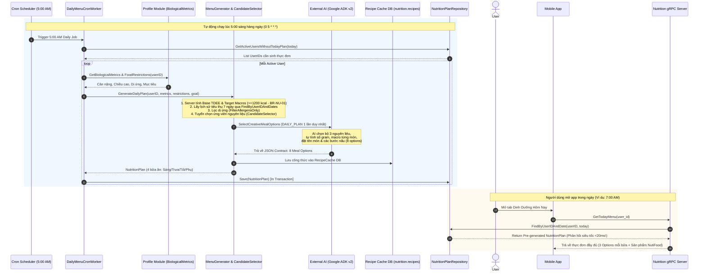
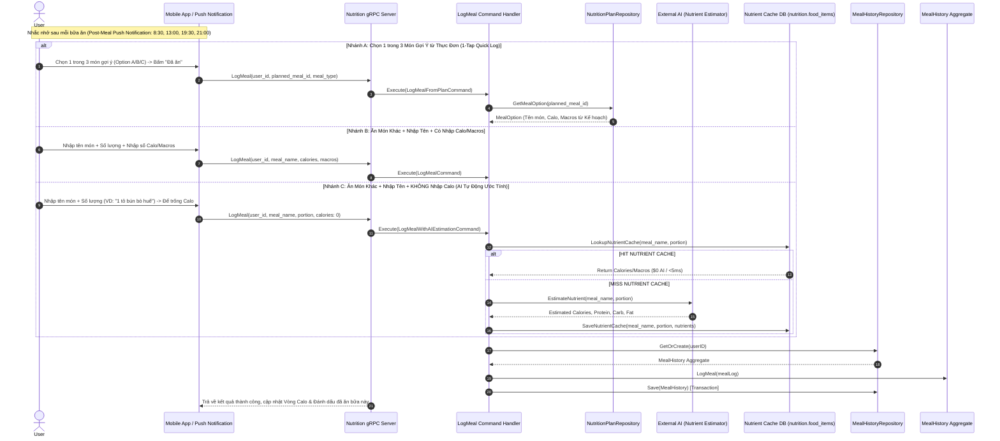
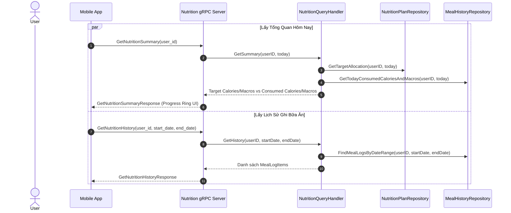
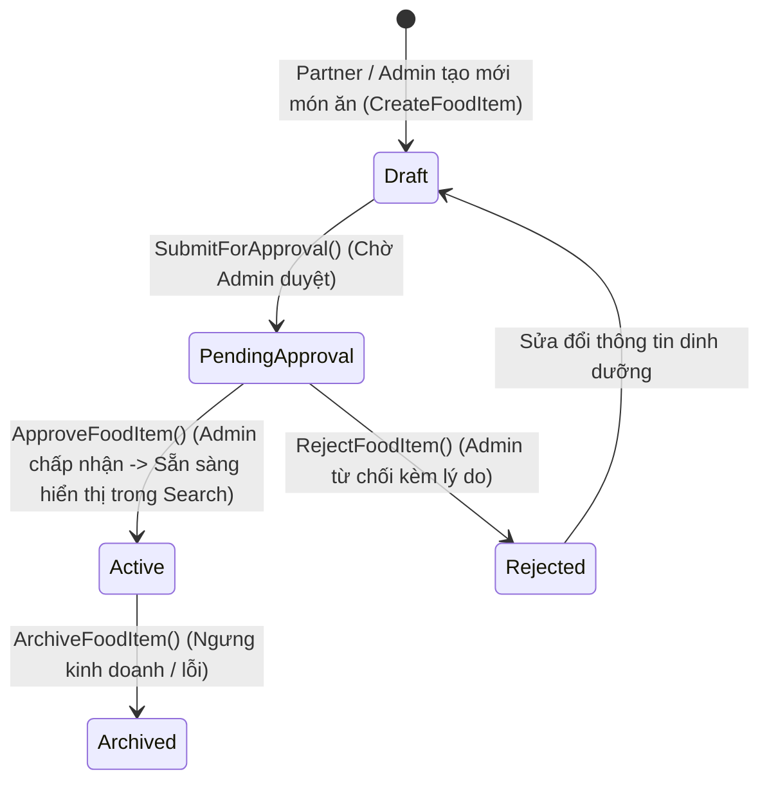
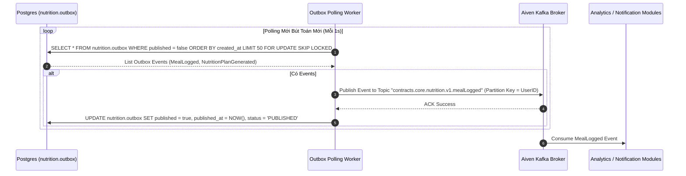
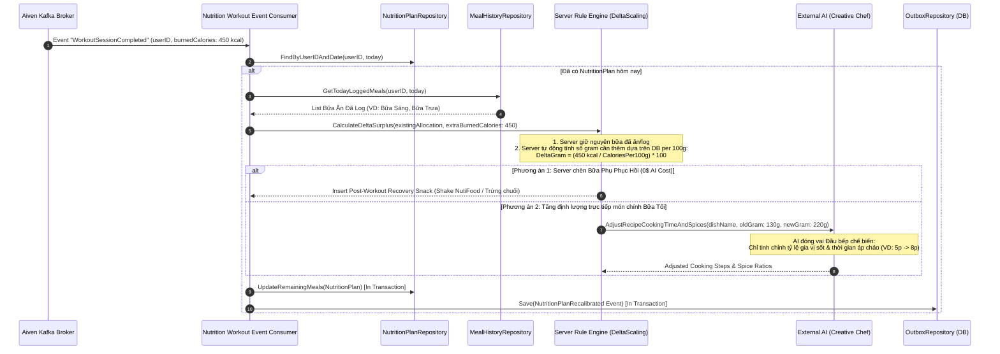
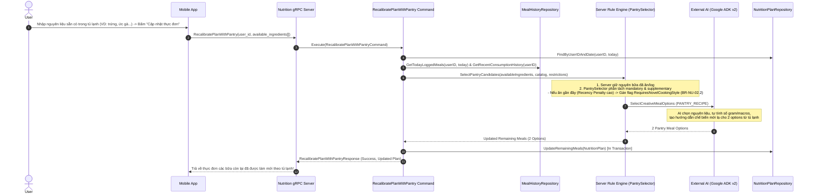

# Master Implementation Plan: Module AI Nutrition Engine / NutiFood (`internal/nutrition`)

Tài liệu kế hoạch kỹ thuật tổng thể dành cho Bounded Context **Nutrition / NutiFood** (`internal/nutrition`) chuẩn kiến trúc **Domain-Driven Design (DDD)**, **Hexagonal Architecture (Ports & Adapters)**, và các quy ước lập trình Go trong `AGENTS.md`.

Tài liệu được cập nhật chính xác theo phân định kỹ thuật thực tế trong codebase:
- **Server Go Backend**: Đóng vai trò Bộ Điều Phối & Lọc Quy Tắc Nghiệp Vụ — tính toán TDEE và Target Macros ngày (`TDEECalculator`), trích xuất lịch sử tiêu thụ 7 ngày qua (`FindByUserIDAndDates`), lọc an toàn dị ứng (`FilterAllergensOnly`), chấm điểm ứng viên đa mục tiêu với phân rã hàm mũ (`CandidateSelector`), đóng gói context gọi AI, thẩm định kết quả (`planValidator`), phân bổ vào 4 bữa ăn và lưu trữ CSDL/Outbox.
- **External AI (Google ADK v2)**: Đóng vai trò sáng tạo ẩm thực và cân bằng dinh dưỡng món ăn — nhận danh sách ứng viên từ Backend, chọn bộ 3 nguyên liệu (Protein + Carb + Veggie), tính gram từng nguyên liệu và macro món ăn, đặt tên món ngắn gọn (< 5 từ) và hướng dẫn nấu (< 15 từ/bước).

---

## 1. User Review & Scope Alignment

> [!IMPORTANT]
> **Khẳng định kiến trúc cốt lõi**:
> 1. **Phạm vi tính năng**: Triển khai đầy đủ 3 Aggregates (`NutritionPlan`, `MealHistory`, `FoodItem`), `TDEECalculator`, `CandidateSelector` (Soft Scoring & Exponential Decay - BR-NU-02), `PantrySelector` (BR-NU-06), `RecipeCacheRepository`, đề xuất sản phẩm NutiFood (BR-NU-03), tái hiệu chỉnh động khi tập luyện (BR-NU-04), và Outbox CDC phát sự kiện lên Kafka.
> 2. **Cơ sở dữ liệu**: Sử dụng PostgreSQL schema riêng `nutrition` với các bảng `nutrition_plans`, `meal_histories`, `meal_logs`, `food_items` (lưu các trường `calories_per_100g`, `protein_per_100g`, `carbs_per_100g`, `fat_per_100g`, `price_per_100g`, `cost_tier`), `recipes` (Recipe Cache), `weekly_insights`, bảng `outbox` & `outbox_log` (đã khởi tạo tại `01-init-schemas.sql`).
> 3. **Phân định ranh giới Server vs AI**: 
>    - **Server**: Quyết định chỉ tiêu Calo/Macros tổng ngày, lọc dị ứng, chấm điểm ứng viên nguyên liệu và lưu trữ kế hoạch.
>    - **External AI**: Chọn bộ 3 nguyên liệu, tính gram chi tiết, tính macro từng món, đặt tên món và các bước nấu.

---

## 2. Proposed Changes & File Structure

### Database & Migrations

#### [NEW] [02-nutrition.sql](../../../shared/database/migrations/ai/02-nutrition.sql)
- Tạo các bảng nghiệp vụ trong PostgreSQL schema `nutrition` (schema `nutrition`, `outbox` và `outbox_log` đã được tạo từ `01-init-schemas.sql`):
  - `nutrition.nutrition_plans`: Lưu kế hoạch calo/macros theo ngày, target calories, phân bổ protein/carb/fat, danh sách bữa ăn gợi ý dưới dạng JSONB.
  - `nutrition.meal_histories`: Quản lý lịch sử ăn uống của user.
  - `nutrition.meal_logs`: Các món ăn thực tế đã ghi nhận (`meal_log_id`, `meal_name`, `meal_type`, `calories`, `protein`, `carbs`, `fat`, `logged_at`).
  - `nutrition.food_items`: Danh mục thực phẩm chuẩn per 100g (`calories_per_100g`, `protein_per_100g`, `carbs_per_100g`, `fat_per_100g`, `price_per_100g`, `cost_tier`), nhãn dị ứng/chay/Halal, nhãn sản phẩm NutiFood, trạng thái vòng đời (`Draft`, `PendingApproval`, `Active`).
  - `nutrition.recipes`: Thư viện Recipe Cache tự động tích lũy từ External AI để tái sử dụng $0$ AI Cost.
  - `nutrition.weekly_insights`: Lưu trữ báo cáo phân tích dinh dưỡng tuần của AI.
- Seed dữ liệu ban đầu duy nhất cho bảng `nutrition.food_items` (danh mục thực phẩm chuẩn & sản phẩm NutiFood như NutiFood Varna, NutiFood LeanMax).

---

### Domain Layer (`internal/nutrition/domain`)

Không import thư viện ngoài (không GORM, không Gin/REST, không ORM tags). Định nghĩa đầy đủ Aggregate Roots, Entities, Value Objects, Domain Events và Interfaces (Ports).

#### [NEW] [calorie_allocation.go](../domain/vo/calorie_allocation.go)
- **Value Object**: `CalorieAllocation` (Target calories, Protein grams, Carb grams, Fat grams).
- **Invariant**: Target calories >= 1200 kcal/ngày (BR-NU-01).

#### [NEW] [historical_consumption.go](../domain/vo/historical_consumption.go)
- **Value Object**: `HistoricalConsumption` lưu vết món ăn và mảng nguyên liệu thực tế: `MealName string`, `Ingredients []string`, `ConsumedAt time.Time`.
- Phục vụ tính toán hàm phân rã thời gian $R(i) = \sum s(i, i_k) e^{-\Delta t_k / \tau}$ ($\tau=48\text{h}$) trong `CandidateSelector`.

#### [NEW] [food_nutrient.go](../domain/vo/food_nutrient.go)
- **Value Object**: `FoodNutrient` chứa calo, macro per 100g (`CaloriesPer100g`, `ProteinPer100g`, `CarbsPer100g`, `FatPer100g`, `PricePer100g`, `CostTier`), allergen tags, partner tags (NutiFood).

#### [NEW] [nutrition_plan.go](../domain/aggregate/nutrition_plan.go)
- **Aggregate Root**: `NutritionPlan`
- Chứa `PlanID`, `UserID`, `Date`, `CalorieAllocation`, `DailyMealOptions` (Sáng, Trưa, Tối, Phụ).
- **BR-NU-05 (Chuyển đổi Thực đơn Kế hoạch -> Lịch sử Ăn uống & Nhắc nhở theo bữa)**:
  - **BR-NU-05.1**: Sinh ít nhất 3 Lựa chọn (`MealOption`) cho mỗi bữa ăn.
  - **BR-NU-05.2**: Nhắc nhở đẩy sau mỗi bữa ăn (8:30, 13:00, 19:30, 21:00).
  - **BR-NU-05.3**: Quick-log 1-tap 1/3 options | Custom log có calo | Custom log KHÔNG calo -> AI tự động ước tính & cache DB.

#### [NEW] [meal_history.go](../domain/aggregate/meal_history.go)
- **Aggregate Root**: `MealHistory`
- Chứa `HistoryID`, `UserID`, danh sách `MealLog` entities.
- Business Method: `LogMeal(...)`, `LogMealFromPlan(...)`, `LogCustomMealWithAIEstimation(...)`.

#### [NEW] [food_item.go](../domain/aggregate/food_item.go)
- **Aggregate Root**: `FoodItem`
- State Lifecycle: `Draft` -> `SubmitForApproval()` -> `Approve()` (`Active`) / `Reject()`.

#### [NEW] [tdee_calculator.go](../domain/service/tdee_calculator.go)
- **Domain Service**: Tính TDEE theo Mifflin-St Jeor và tự động điều chỉnh Calo/Macro linh hoạt.
- **BR-NU-04**: Tái hiệu chỉnh thực đơn động khi có sự kiện tập luyện `WorkoutSessionCompleted`.

#### [NEW] [candidate_selector.go](../domain/service/candidate_selector.go)
- **Domain Service**: Chấm điểm đa tiêu chí $S(i, u, t)$, phân rã hàm mũ theo thời gian $R(i)$ và tie-breaker bằng `DeterministicRNG`.

#### [NEW] [food_filter.go](../domain/service/food_filter.go)
- **Domain Service**: `FilterAllergensOnly` sàng lọc nguyên liệu theo tên, loại bỏ nguy cơ phản ứng dị ứng của người dùng.

#### [NEW] [pantry_selector.go](../domain/service/pantry_selector.go)
- **Domain Service**: Đánh giá nguyên liệu tủ lạnh, ưu tiên đưa vào bữa ăn và gán cờ `RequiresNovelCookingStyle` khi nguyên liệu đã ăn gần đây.

#### [NEW] [sampling.go](../domain/service/sampling.go)
- **Domain Service**: Cung cấp `DeterministicRNG(userID, planDate)` sinh jitter $\pm 0.05$ và thuật toán Reservoir Sampling.

#### [NEW] [menu_generator.go](../domain/service/menu_generator.go)
- **Domain Service Orchestrator**: 
  1. Sử dụng `CandidateSelector` để tuyển chọn danh sách nguyên liệu ứng viên khả thi theo chỉ tiêu dinh dưỡng.
  2. Ủy thác cho `AIService` làm việc sáng tạo công thức, ghép bộ 3 nguyên liệu, tính gram cụ thể và đặt tên món.
  3. Phân bổ 8 options do AI trả về vào 4 bữa ăn trong ngày (`Breakfast` 25%, `Lunch` 35%, `Dinner` 30%, `Snack` 10%).
  4. Lưu công thức vào `nutrition.recipes` (Recipe Cache DB).

#### [NEW] [ai_service.go](../domain/repository/ai_service.go)
- **Port / Interface**: `AIService` hợp đồng gọi External AI làm **Creative Chef (Đầu bếp chế biến & nêm nếm)** và **Nutrient Estimator**, tích hợp Prompt Rule cho phép bổ sung nguyên liệu phụ trợ và trích xuất nguyên liệu mới để đồng bộ CSDL.

#### [NEW] [events.go](../domain/event/events.go)
- Domain Events: `NutritionPlanGenerated`, `NutritionPlanRecalibrated`, `MealLogged`, `FoodItemCreated`, `FoodItemApproved`.

#### [NEW] [repository.go](../domain/repository/nutrition_plan_repository.go)
- Interfaces: `NutritionPlanRepository` (với batch query `FindByUserIDAndDates`), `MealHistoryRepository`, `FoodItemRepository`, `RecipeCacheRepository`.

---

### Application Layer (`internal/nutrition/application`)

#### Commands:
- [NEW] [generate_daily_plan.go](../application/command/generate_daily_plan.go): UC-05.1 Base TDEE plan generation với batch lookup lịch sử tiêu thụ theo ngày.
- [NEW] [recalibrate_plan_with_pantry.go](../application/command/recalibrate_plan_with_pantry.go): **BR-NU-06** API tái hiệu chỉnh bữa ăn theo nguyên liệu tủ lạnh.
- [NEW] [log_meal.go](../application/command/log_meal.go): UC-05.2 & **BR-NU-05** Log meal (1-tap quick log / custom log với AI auto estimation).
- [NEW] [create_food_item.go](../application/command/create_food_item.go)
- [NEW] [approve_food_item.go](../application/command/approve_food_item.go)

#### Queries:
- [NEW] [get_today_menu.go](../application/query/get_today_menu.go)
- [NEW] [get_nutrition_history.go](../application/query/get_nutrition_history.go)
- [NEW] [get_nutrition_summary.go](../application/query/get_nutrition_summary.go)

---

### Infrastructure Layer (`internal/nutrition/infrastructure`)

#### AI Integration (Google ADK v2 & FallbackLLM) & Persistence:
- [NEW] [agent.go](../infrastructure/ai/adk/agent.go): `ADKNutritionAgent` triển khai `repository.AIService`.
- [NEW] [fallback_llm.go](../infrastructure/ai/adk/fallback_llm.go): `FallbackLLM` bọc `model.LLM`, tự động failover sang model dự phòng khi hết quota/429 (`GEMINI_MODEL` & `GEMINI_FALLBACK_MODELS`).
- [NEW] [build_agents.go](../infrastructure/ai/adk/build_agents.go): Khởi tạo LLM nodes & workflow agents với file prompt nhúng tĩnh (`//go:embed prompts/*.txt`).
- [NEW] [tools.go](../infrastructure/ai/adk/tools.go): ADK Function Tools (`fetch_food_catalog`, `calculate_macro_gram`, `suggest_nutifood_supplement`).
- [NEW] [retry.go](../infrastructure/ai/adk/retry.go): Retry mechanism & plan validation.
- [NEW] [gorm_models.go](../infrastructure/persistence/models.go): Mapping `ToDomain()` / `ToPersistence()`.
- [NEW] [postgres_repository.go](../infrastructure/persistence/postgres_repository.go)
- [NEW] [outbox_repository.go](../infrastructure/persistence/outbox_repository.go)
- [NEW] [grpc_handler.go](../../transport/grpc/handler.go): gRPC Adapter `NutritionServiceServer`.

#### Workers:
- [NEW] [outbox_worker.go](../infrastructure/worker/outbox_worker.go): CDC Outbox Worker sang Kafka.
- [NEW] [daily_menu_cron_worker.go](../infrastructure/worker/daily_menu_cron_worker.go): Cron Job 5:00 AM (`0 5 * * *`) pre-generate Base TDEE plan.

---

## 3. Workflows & Activity Diagrams (7 Sơ Đồ Mermaid Chuẩn AI Creative Chef)

### Flow 1: Cron Job 5:00 AM Tự Động Sinh Thực Đơn Đầu Ngày (`DailyMenuCronWorker` & `GetTodayMenu`)

---

### Flow 2: Log Bữa Ăn Theo Nhắc Nhở & AI Tự Động Tính Calo (`LogMeal` & `BR-NU-05`)

---

### Flow 3: Tổng Quan Calo/Macro & Lịch Sử (`GetSummary` & `GetHistory`)

---

### Flow 4: Vòng Đời Phê Duyệt Thực Phẩm (`FoodItem` Lifecycle)

---

### Flow 5: Outbox CDC & Phát Sự Kiện Sang Kafka

---

### Flow 6: Tái Hiệu Chỉnh Định Lượng Khi Tập Luyện Chiều (`WorkoutSessionCompleted` Event - BR-NU-04)

---

### Flow 7: Tái Hiệu Chỉnh Thực Đơn Khi Nhập Nguyên Liệu Sẵn Có (`RecalibratePlanWithPantry` API - BR-NU-06)

---

## 4. Verification Plan

### Automated Unit Tests
1. **Domain Tests**:
   - `go test -v ./internal/nutrition/domain/...`
   - Test `CalorieAllocation`: Kiểm tra Invariant `target >= 1200 kcal` (BR-NU-01).
   - Test `CandidateSelector` & `HistoricalConsumption`: Kiểm tra cơ chế chấm điểm mềm đa mục tiêu, phân rã hàm mũ $e^{-\Delta t/\tau}$ ($\tau=48\text{h}$) từ nguyên liệu bữa ăn cũ, tie-breaker deterministic RNG.
   - Test `FoodFilter`: Kiểm tra lọc an toàn dị ứng tinh giản (`FilterAllergensOnly`).
   - Test `PantrySelector`: Kiểm tra phân tách nguyên liệu tủ lạnh mandatory/supplementary và cờ `RequiresNovelCookingStyle`.
   - Test `MenuGenerator`: Kiểm tra điều phối sinh thực đơn và Recipe Cache.
2. **Application CQRS Tests**:
   - `go test -v ./internal/nutrition/application/...`
   - Mock repositories để kiểm tra logic `GenerateDailyPlan`, `RecalibratePlanWithPantry`, `LogMeal`.

### Automated Integration Tests
1. **Repository & Outbox Integration Tests**:
   - `go test -v ./internal/nutrition/infrastructure/persistence/...`
   - Chạy với Postgres/SQLite test DB để kiểm tra transaction lưu Aggregate và Outbox event nguyên khối.

### Code Quality & Contract Validation
1. **Go Code Style Rules**: `golangci-lint run ./internal/nutrition/...`
2. **Buf Proto Schema**: `buf lint`
