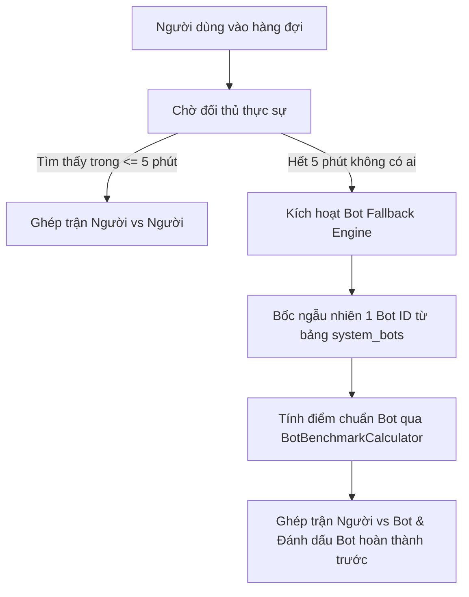
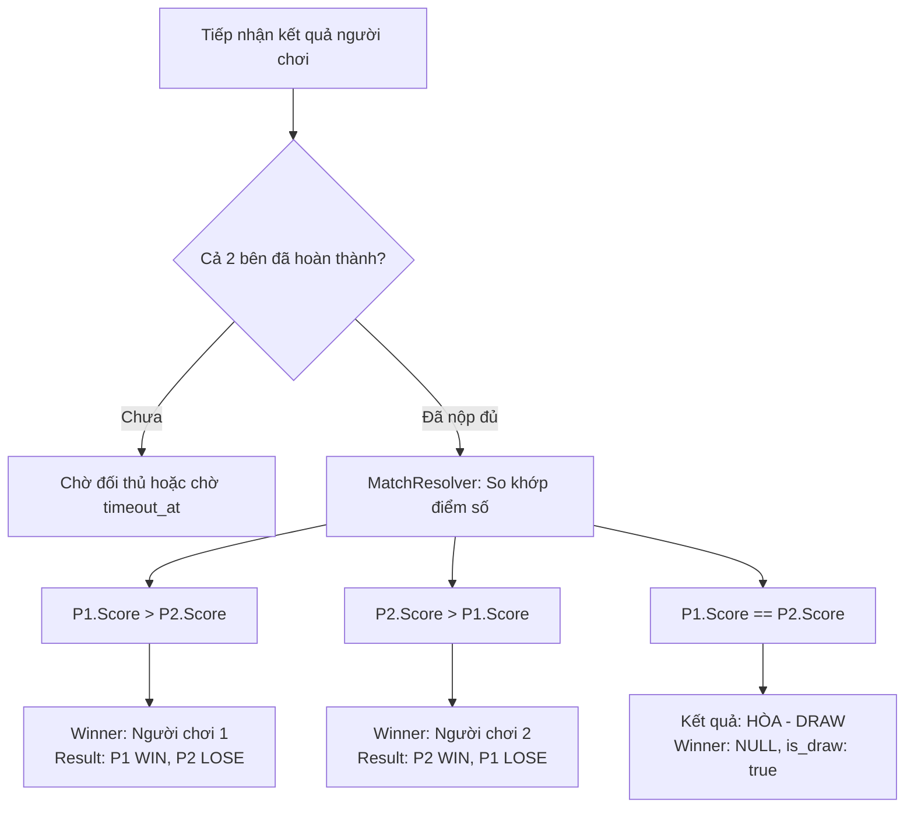

# Đặc Tả Yêu Cầu Nghiệp Vụ — Module Solo Match (Business Requirements)

Tài liệu này định nghĩa toàn bộ mục tiêu, phạm vi và quy tắc nghiệp vụ của Bounded Context **Solo Match** (Ghép trận đối kháng thể lực 1v1) trong hệ thống Gym Companion.

---

## 1. Giới Thiệu & Mục Tiêu Nghiệp Vụ

Module **Solo Match** đóng vai trò là phân hệ đối kháng thể thao điện tử giữa các người dùng trong hệ thống:
1. **Tạo động lực thi đấu trực tiếp (Social Competition & Motivation)**: Thúc đẩy gymer vượt qua giới hạn bản thân thông qua các trận đấu 1v1 ngắn hạn, ngẫu nhiên với đối thủ có trình độ tương đương.
2. **Trải nghiệm thời gian thực, độ trễ cực thấp**: Đảm bảo thời gian tìm kiếm đối thủ diễn ra nhanh chóng, phản hồi trực quan qua Server-Streaming.
3. **Đảm bảo tính liên tục (Always-Available Matching)**: Không bao giờ để người dùng rơi vào trạng thái chờ đợi vô hạn (Deadlock / Starvation) khi phòng tập vắng người hoặc đêm muộn bằng cơ chế Bot Fallback thông minh sau 5 phút.
4. **Công bằng & Minh bạch (Anti-Cheat & Strict Fairness)**:
   - Cả 2 bên được giao chung một bài tập ngẫu nhiên.
   - Kết quả được ghi nhận khách quan thông qua hệ thống AI Camera Pose Tracking của ứng dụng, loại bỏ hoàn toàn khả năng người chơi tự nhập điểm ảo.
5. **Độc lập ranh giới (Domain Isolation)**: Module tập trung kiểm soát vòng đời trận đấu và kết quả thắng/thua, không can thiệp sâu vào chi tiết các góc xương hay tracking camera của module `workout_execution`.

---

## 2. Các Phân Hệ Nghiệp Vụ Chính

### 2.1. Hàng Đợi Ghép Trận Ngẫu Nhiên (Matchmaking Queue)
- **Vào hàng đợi (Join Queue)**:
  - Bất kỳ người dùng hợp lệ nào đã đăng nhập đều có thể gửi yêu cầu tìm trận.
  - Người dùng đang có một trận đấu chưa hoàn thành (`IN_PROGRESS`) thì không được phép tìm trận mới.
  - Kết nối tìm trận được duy trì qua gRPC Server-Streaming (hoặc ConnectRPC), giữ luồng stream mở để sẵn sàng nhận tín hiệu ngay khi ghép thành công.
- **Hủy tìm trận (Cancel Queue)**:
  - Người dùng có thể chủ động hủy vé tìm trận bất kỳ lúc nào khi đang đợi trong hàng.
  - Sau khi hủy, vé lập tức bị thu hồi khỏi Redis Memory và luồng stream đóng lại an toàn.
- **Thuật toán bốc cặp (FIFO Pairing)**:
  - Sử dụng hàng đợi theo thứ tự thời gian gia nhập (Sorted Set với Score là Unix timestamp).
  - Hai người dùng đầu tiên trong hàng đợi sẽ được bốc ra cùng lúc (nguyên tử) để ghép thành một trận đấu.

---

### 2.2. Thể Thức Thi Đấu & Bài Tập Ngẫu Nhiên (Exercise Challenge)
Khi hai đối thủ được ghép cặp thành công, hệ thống sẽ tự động bốc ngẫu nhiên một bài tập thể lực kèm theo thể thức thi đấu:

| Thể thức | Bản chất nghiệp vụ | Ví dụ bài tập | Tiêu chí phân định thắng thua |
| :--- | :--- | :--- | :--- |
| **`REPS`** | Bài tập đếm số lần lặp lại (Repetitions) | Push-up (Hít đất), Bodyweight Squat, Pull-up, Burpees | Bên nào hoàn thành được **nhiều rep chuẩn hơn** sẽ giành chiến thắng. |
| **`DURATION`** | Bài tập giữ tư thế tĩnh theo thời gian (Isometric Hold) | Plank, Wall-sit, Hollow Body Hold | Bên nào duy trì tư thế đúng form **lâu hơn (số giây lớn hơn)** sẽ giành chiến thắng. |

- **Thời hạn trận đấu (`timeout_duration`)**:
  - Mỗi trận đấu có một mốc thời gian tối đa để hoàn thành (mặc định từ 5 – 10 phút tùy độ khó bài tập).
  - Hệ thống chốt mốc `timeout_at = started_at + timeout_duration`. Sau thời điểm này, nếu người chơi không nộp bài, trận đấu sẽ bị xử lý quá hạn.

---

### 2.3. Cơ Chế Bot Fallback & Tài Khoản Bot Hệ Thống (System Bot Pool)
Nhằm triệt tiêu trải nghiệm chờ đợi tiêu cực khi hệ thống ít người online, Solo Match áp dụng cơ chế Bot thông minh:

1. **Ngưỡng kích hoạt**: Nếu sau **5 phút** trong hàng đợi mà không tìm được người chơi thực, Worker sẽ tự động bốc vé của người dùng đó và kích hoạt cơ chế ghép với Bot.
2. **Kho tài khoản Bot trong Database (System Bot Pool)**:
   - Bot không phải là chuỗi ngẫu nhiên sinh ra tức thời (on-the-fly), mà là **các tài khoản gymer thật được cấu hình sẵn trong Database** (bảng `solo_match.system_bots` liên kết khóa ngoại với `solo_match.user_snapshots`).
   - Repository [`GORMBotRepository`](../../infrastructure/persistence/gorm_bot_repository.go) bốc ngẫu nhiên 1 `user_id` của bot đang kích hoạt (`is_active = true`) thông qua **bộ nhớ đệm In-Memory (TTL 30 ngày)**, đạt độ trễ cực thấp $O(1)$ mà không gây tải cho PostgreSQL.
3. **Ẩn danh tính AI (Secrecy Policy)**:
   - Người dùng **hoàn toàn không biết** mình đang thi đấu với Bot.
   - Trong Protobuf Contract gửi về Client (`ParticipantView`), không có bất kỳ cờ `is_bot` nào.
4. **Tính toán điểm chuẩn của Bot (`BotBenchmarkCalculator`)**:
   - Điểm số của Bot được tính toán tập trung tại [`BotBenchmarkCalculator`](../../domain/service/bot_benchmark_calculator.go):
     - *Kịch bản 1 (Người chơi có dữ liệu PR)*: Điểm Bot được gán bằng chính **Kỷ lục cá nhân (PR)** gần nhất của người chơi đối với bài tập đó (`*userPR`).
     - *Kịch bản 2 (Người chơi mới chưa có PR)*:
       - Nếu là bài tập đếm số lần (`REPS`): Điểm Bot là **5 reps** (`DefaultBotReps = 5.0`).
       - Nếu là bài tập giữ thời gian (`DURATION`): Điểm Bot là **300 giây / 5 phút** (`DefaultBotDuration = 300.0`).
   - Khi tạo trận đấu, điểm số của Bot được ghi nhận và chốt hoàn thành ngay lập tức (`pBot.RecordResult(botScore, now)`). Người chơi sau đó thực hiện buổi tập và nộp kết quả; khi người chơi hoàn tất, `MatchResolver` sẽ so sánh điểm số hai bên để phân định kết quả chung cuộc.

---

### 2.4. Quy Tắc Phân Định Kết Quả Chung Cuộc (Match Outcome Resolution)

Khi nhận được kết quả buổi tập nộp về từ các bên tham gia:

- **Quy tắc đặc thù cho bài tập Duration (Thời gian)**:
  - Nếu Người chơi 1 dừng lại ở giây thứ 60, **Người chơi 2 vẫn tiếp tục được tập luyện bình thường** để chinh phục mốc thời gian cao hơn (ví dụ 90s, 120s) cho đến khi người chơi 2 tự kết thúc hoặc chạm hạn chót `timeout_at`.
  - Hệ thống không ngắt ngang buổi tập của người chơi đang nỗ lực.

---

### 2.5. Cơ Chế 2 Tầng Xử Lý Timeout & Bỏ Cuộc (Two-Tier Forfeit Mechanism)

Để bảo vệ người chơi nghiêm túc trước các hành vi thoát game hoặc treo máy (AFK):

#### Tầng 1: Xử thua tức thì (Fast Forfeit qua Event Stream)
- Khi một bên nhấn nút **"Bỏ cuộc / Thoát trận"** hoặc gặp sự cố mất kết nối camera AI quá lâu, module `workout_execution` sẽ phát ra sự kiện hủy buổi tập (`WorkoutSessionAborted`).
- Consumer của `solo_match` lập tức tiếp nhận sự kiện này:
  - Đánh dấu người bỏ cuộc là `FORFEITED`.
  - **Xử thắng (`WIN`) ngay lập tức cho đối thủ còn lại** mà không bắt họ phải chờ đến hết giờ `timeout_at`.
  - Phát sự kiện `SoloMatchForfeited` và `SoloMatchCompleted` ra Kafka để trao thưởng tức thì.

#### Tầng 2: Lưới an toàn bảo hiểm tầng cuối (Safety Net Timeout Worker)
- Dành cho các trường hợp ngoại lệ bất khả kháng:
  - Người chơi tắt app, hết pin, thoát ứng dụng trước khi màn hình tập kịp khởi tạo (No-show / Ghost Player).
  - Sự cố mất mạng hoàn toàn khiến client không gửi được bất kỳ API nào về server.
- Background Worker chạy định kỳ quét các trận `status = IN_PROGRESS` mà `now > timeout_at`:
  - **Trường hợp 1 bên đã nộp, 1 bên chưa**: Xử bên chưa nộp là `FORFEITED`, bên đã nộp là `WIN`.
  - **Trường hợp cả 2 bên đều không nộp**: Hủy trận đấu (`CANCELLED`), không tính thắng thua và không trừ điểm.

---

### 2.6. Đồng Bộ Bản Sao Danh Tính (User Snapshot Synchronizer)
- Tuân thủ nguyên tắc **Schema Isolation**: Bảng dữ liệu của module `solo_match` tuyệt đối **không JOIN sang bảng users** của module Auth/Account.
- Module duy trì bảng cục bộ `solo_match.user_snapshots` (`user_id`, `display_name`, `avatar_url`).
- Lắng nghe sự kiện Kafka:
  - `UserRegistered` (Module `auth`, topic `auth.events`): Tự động tạo bản ghi snapshot khi có tài khoản mới đăng ký.
  - `UserIdentityUpdated` (Module `profile`, topic `profile.events`): Cập nhật lại tên đại diện và avatar khi người dùng đổi hồ sơ cá nhân.
- Tốc độ đọc thông tin đối thủ khi ghép trận đạt mức < 1ms, phục vụ hoàn hảo cho việc hiển thị bảng kết quả và lịch sử đối đầu.

---

### 2.7. Tách Bạch Ranh Giới Nghiệp Vụ Với Workout Execution
- Module `workout_execution`: Chịu trách nhiệm về thị giác máy tính AI (Computer Vision), đo góc khớp, tính toán điểm chuẩn tư thế (Form Score), đếm từng rep theo thời gian thực và quản lý nhật ký từng set tập.
- Module `solo_match`: Đứng ở tầng cao hơn, chỉ tiếp nhận tổng số rep hoặc tổng thời lượng đã hoàn thành để so sánh tỷ số và phân định thắng thua.
- Sự tách biệt này giúp hai module hoàn toàn độc lập, dễ dàng thay thế hoặc nâng cấp công nghệ tracking mà không làm ảnh hưởng đến luật thi đấu của trận Solo.

