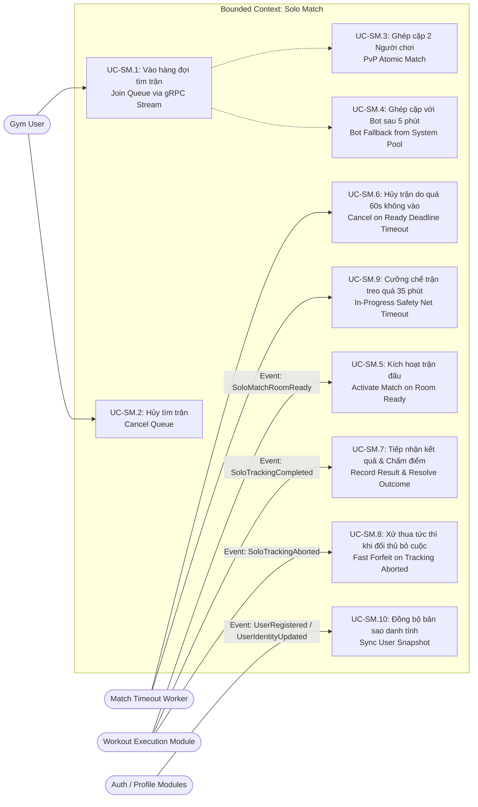
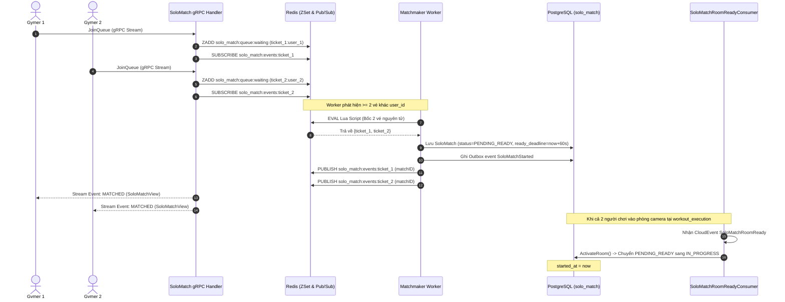
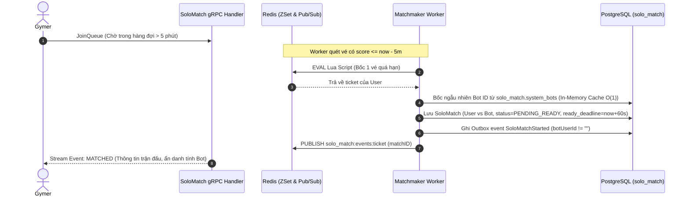
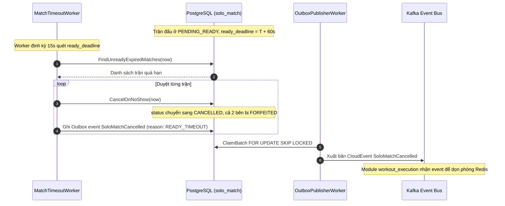
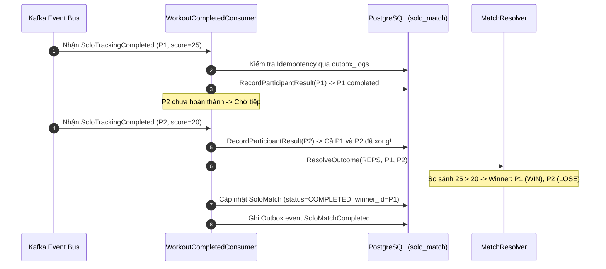
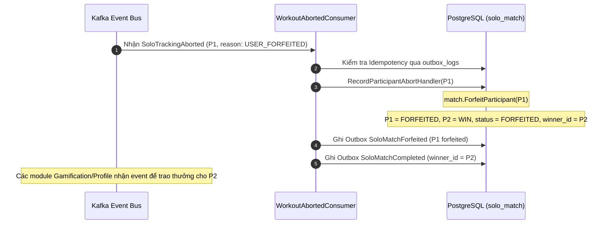
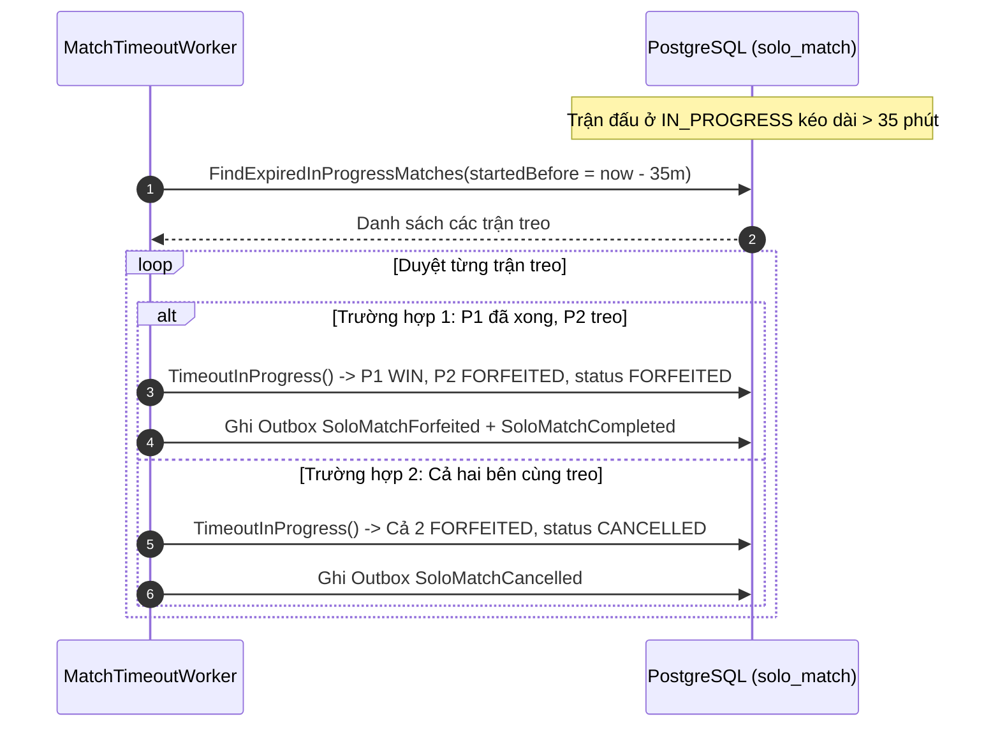
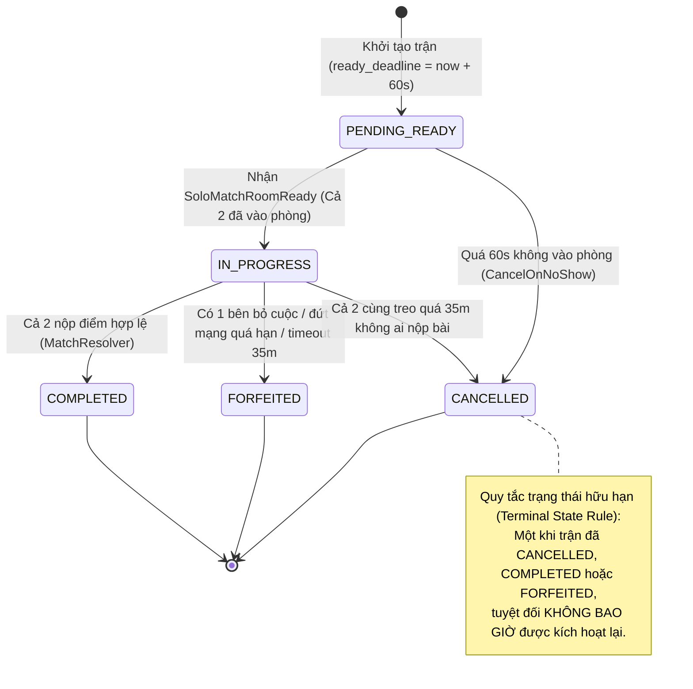

# Phân Tích Hệ Thống — Bounded Context Solo Match (System Analysis)

Tài liệu này trình bày phân tích chi tiết về ca sử dụng (Use Cases), tác nhân (Actors), sơ đồ tuần tự (Sequence Diagrams), phân tích sự kiện liên module (Event Storming) và máy trạng thái hữu hạn (FSM) thuộc phạm vi quản lý của Bounded Context **Solo Match**.

---

## 1. Tác Nhân Hệ Thống (Actors)

| Tác nhân | Phân loại | Vai trò và tương tác với Solo Match |
| :--- | :--- | :--- |
| **Gym User (Player)** | Con người (User) | Gửi yêu cầu tìm trận (`JoinQueue`), hủy tìm trận (`CancelQueue`), tra cứu chi tiết trận (`GetMatch`), xem lịch sử (`GetMatchHistory`). |
| **Redis Matchmaker Engine** | Hạ tầng thời gian thực | Lưu trữ vé chờ trong ZSet, thực thi Lua script bốc vé nguyên tử, phát thông báo qua kênh Pub/Sub. |
| **System Bot Pool** | Tài nguyên hệ thống | Bảng cơ sở dữ liệu `solo_match.system_bots` cung cấp danh sách Bot hợp lệ khi kích hoạt Bot Fallback sau 5 phút. |
| **MatchTimeoutWorker** | Daemon Worker | Chạy ngầm định kỳ: quét trận `PENDING_READY` quá hạn 60s điểm danh (`CancelOnNoShow`) và quét trận `IN_PROGRESS` treo quá 35 phút (`TimeoutInProgress`). |
| **Exercise Provider** | Outbound Port (Service) | Cung cấp bài tập thể lực thi đấu ngẫu nhiên kèm thể thức `REPS` hoặc `DURATION`. |
| **Workout Execution Module** | Module bên ngoài (Event) | Nơi diễn ra buổi tập camera thực tế; phát các sự kiện `SoloMatchRoomReady`, `SoloTrackingCompleted`, `SoloTrackingAborted` về cho `solo_match`. |
| **Auth & Profile Modules** | Module bên ngoài (Event) | Phát sự kiện `UserRegistered`, `UserIdentityUpdated` để `solo_match` duy trì bản sao danh tính `user_snapshots`. |

---

## 2. Biểu Đồ Ca Sử Dụng (Use Case Diagram)

---

## 3. Sơ Đồ Tuần Tự Chi Tiết (Sequence Diagrams)

### 3.1. Luồng Ghép Cặp PvP & Kích Hoạt Trận Đấu

---

### 3.2. Luồng Bot Fallback Sau 5 Phút

---

### 3.3. Luồng Quá Hạn 60s Điểm Danh Không Vào Phòng (Check-in No-Show)

---

### 3.4. Luồng Phân Định Thắng Thua Khi Cả Hai Cùng Hoàn Thành

---

### 3.5. Luồng Xử Thua Tức Thì Khi Có Bên Bỏ Cuộc (Fast Forfeit)

---

### 3.6. Luồng Lưới An Toàn Cưỡng Chế Trận Treo Quá 35 Phút

---

## 4. Phân Tích Sự Kiện Liên Module (Event Storming)

### 4.1. Sự Kiện Xuất Bản (Outbound CloudEvents từ `solo_match`)

| Tên sự kiện | CloudEvent Type | Thời điểm phát sinh | Đích đến |
| :--- | :--- | :--- | :--- |
| **`SoloMatchStarted`** | `contracts.core.solo_match.v1.soloMatchStarted` | Ngay khi tạo xong trận đấu (`PENDING_READY`) | `workout_execution` (chuẩn bị phòng & khởi chạy Bot nếu có) |
| **`SoloMatchCancelled`** | `contracts.core.solo_match.v1.soloMatchCancelled` | Khi quá 60s không vào phòng hoặc cả 2 cùng treo quá 35m | `workout_execution` (dọn phòng Redis & hủy bot runner) |
| **`SoloMatchCompleted`** | `contracts.core.solo_match.v1.soloMatchCompleted` | Khi có kết quả chung cuộc (Thắng, Thua, Hòa) | `gamification`, `social`, `coaching` |
| **`SoloMatchForfeited`** | `contracts.core.solo_match.v1.soloMatchForfeited` | Khi có người chơi bị xử thua do bỏ cuộc hoặc timeout | `gamification`, `profile` |

### 4.2. Sự Kiện Lắng Nghe (Inbound CloudEvents tới `solo_match`)

| Tên sự kiện | CloudEvent Type | Nguồn gửi | Hành động tương ứng của `solo_match` |
| :--- | :--- | :--- | :--- |
| **`SoloMatchRoomReady`** | `contracts.core.workout_execution.v1.soloMatchRoomReady` | `workout_execution` | Kích hoạt trận đấu: chuyển từ `PENDING_READY` sang `IN_PROGRESS`. |
| **`SoloTrackingCompleted`** | `contracts.core.workout_execution.v1.soloTrackingCompleted` | `workout_execution` | Ghi nhận điểm số thành tích của người chơi và phân định thắng thua khi đủ 2 bên. |
| **`SoloTrackingAborted`** | `contracts.core.workout_execution.v1.soloTrackingAborted` | `workout_execution` | Xử thua tức thì cho bên bỏ cuộc, trao chiến thắng cho đối thủ còn lại. |
| **`UserRegistered`** | `contracts.generic.auth.v1.userRegistered` | `auth` | Tạo bản ghi định danh ban đầu trong `solo_match.user_snapshots`. |
| **`UserIdentityUpdated`** | `contracts.supporting.profile.v1.userIdentityUpdated` | `profile` | Cập nhật `display_name` và `avatar_url` trong `user_snapshots`. |

---

## 5. Máy Trạng Thái Hữu Hạn Của Trận Đấu (`SoloMatch.Status`)

