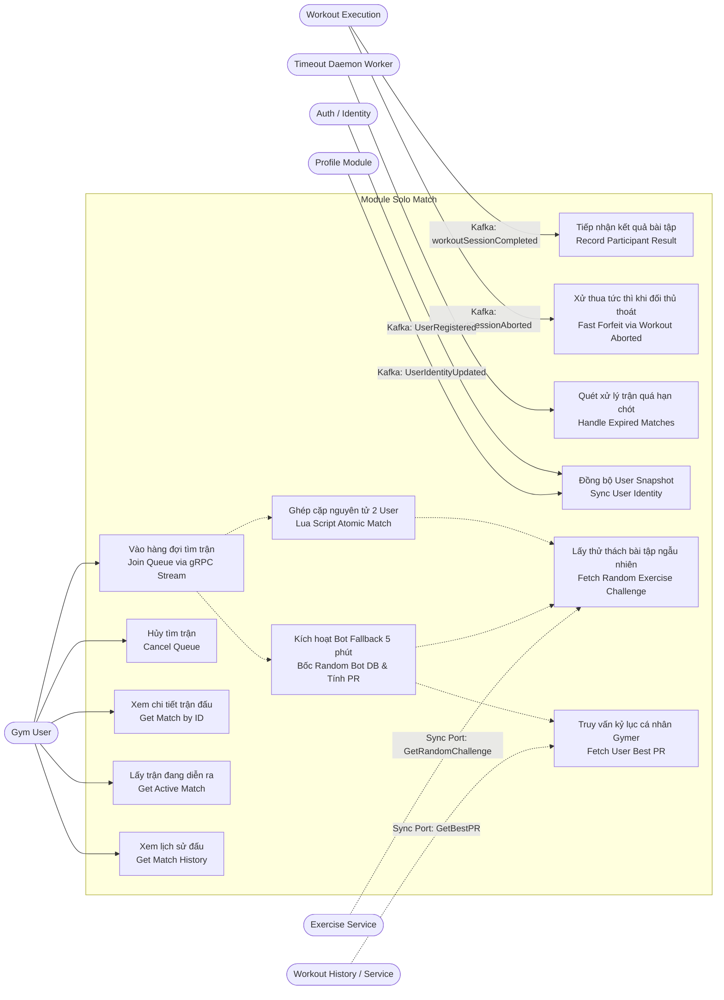
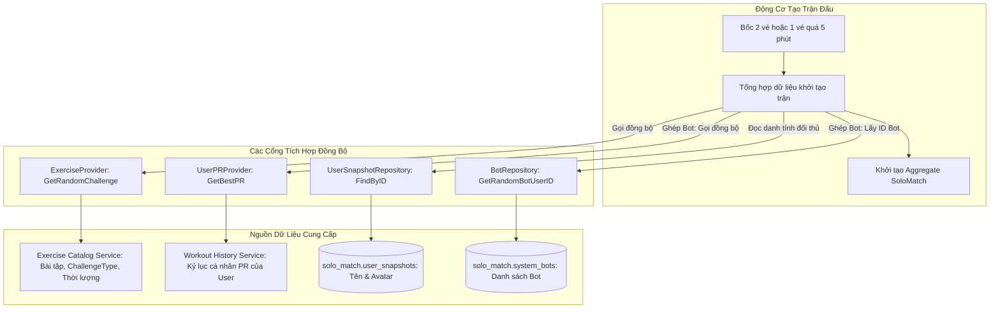
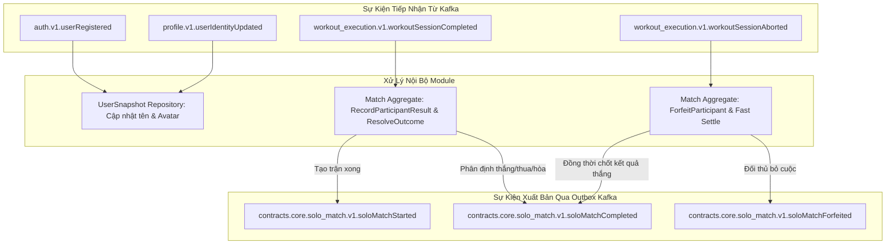
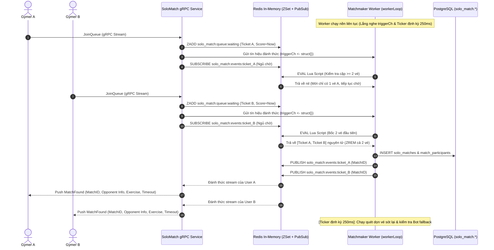
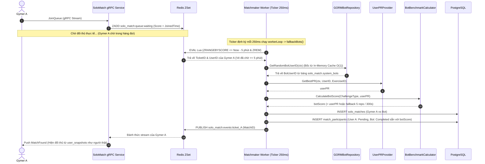
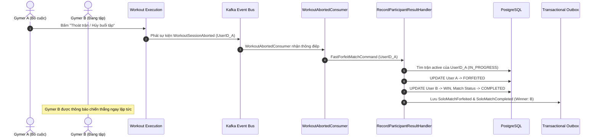
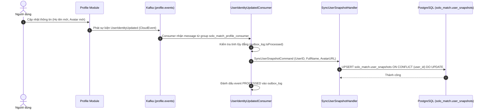
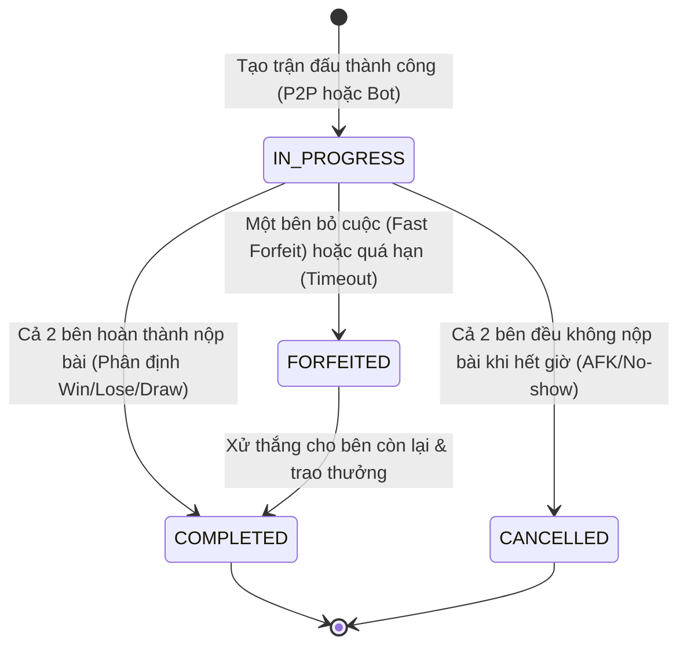

# Phân Tích Hệ Thống — Module Solo Match (System Analysis)

Tài liệu này trình bày phân tích ca sử dụng (Use Cases), tác nhân (Actors), dữ liệu khởi tạo trận & các cổng tích hợp đồng bộ (Match Data Provisioning), phân tích sự kiện (Event Storming), sơ đồ tuần tự (Sequence Diagrams) và máy trạng thái (State Machine) của Bounded Context **Solo Match**.

---

## 1. Tác Nhân Hệ Thống (Actors)

| Tác nhân | Phân loại | Vai trò trong hệ thống |
| :--- | :--- | :--- |
| **Gym User (Player)** | Con người (User) | Người dùng đăng ký tìm trận, hủy tìm trận, thực hiện bài tập đối kháng, xem kết quả và xem lịch sử thi đấu. |
| **System Bot (AI Opponent)** | Tác nhân hệ thống | Tài khoản gymer mẫu cấu hình sẵn trong DB (`solo_match.system_bots`), bốc ngẫu nhiên qua In-Memory Cache tham gia trận đấu khi thời gian chờ của người dùng vượt quá 5 phút. |
| **Redis Matchmaker Engine** | Hạ tầng thời gian thực | Quản lý vé chờ (ZSet), phân giải vé nguyên tử bằng Lua script, và phát thông báo qua Redis Pub/Sub. |
| **Match Timeout Worker** | Tác nhân nền (Daemon) | Worker chạy ngầm định kỳ quét và xử lý các trận đấu `IN_PROGRESS` đã vượt quá mốc `timeout_at`. |
| **Exercise Management Service** | Module bên ngoài / Port | Cung cấp danh mục bài tập thi đấu đối kháng ngẫu nhiên (`ExerciseID`, `ExerciseName`, `ChallengeType` REPS/DURATION, thời lượng `Duration`) qua cổng `port.ExerciseProvider`. |
| **Workout History / Execution Service** | Module bên ngoài / Port | Cung cấp kỷ lục cá nhân (Personal Record - PR) của người dùng qua cổng `port.UserPRProvider` để tính toán độ khó của Bot. |
| **Workout Execution Module** | Module bên ngoài (Event) | Đơn vị tracking camera AI, phát sự kiện hoàn thành (`workoutSessionCompleted`) hoặc hủy bỏ (`workoutSessionAborted`). |
| **Auth & Identity Module** | Module bên ngoài (Event) | Phát sự kiện `UserRegistered` trên topic `auth.events` khi người dùng đăng ký tài khoản mới. |
| **Profile Module** | Module bên ngoài (Event) | Phát sự kiện `UserIdentityUpdated` trên topic `profile.events` khi người dùng cập nhật thông tin cá nhân (họ tên, avatar). |

---

## 2. Biểu Đồ Ca Sử Dụng (Use Case Diagram)



---

## 3. Phân Tích Dữ Liệu Khởi Tạo Trận & Các Cổng Tích Hợp Đồng Bộ (Match Data Provisioning)

Bên cạnh việc lắng nghe các sự kiện bất đồng bộ qua Kafka, việc khởi tạo một trận đấu (cả PvP lẫn Bot) đòi hỏi quá trình tổng hợp dữ liệu đồng bộ từ các dịch vụ bên ngoài thông qua các cổng **Outbound Ports**:



### 3.1. Danh mục thông tin cần thu thập để tạo trận đấu
Để khởi tạo thành công một Aggregate Root `SoloMatch`, hệ thống bắt buộc phải thu thập đủ 4 nhóm dữ liệu cốt lõi:
1. **Thông tin thử thách bài tập (`ExerciseChallenge`)**:
   - `ExerciseID` & `ExerciseName`: Mã và tên bài tập đối kháng (ví dụ: `ex_pushup` - `Push-Up`).
   - `ChallengeType`: Hình thức thi đấu (`REPS` - đếm số lượt, hoặc `DURATION` - giữ thời gian tư thế).
   - `Duration`: Thời lượng tối đa cho phép làm bài (ví dụ: 15 phút), dùng để tính mốc `timeout_at = now + duration`.
2. **Kỷ lục cá nhân Gymer (`UserPR`) - Phục vụ riêng cho trận đấu với Bot**:
   - Kỷ lục thành tích cao nhất của người dùng đối với bài tập được chọn (`*float64`).
3. **Danh tính người chơi (`User Identity Snapshot`)**:
   - `DisplayName` và `AvatarURL` của cả 2 đấu thủ (lấy từ bảng cô lập `solo_match.user_snapshots`) để phản hồi ngay lập tức cho gRPC stream mà không cần query chéo DB.
4. **Tài khoản Bot hệ thống (`System Bot`) - Phục vụ riêng cho Bot Fallback**:
   - `BotUserID`: Được bốc ngẫu nhiên từ In-Memory Cache $O(1)$ của bảng `solo_match.system_bots`.

---

### 3.2. Cổng cung cấp thử thách bài tập (`port.ExerciseProvider`)
- **Giao diện Port**:
  ```go
  type ExerciseProvider interface {
      GetRandomChallenge(ctx context.Context) (*ExerciseChallenge, error)
  }
  ```
- **Vai trò**:
  - Chọn ngẫu nhiên một bài tập trong danh mục thi đấu để hai đấu thủ tranh tài công bằng.
  - Cung cấp luật chấm điểm (`ChallengeType`) và hạn chót thi đấu (`Duration`).
- **Triển khai kiến trúc**:
  - Môi trường phát triển & kiểm thử: Sử dụng `StubExerciseClient` (mặc định thử thách `Push-Up`, `ChallengeTypeReps`, thời lượng 15 phút).
  - Môi trường Production: Kết nối qua gRPC/HTTP Client gọi sang module `exercise`.

---

### 3.3. Cổng truy vấn PR & Chiến lược cân bằng sức mạnh Bot (`port.UserPRProvider`)
- **Giao diện Port**:
  ```go
  type UserPRProvider interface {
      GetBestPR(ctx context.Context, userID, exerciseID string) (*float64, error)
  }
  ```
- **Thời điểm kích hoạt**:
  - **Chỉ kích hoạt khi người dùng chờ quá 5 phút** và chuyển sang ghép cặp với Bot.
- **Chiến lược tính toán điểm số Bot (`BotBenchmarkCalculator`)**:
  - **Trường hợp 1 (Người dùng đã có PR)**:
    - Bot sao chép chỉ số `botScore = *userPR`.
    - **Ý nghĩa nghiệp vụ**: Tạo ra trận đấu "đối đầu với kỷ lục tốt nhất của chính mình" (Ghost Runner), vừa tạo động lực vượt ngưỡng vừa đảm bảo trận đấu có tính cạnh tranh cao.
  - **Trường hợp 2 (Người dùng mới chưa có PR hoặc lỗi mạng kết nối)**:
    - Tự động fallback về điểm chuẩn mặc định của hệ thống (`DefaultBenchmark`):
      + Bài tập `REPS`: **5 reps**.
      + Bài tập `DURATION`: **300 giây (5 phút)**.
  - **Đặc điểm trận đấu Bot**: Kết quả của Bot được chốt ngay tại thời điểm tạo trận (`COMPLETED` với điểm `botScore`), còn Gymer ở trạng thái `PENDING` và biết trước mục tiêu cần đánh bại.

---

## 4. Phân Tích Sự Kiện (Event Storming & Event Integration)

Module `solo_match` là điểm giao thoa giữa giao tiếp đồng bộ thời gian thực (In-Memory Redis + gRPC Stream) và giao tiếp bất đồng bộ chịu lỗi cao (Transactional Outbox + Kafka CloudEvents):



### 4.1. Danh mục CloudEvents Tiếp Nhận (Inbound)
1. `contracts.core.workout_execution.v1.workoutSessionCompleted`:
   - Mang thông tin buổi tập đã hoàn thành của người dùng, bao gồm tổng số rep hoặc thời gian thực hiện (`score_value` hoặc `total_sets`).
   - Consumer đối chiếu trận đấu `IN_PROGRESS` của `user_id` để ghi nhận thành tích.
2. `contracts.core.workout_execution.v1.workoutSessionAborted`:
   - Mang thông báo người chơi đã bỏ cuộc hoặc bị ngắt kết nối khi đang tập.
   - Kích hoạt luồng **Fast Forfeit**, xử thắng ngay cho đối thủ còn lại.
3. `contracts.generic.auth.v1.event.UserRegistered` (Module `auth`, Topic: `auth.events`):
   - Phát ra khi người dùng đăng ký tài khoản mới, mang `userId`, `displayName`, `avatarUrl` khởi tạo bản ghi trong `solo_match.user_snapshots`.
4. `contracts.supporting.profile.v1.event.UserIdentityUpdated` (Module `profile`, Topic: `profile.events`):
   - Phát ra khi người dùng chỉnh sửa hồ sơ cá nhân (đổi tên hiển thị `fullName`, cập nhật ảnh đại diện `avatarUrl`).
   - Consumer `UserIdentityUpdatedConsumer` tự động `Upsert` cập nhật lại bản ghi trong bảng cô lập `solo_match.user_snapshots`.

### 4.2. Danh mục CloudEvents Xuất Bản (Outbound qua Transactional Outbox)
1. `contracts.core.solo_match.v1.soloMatchCompleted`:
   - Phát ra khi trận đấu kết thúc chính thức (cả 2 bên hoàn thành, hoặc sau khi xử Forfeit).
   - Payload chứa: `matchId`, `winnerId`, `isDraw`, `exerciseId`, `botUserId`, điểm số của từng bên.
   - Phục vụ module Gamification cộng cúp, tính điểm xếp hạng Elo, và gửi push notification chúc mừng.
2. `contracts.core.solo_match.v1.soloMatchForfeited`:
   - Phát ra khi có bên bị xử thua do bỏ cuộc (`workoutSessionAborted`) hoặc quá hạn chót (`timeout_at`).
   - Chứa `forfeitedUserId`, `opponentUserId`, `botUserId`.
*(Lưu ý: Sự kiện `soloMatchStarted` được chuẩn bị sẵn trong contract/packer, nhưng trong luồng tạo trận hiện tại thông báo bắt đầu trận được đẩy trực tiếp thời gian thực qua Redis Pub/Sub đến gRPC Server-Streaming cho 2 client).*

---

## 5. Sơ Đồ Tuần Tự (Sequence Diagrams)

### 5.1. Luồng Tìm Trận Thời Gian Thực & Ghép Cặp 2 Người Chơi (P2P Matchmaking)

Cơ chế điều phối Worker hoạt động theo mô hình **Hybrid Trigger (Kích hoạt kép)**:
1. **Event-driven Trigger (Tức thì khi tạo vé)**: Khi API tiếp nhận lệnh `JoinQueue` và `ZADD` vé vào Redis, API gửi tín hiệu nội bộ qua Go channel `triggerCh <- struct{}{}` để đánh thức Matchmaker Worker chạy ghép trận ngay tức thì (Zero-latency).
2. **Periodic Ticker (Định kỳ mỗi 250ms)**: Ticker `time.NewTicker(pollInterval)` (cấu hình mặc định 250 miligiây trong `module.go`) định kỳ quét lại để chống sót vé (phòng trường hợp race condition hoặc channel buffer đầy) và quét vé phục vụ bot fallback.



---

### 5.2. Luồng Ghép Trận Với Bot Sau 5 Phút (Bot Fallback)

Khi người dùng đợi mà không có đối thủ thực tế, nhịp định kỳ của Matchmaker Worker sẽ phát hiện và chuyển hướng sang Bot:



---

### 5.3. Luồng Xử Thua Tức Thì Khi Bỏ Cuộc (Fast Forfeit)



---

### 5.4. Luồng Đồng Bộ User Snapshot Khi Đổi Tên / Avatar (Profile Synchronizer)



---

## 6. Máy Trạng Thái Trận Đấu (Match State Machine)

Trạng thái của Aggregate Root `SoloMatch` được bảo vệ nghiêm ngặt qua các quy tắc nghiệp vụ:



- **Tính bất biến (Immutability)**: Khi trận đấu đã chuyển sang `COMPLETED`, `FORFEITED` hoặc `CANCELLED`, mọi yêu cầu ghi nhận điểm số tiếp theo đều bị chặn với lỗi `ErrMatchNotActive` hoặc `ErrParticipantFinished`.
