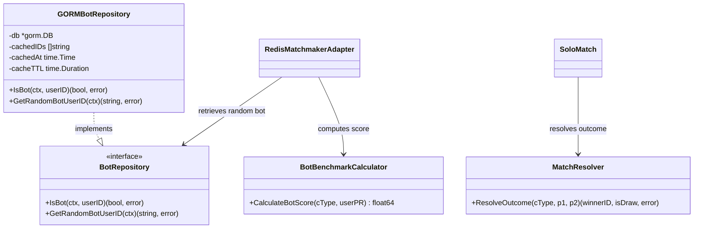

# Thiết Kế Hệ Thống — Module Solo Match (System Design)

Tài liệu này đặc tả chi tiết kiến trúc kỹ thuật của Bounded Context **Solo Match** theo mô hình **Hexagonal Architecture (Ports & Adapters)** và các tiêu chuẩn khắt khe trong `AGENTS.md`.

---

## 1. Kiến Trúc Hexagonal (Ports & Adapters)

Toàn bộ mã nguồn của module được đóng gói hoàn toàn trong `/internal/solo_match/`:

```
internal/solo_match/
├── domain/                      # LÕI NGHIỆP VỤ (Pure Go, không ORM/JSON tag)
│   ├── aggregate/               # SoloMatch (Aggregate Root), MatchmakingTicket
│   ├── entity/                  # MatchParticipant, UserSnapshot
│   ├── value_object/            # MatchStatus, MatchResult, ChallengeType, ExerciseChallenge, ParticipantScore
│   ├── event/                   # DomainEvent interface, SoloMatchStarted, SoloMatchCompleted, SoloMatchForfeited
│   ├── repository/              # Ports (Interfaces): SoloMatchRepository, UserSnapshotRepository, OutboxRepository, OutboxLogRepository
│   ├── service/                 # Domain Services: MatchResolver, BotBenchmarkCalculator
│   └── derror/                  # Domain Business Errors (ErrMatchNotActive, ErrParticipantNotFound, ...)
│
├── application/                 # APPLICATION LAYER (Điều phối use cases theo CQRS)
│   ├── command/                 # Command Handlers: JoinMatchmakingQueue, CancelMatchmaking, RecordParticipantResult, FastForfeitMatch, HandleMatchTimeout, SyncUserSnapshot
│   ├── query/                   # Query Handlers: GetSoloMatchByID, GetUserMatchHistory, GetActiveMatch
│   ├── port/                    # Inbound/Outbound Ports: MatchmakerQueuePort, UserPRProvider, ExerciseProvider, BotBenchmarkProvider, TxManager, EventPublisher
│   └── dto/                     # Data Transfer Objects (SoloMatchDTO, ParticipantDTO, TicketDTO)
│
├── infrastructure/              # ADAPTERS NGOÀI (Triển khai công nghệ)
│   ├── matchmaker/              # Redis Matchmaker Adapter (ZSet + Lua Script + Pub/Sub), miniredis test
│   ├── persistence/             # GORM Repositories (PostgreSQL schema solo_match.*)
│   │   ├── gorm_solo_match_repository.go
│   │   ├── gorm_user_snapshot_repository.go
│   │   ├── gorm_outbox_repository.go       # Khóa FOR UPDATE SKIP LOCKED
│   │   ├── gorm_outbox_log_repository.go   # Idempotent event logger
│   │   ├── models.go                       # GORM Entities
│   │   ├── mapper.go                       # Mapping Domain <-> Persistence
│   │   └── tx_manager.go                   # Quản lý Database Transaction
│   ├── publisher/               # Outbox Publisher đẩy CloudEvents sang Kafka
│   ├── exercise_client/         # Exercise Catalog Client Port Implementation
│   ├── workout_client/          # Workout Execution Client / PR Provider Adapter
│   └── event/                   # Outbox Writer Adapter
│
├── transport/                   # DRIVING ADAPTERS (Giao diện ra bên ngoài)
│   ├── grpc/                    # gRPC & ConnectRPC Service Handler (JoinQueue Streaming, GetMatch, ...)
│   │   ├── server.go            # Đăng ký Service với gRPC Server
│   │   ├── handler.go           # Triển khai RPC Handlers chuẩn gRPC
│   │   ├── connect.go           # Triển khai ConnectRPC Handlers
│   │   └── mapper.go            # Chuyển đổi DTO <-> Protobuf Messages
│   └── consumer/                # Kafka Consumers (Unpack CloudEvents)
│       ├── workout_completed_consumer.go
│       ├── workout_aborted_consumer.go
│       ├── user_registered_consumer.go
│       └── user_identity_updated_consumer.go
│
├── docs/                        # TÀI LIỆU KỸ THUẬT DỰ ÁN
└── module.go                    # ENTRYPOINT DEPENDENCY INJECTION CỦA MODULE
```

---

## 2. Thiết Kế Cơ Sở Dữ Liệu (PostgreSQL Schema: `solo_match.*`)

Áp dụng quy chuẩn **Schema Isolation**, toàn bộ bảng dữ liệu nằm trong schema `solo_match` (Migration: `13-create-solo-match-tables.sql`):

```sql
CREATE SCHEMA IF NOT EXISTS solo_match;

-- 1. Bảng User Snapshot (Bản sao danh tính siêu tốc)
CREATE TABLE IF NOT EXISTS solo_match.user_snapshots (
    user_id VARCHAR(64) PRIMARY KEY,
    display_name VARCHAR(128) NOT NULL,
    avatar_url TEXT NOT NULL DEFAULT '',
    synced_at TIMESTAMP WITH TIME ZONE NOT NULL DEFAULT NOW()
);

-- 2. Bảng Solo Matches (Quản lý trận đấu và kết quả chung cuộc)
CREATE TABLE IF NOT EXISTS solo_match.solo_matches (
    id VARCHAR(64) PRIMARY KEY,
    exercise_id VARCHAR(64) NOT NULL,
    exercise_name VARCHAR(128) NOT NULL,
    challenge_type VARCHAR(32) NOT NULL, -- 'REPS' hoặc 'DURATION'
    status VARCHAR(32) NOT NULL,         -- 'IN_PROGRESS', 'COMPLETED', 'FORFEITED', 'CANCELLED'
    winner_id VARCHAR(64) NULL,          -- NULL nếu đang diễn ra hoặc kết quả HÒA (DRAW)
    is_draw BOOLEAN NOT NULL DEFAULT FALSE,
    timeout_at TIMESTAMP WITH TIME ZONE NOT NULL,
    started_at TIMESTAMP WITH TIME ZONE NOT NULL DEFAULT NOW(),
    ended_at TIMESTAMP WITH TIME ZONE NULL,
    created_at TIMESTAMP WITH TIME ZONE NOT NULL DEFAULT NOW(),
    updated_at TIMESTAMP WITH TIME ZONE NOT NULL DEFAULT NOW()
);

CREATE INDEX idx_solo_matches_status ON solo_match.solo_matches(status);
CREATE INDEX idx_solo_matches_timeout ON solo_match.solo_matches(timeout_at) WHERE status = 'IN_PROGRESS';

-- 3. Bảng Người Tham Gia Trận Đấu
CREATE TABLE IF NOT EXISTS solo_match.match_participants (
    id VARCHAR(64) PRIMARY KEY,
    match_id VARCHAR(64) NOT NULL REFERENCES solo_match.solo_matches(id) ON DELETE CASCADE,
    user_id VARCHAR(64) NOT NULL,
    score DOUBLE PRECISION NOT NULL DEFAULT 0,
    is_completed BOOLEAN NOT NULL DEFAULT FALSE,
    completed_at TIMESTAMP WITH TIME ZONE NULL,
    result VARCHAR(32) NOT NULL DEFAULT 'PENDING', -- 'PENDING', 'WIN', 'LOSE', 'DRAW', 'FORFEITED'
    created_at TIMESTAMP WITH TIME ZONE NOT NULL DEFAULT NOW(),
    updated_at TIMESTAMP WITH TIME ZONE NOT NULL DEFAULT NOW(),
    CONSTRAINT uniq_match_participant_user UNIQUE (match_id, user_id)
);

CREATE INDEX idx_match_participants_user_id ON solo_match.match_participants(user_id);

-- 4. Bảng Transactional Outbox Events
CREATE TABLE IF NOT EXISTS solo_match.outbox_events (
    id VARCHAR(64) PRIMARY KEY,
    event_id VARCHAR(64) NOT NULL UNIQUE,
    aggregate_type VARCHAR(64) NOT NULL,
    aggregate_id VARCHAR(64) NOT NULL,
    event_type VARCHAR(128) NOT NULL,
    payload JSONB NOT NULL,
    partition_key VARCHAR(128) NOT NULL,
    status VARCHAR(32) NOT NULL DEFAULT 'PENDING',
    retry_count INT NOT NULL DEFAULT 0,
    locked_until TIMESTAMP WITH TIME ZONE NULL,
    created_at TIMESTAMP WITH TIME ZONE NOT NULL DEFAULT NOW(),
    published_at TIMESTAMP WITH TIME ZONE NULL
);

CREATE INDEX idx_solo_match_outbox_fetch ON solo_match.outbox_events(status, locked_until, created_at);

-- 5. Bảng Idempotent Consumer Outbox Logs
CREATE TABLE IF NOT EXISTS solo_match.outbox_logs (
    event_id VARCHAR(64) PRIMARY KEY,
    consumer_name VARCHAR(128) NOT NULL,
    status VARCHAR(32) NOT NULL DEFAULT 'PROCESSED',
    processed_at TIMESTAMP WITH TIME ZONE NOT NULL DEFAULT NOW()
);
```

---

## 3. Thiết Kế Pure Redis In-Memory Matchmaker (ZSet + Lua Script + Pub/Sub)

Để đạt hiệu năng ghép trận < 5ms và loại bỏ hoàn toàn gánh nặng I/O lên PostgreSQL khi người dùng vào/ra hàng đợi, hệ thống sử dụng 100% Redis RAM:

### 3.1. Cấu trúc lưu trữ vé (Redis Sorted Set)
- **Key**: `solo_match:queue:waiting`
- **Member**: Chuỗi định dạng `{ticketId}:{userId}`.
- **Score**: Unix timestamp thời điểm gia nhập (`float64(ticket.JoinedAt().Unix())`).
- **Ưu điểm**: Tự động sắp xếp người chơi theo nguyên tắc FIFO (ai vào trước được ghép trước), tra cứu và bốc cặp $O(\log N)$.

### 3.2. Thuật toán bốc cặp nguyên tử (Atomic Lua Script)
Để tránh tình trạng race condition khi nhiều instance/worker cùng truy cập hàng đợi, thao tác bốc 2 vé đầu hàng được đóng gói trong một Lua script duy nhất:

```lua
local members = redis.call('ZRANGE', KEYS[1], 0, 1)
if #members == 2 then
    redis.call('ZREM', KEYS[1], members[1], members[2])
    return members
end
return nil
```
- Khi chạy qua `EVAL`, Redis bảo đảm tính đơn luồng (Single-Threaded Atomicity), triệt tiêu hoàn toàn khả năng 1 vé bị ghép 2 lần.

### 3.3. Đánh thức luồng Stream qua Redis Pub/Sub
- **Kênh lắng nghe**: `solo_match:events:{ticketId}`
- Khi client gọi RPC `JoinQueue`, server đăng ký `SUBSCRIBE` vào kênh riêng của vé đó và đưa goroutine vào trạng thái ngủ (Sleep, 0% CPU, 0 DB Query).
- Khi worker ghép trận thành công, nó gửi thông điệp `PUBLISH` kèm ID trận đấu. Goroutine ngay lập tức thức dậy, truy vấn chi tiết trận đấu, đẩy gói tin `MatchFound` qua gRPC Server-Streaming về app và kết thúc stream an toàn.

### 3.4. Cơ chế Điều Phối Worker: Hybrid Trigger Engine (Sự Kiện Kép)
Worker `RedisMatchmakerAdapter.workerLoop()` chạy ngầm liên tục và được kích hoạt bởi 2 nguồn sự kiện:
1. **Event-driven Trigger (Tức thì khi người dùng Enqueue vé)**:
   - Ngay khi API ghi vé vào Redis ZSet qua `Enqueue()`, API gửi tín hiệu nội bộ qua Go channel `triggerCh <- struct{}{}`.
   - Worker thức dậy ngay tức khắc để chạy `matchPairs()` (Lua script). Nếu đã có người chờ sẵn, 2 người chơi được ghép cặp trong **vài miligiây (Zero Latency)** mà không cần chờ hết chu kỳ Ticker.
2. **Periodic Ticker (Định kỳ mỗi 250ms - Fallback & Bot Sweep)**:
   - Worker chạy timer `time.NewTicker(pollInterval)` mỗi 250ms (cấu hình trong `module.go`) để:
     - Quét lại `matchPairs()` (dọn các vé chưa kịp ghép phòng trường hợp channel buffer đầy).
     - Quét `fallbackBots()`: Bốc các vé lẻ đã đợi quá hạn chót 5 phút (`score <= now - 5 minutes`) để ghép với System Bot.

---

## 4. Thiết Kế System Bot Pool & Bot Benchmark Calculator



1. **Kho tài khoản Bot hệ thống (System Bot Pool)**:
   - Các tài khoản Bot được đăng ký chính thức qua Auth API bởi [`bot_seeder.go`](../../../shared/seeder/bot_seeder.go) (`DefaultBotProfiles`: Alex Vance, Sarah Jenkins, Leo Martinez, Maya Lin, Marcus Stone...) và lưu trữ tại bảng `solo_match.system_bots` kèm bản ghi `solo_match.user_snapshots`.
   - [`GORMBotRepository`](../../infrastructure/persistence/gorm_bot_repository.go) bốc ngẫu nhiên 1 `user_id` bot đang kích hoạt (`is_active = true`), đồng thời lưu đệm trên In-Memory Cache (TTL 1 tháng) để phục vụ với chi phí truy vấn $O(1)$ mà không tạo áp lực lên PostgreSQL.
2. **Thuật toán tính điểm Bot (`BotBenchmarkCalculator`)**:
   - Được triển khai chuẩn xác theo mã nguồn tại [`bot_benchmark_calculator.go`](../../domain/service/bot_benchmark_calculator.go):
     - Nếu người chơi có dữ liệu Kỷ lục cá nhân (PR > 0): Điểm Bot bằng chính điểm PR của người chơi (`*userPR`).
     - Nếu người chơi chưa có PR (`userPR == nil` hoặc $\le 0$):
       - Bài tập tính thời gian (`DURATION`): `DefaultBotDuration = 300.0` (giây - 5 phút).
       - Bài tập đếm số rep (`REPS`): `DefaultBotReps = 5.0` (lần).
3. **Quy trình hoàn tất Bot trong trận đấu**:
   - Khi tạo trận, hệ thống tính sẵn `botScore` và ghi nhận hoàn thành ngay cho Bot (`pBot.RecordResult(botScore, now)`). Người chơi sau khi tập xong nộp kết quả, `MatchResolver` sẽ so sánh trực tiếp với điểm Bot để phân định Thắng / Thua / Hòa.

---

## 5. Transactional Outbox Pattern & CDC Poller

Module áp dụng triệt để Transactional Outbox để loại bỏ bài toán Dual-Write (vừa ghi DB vừa bắn Kafka):

1. **Ghi đồng thời**: Mọi thay đổi trạng thái chốt kết quả của Aggregate `SoloMatch` và sự kiện Domain (`SoloMatchCompleted`, `SoloMatchForfeited`) được lưu trong **cùng 1 Database Transaction** qua `OutboxWriter`.
2. **Khóa chống tranh chấp (Pessimistic Locking)**:
   ```sql
   SELECT * FROM solo_match.outbox_events 
   WHERE status = 'PENDING' AND (locked_until IS NULL OR locked_until < NOW())
   ORDER BY created_at ASC 
   LIMIT 50 
   FOR UPDATE SKIP LOCKED;
   ```
3. **Kafka Publishing**: `OutboxPublisher` định kỳ mỗi 2 giây (`2*time.Second`) lấy batch tối đa 50 bản ghi (khóa `locked_until` 10 giây), giải mã và đẩy lên Kafka topic `solo_match.events` với partition key là `matchId`. Sau khi Kafka ACK thành công, đánh dấu `status = 'PUBLISHED'`.

---

## 6. Chuẩn Hóa API Contract-First (Protobuf / gRPC)

Tất cả API được định nghĩa tại `proto/contracts/core/solo_match/v1/`:

| RPC Method | Loại giao thức | Đường dẫn REST Gateway | Chức năng nghiệp vụ |
| :--- | :--- | :--- | :--- |
| **`JoinQueue`** | Server-Streaming | `POST /api/v1/solo-matches/queue` | Vào hàng đợi và giữ kết nối stream nhận thông báo tìm thấy trận. |
| **`CancelQueue`** | Unary RPC | `POST /api/v1/solo-matches/queue/cancel` | Rời khỏi hàng đợi tìm trận. |
| **`GetMatch`** | Unary RPC | `GET /api/v1/solo-matches/{match_id}` | Xem chi tiết trận đấu, bài tập, người tham gia và kết quả. |
| **`GetMatchHistory`** | Unary RPC | `GET /api/v1/solo-matches/history` | Xem danh sách lịch sử các trận đấu đã tham gia của người dùng. |

---

## 7. Tổng Hợp Các Kỹ Thuật Độc Quyền Của Solo Match (Exclusive Technical Innovations)

Phân hệ `solo_match` sở hữu 8 kỹ thuật kiến trúc chuyên biệt, độc nhất trong toàn bộ hệ thống Gym Companion:

| Kỹ thuật chuyên biệt | Vấn đề kỹ thuật giải quyết | Giải pháp kiến trúc áp dụng | Hiệu quả đạt được |
| :--- | :--- | :--- | :--- |
| **1. Pure Redis In-Memory Matchmaker** | Gánh nặng I/O DB và nghẽn cổ chai khi hàng nghìn người cùng tìm/hủy trận liên tục. | Sử dụng **Redis Sorted Set (`ZSet`)** với Score là millisecond timestamp. Tuyệt đối không ghi vé tạm xuống PostgreSQL. | Giảm 100% tải I/O ghi đĩa DB cho việc tìm trận; độ trễ ghép cặp đạt mức **< 5ms**. |
| **2. Atomic Dequeue qua Lua Script** | Race condition (tranh chấp dữ liệu) giữa nhiều Pod / Instance khi cùng bốc vé người chơi. | Đóng gói logic bốc 2 vé đầu và xóa vé trong 1 đoạn **Lua Script nguyên tử** thực thi đơn luồng trên Redis. | Triệt tiêu 100% nguy cơ trùng lặp vé (1 vé không bao giờ bị bốc 2 lần), hỗ trợ Scale ngang vô hạn. |
| **3. Non-Blocking Stream Wakeup (Pub/Sub)** | Tốn CPU và lãng phí tài nguyên mạng do Busy Polling hoặc Sleep Loop trong luồng gRPC Stream. | Luồng stream `JoinQueue` của server thực hiện `SUBSCRIBE` kênh riêng `solo_match:events:{ticketId}` và rơi vào trạng thái ngủ. | **0% CPU và 0 Query DB** trong thời gian chờ; đánh thức tức thì (< 1ms) khi Worker tìm thấy đối thủ. |
| **4. System Bot Pool & Benchmark Calculator** | Người chơi chờ đợi vô hạn khi ít người online; bot chơi quá yếu hoặc bất khả thi. | Tự động kích hoạt sau **5 phút**. Bốc ngẫu nhiên tài khoản Bot cấu hình sẵn trong DB qua In-Memory Cache $O(1)$ (ẩn cờ `is_bot`). Điểm Bot neo theo PR thực tế: $\text{Bot} = \text{UserPR}$ (hoặc fallback 5 reps / 300s). | Trải nghiệm thi đấu luôn sẵn sàng 24/7; hiệu năng bốc bot $O(1)$ không tốn DB; chống lộ danh tính AI. |
| **5. Two-Tier Forfeit Mechanism** | Đối thủ thoát game hoặc ngắt mạng khiến người chơi còn lại bị ức chế vì phải chờ hết giờ. | **Tầng 1 (Fast Forfeit)**: Bắt event `WorkoutSessionAborted` xử thắng ngay lập tức.<br>**Tầng 2 (Safety Net)**: Daemon worker quét định kỳ `timeout_at <= NOW()` xử lý Ghost Player / AFK. | Người chơi nghiêm túc được trao thưởng chiến thắng ngay lập tức mà không phải chờ đợi lãng phí. |
| **6. Consumer Idempotency Logging** | Trùng lặp xử lý kết quả khi Kafka Rebalance hoặc At-least-once delivery retry. | Duy trì bảng `solo_match.outbox_logs`. Kiểm tra `IsProcessed(eventID)` trước khi thực thi nghiệp vụ nộp điểm. | Đảm bảo tính lũy đẳng (Idempotency) tuyệt đối; ngăn chặn việc cộng cúp hoặc tính điểm Elo nhiều lần. |
| **7. Transactional Outbox Pattern** | Rủi ro Dual-Write khi vừa ghi PostgreSQL vừa bắn Kafka message. | Lưu Aggregate & Outbox Event chung trong 1 Transaction. Worker bốc theo batch với khóa không chặn `FOR UPDATE SKIP LOCKED`. | Đảm bảo tính nhất quán dữ liệu (ACID) 100%; hỗ trợ Scale ngang nhiều publisher cùng lúc. |
| **8. Active Match Guard** | Người dùng spam tìm trận mới trong khi đang có một trận đấu dang dở (`IN_PROGRESS`). | Chặn tại Application Handler bằng `FindActiveByUserID`, trả về gRPC `codes.FailedPrecondition` (HTTP 412/400). | Chống gian lận thoát trận, tránh rác dữ liệu, cung cấp trải nghiệm điều hướng thông minh cho Mobile/Web. |

> 📖 **Xem tài liệu kỹ thuật chuyên sâu**: Để xem chi tiết mã nguồn triển khai, phân tích độ phức tạp thuật toán và sơ đồ tương tác của từng kỹ thuật, vui lòng đọc tại [Tài Liệu Kỹ Thuật Chuyên Sâu (Technical Deep Dive)](./technical_innovations.md).


