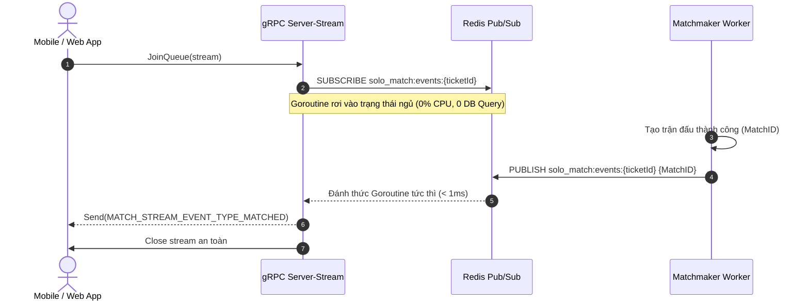

# Các Kỹ Thuật Chuyên Biệt — Module Solo Match (Technical Deep Dive)

Tài liệu này đặc tả chi tiết các giải pháp kỹ thuật chuyên sâu được triển khai trong Bounded Context **Solo Match**, giải thích lý do thiết kế, phân tích độ phức tạp thuật toán và cơ chế concurrency giải quyết các bài toán cốt lõi của hệ thống.

---

## Mục Lục
1. [Kỹ Thuật 1: Pure Redis In-Memory Matchmaker (ZSet FIFO)](#1-kỹ-thuật-1-pure-redis-in-memory-matchmaker-zset-fifo)
2. [Kỹ Thuật 2: Atomic Dequeue qua Lua Script (Chống Race Condition Khi Scale Ngang)](#2-kỹ-thuật-2-atomic-dequeue-qua-lua-script-chống-race-condition-khi-scale-ngang)
3. [Kỹ Thuật 3: Non-Blocking Stream Wakeup via Redis Pub/Sub & gRPC Server-Streaming](#3-kỹ-thuật-3-non-blocking-stream-wakeup-via-redis-pubsub--grpc-server-streaming)
4. [Kỹ Thuật 4: System Bot Pool & In-Memory Cache O(1) Kết Hợp Dynamic PR Benchmark](#4-kỹ-thuật-4-system-bot-pool--in-memory-cache-o1-kết-hợp-dynamic-pr-benchmark)
5. [Kỹ Thuật 5: Two-Tier Forfeit Architecture (Fast Forfeit Stream + Timeout Daemon)](#5-kỹ-thuật-5-two-tier-forfeit-architecture-fast-forfeit-stream--timeout-daemon)
6. [Kỹ Thuật 6: Transactional Outbox Pattern với FOR UPDATE SKIP LOCKED](#6-kỹ-thuật-6-transactional-outbox-pattern-với-for-update-skip-locked)
7. [Kỹ Thuật 7: Consumer Idempotency Logging (Lũy Đẳng Tuyệt Đối)](#7-kỹ-thuật-7-consumer-idempotency-logging-lũy-đẳng-tuyệt-đối)
8. [Kỹ Thuật 8: Active Match Guard (Kiểm Soát Trạng Thái Tiên Quyết)](#8-kỹ-thuật-8-active-match-guard-kiểm-soát-trạng-thái-tiên-quyết)

---

## 1. Kỹ Thuật 1: Pure Redis In-Memory Matchmaker (ZSet FIFO)

### 1.1. Bối cảnh & Vấn đề kỹ thuật
Trong các hệ thống tìm trận thông thường, cách làm ngây thơ (naive approach) là lưu các vé tìm trận (Matchmaking Tickets) vào một bảng trong Cơ sở dữ liệu quan hệ (PostgreSQL / MySQL) với cờ `status = 'WAITING'`, sau đó một background cron job định kỳ chạy câu truy vấn:
```sql
-- ANTI-PATTERN: Gây nghẽn cổ chai I/O cực lớn
SELECT * FROM tickets WHERE status = 'WAITING' ORDER BY created_at ASC LIMIT 2 FOR UPDATE;
```
Khi có 5.000 – 10.000 người dùng đồng thời tìm trận, hủy trận hoặc rớt mạng:
* Tần suất ghi/xóa vé tạm thời (ephemeral data) tạo ra hàng triệu transaction ghi đĩa, gây phình to WAL logs và làm cạn kiệt Connection Pool của Database.
* Khóa dòng (Row Locking) trên bảng chung gây hiện tượng tranh chấp (lock contention) và timeout.

### 1.2. Giải pháp kiến trúc
Solo Match loại bỏ **100% việc ghi vé tạm xuống PostgreSQL**, chuyển toàn bộ vòng đời vé chờ lên bộ nhớ RAM của Redis bằng cấu trúc dữ liệu **Sorted Set (`ZSet`)**:
* **Redis Key**: `solo_match:queue:waiting`
* **Score**: Unix timestamp thời điểm gia nhập hàng đợi (`time.Now().UTC().Unix()`). Score đóng vai trò là chỉ số sắp xếp thời gian tự nhiên (FIFO).
* **Member Value**: Chuỗi định danh kết hợp `{ticketID}:{userID}`.

```
Key: "solo_match:queue:waiting"
┌─────────────────────────────────────────────────────────────┐
│ Score: 1774080001  Member: "ticket_111:user_player_A"       │  <-- Đầu hàng (Vào trước)
│ Score: 1774080004  Member: "ticket_222:user_player_B"       │
│ Score: 1774080010  Member: "ticket_333:user_player_C"       │  <-- Cuối hàng (Vào sau)
└─────────────────────────────────────────────────────────────┘
```

### 1.3. Hiệu quả đạt được
* **Tải I/O Database**: Giảm từ hàng nghìn write/sec xuống **0 write/sec**. Database chỉ được ghi đúng 1 lần khi trận đấu đã được tạo thành công (`solo_matches`).
* **Độ trễ thao tác**: Lệnh `ZADD` (thêm vé) và `ZREM` (hủy vé) có độ phức tạp thuật toán $O(\log N)$, phản hồi trong **< 1ms**.

---

## 2. Kỹ Thuật 2: Atomic Dequeue qua Lua Script (Chống Race Condition Khi Scale Ngang)

### 2.1. Vấn đề tranh chấp dữ liệu khi chạy Multi-Instance
Khi triển khai hệ thống trên Kubernetes hoặc môi trường đa Container, có nhiều instance backend chạy song song. Nếu worker dùng các lệnh Redis riêng rẽ:
1. Pod 1: `ZRANGE solo_match:queue:waiting 0 1` $\rightarrow$ Lấy vé A và vé B.
2. Pod 2: `ZRANGE solo_match:queue:waiting 0 1` $\rightarrow$ Cũng lấy vé A và vé B (trước khi Pod 1 kịp xóa).
3. Cả hai Pod cùng tạo trận đấu cho vé A và vé B $\rightarrow$ **Ghép trùng trận (Duplicate Match)**, làm sập trạng thái của cả hai người chơi.

Dùng Distributed Lock (như Redlock) sẽ làm tăng độ trễ mạng và dễ gặp rủi ro Deadlock nếu container bị crash giữa chừng.

### 2.2. Giải pháp Lua Script nguyên tử đơn luồng
Redis xử lý lệnh theo mô hình đơn luồng (Single-Threaded Event Loop). Bất kỳ đoạn mã Lua script nào thực thi qua lệnh `EVAL` đều được đảm bảo **tính nguyên tử tuyệt đối (Atomicity)**: Không có bất kỳ lệnh Redis nào khác có thể chen ngang trong suốt quá trình script chạy.

#### A. Lua Script bốc cặp 2 người (PvP Match):
```lua
local members = redis.call('ZRANGE', KEYS[1], 0, 1)
if #members == 2 then
    redis.call('ZREM', KEYS[1], members[1], members[2])
    return members
end
return {}
```
* **Luật thực thi**: Nếu hàng đợi có $\ge 2$ vé, script lấy chính xác 2 vé đầu và xóa ngay lập tức khỏi ZSet trong cùng 1 chu kỳ CPU của Redis.
* **Đảm bảo**: Một vé một khi đã bốc ra thì không có Pod nào khác có thể nhìn thấy hay bốc lại được nữa.

#### B. Lua Script bốc vé lẻ kích hoạt Bot Fallback:
```lua
local members = redis.call('ZRANGEBYSCORE', KEYS[1], '-inf', ARGV[1], 'LIMIT', 0, 1)
if #members >= 1 then
    redis.call('ZREM', KEYS[1], members[1])
    return members[1]
end
return ""
```
* **Tham số `ARGV[1]`**: Ngưỡng thời gian quá hạn `threshold = now - 5 minutes`.
* Rút chính xác 1 vé lẻ đã đợi quá 5 phút và xóa khỏi ZSet để tiến hành ghép với Bot.

### 2.3. Cơ chế Điều Phối Worker: Hybrid Trigger Engine (Sự Kiện Kép)

Nhằm tối ưu hóa trải nghiệm người dùng không phải chờ đợi dù chỉ 1 tick, worker `RedisMatchmakerAdapter` áp dụng cơ chế kích hoạt lai (Hybrid Trigger):
1. **Event-driven Trigger (Tức thì khi người dùng Enqueue vé)**:
   - Ngay khi API ghi vé thành công vào Redis ZSet (`ZADD`), hệ thống lập tức gửi một tín hiệu không khóa (non-blocking) qua kênh Go channel:
     ```go
     select {
     case a.triggerCh <- struct{}{}:
     default: // Nếu buffer đang bận, bỏ qua vì worker đang bận xử lý
     }
     ```
   - Worker lắng nghe `case <-a.triggerCh` sẽ thức dậy ngay lập tức và gọi `matchPairs()`. Nếu đã có đối thủ đang chờ sẵn trong hàng đợi, 2 người chơi sẽ được ghép cặp chỉ trong **vài miligiây (Zero Latency)** mà không cần đợi hết chu kỳ Ticker.
2. **Periodic Ticker Trigger (Định kỳ mỗi 250ms - Fallback & Sweep)**:
   - Worker duy trì `ticker := time.NewTicker(a.pollInterval)` (cấu hình mặc định `250*time.Millisecond` tại `module.go`):
     ```go
     case <-ticker.C:
         a.matchPairs()   // Dọn dẹp vé tồn sót (phòng trường hợp race condition hoặc buffer đầy)
         a.fallbackBots() // Quét và rút các vé lẻ đã đợi quá 5 phút để ghép với Bot
     ```
   - Đảm bảo tính chịu lỗi tuyệt đối (Fault Tolerance): Ngay cả khi tín hiệu kênh nội bộ bị miss, vòng quét 250ms vẫn xử lý triệt để toàn bộ vé và tự động chuyển giao vé sang System Bot Pool khi quá hạn 5 phút.

---

## 3. Kỹ Thuật 3: Non-Blocking Stream Wakeup via Redis Pub/Sub & gRPC Server-Streaming

### 3.1. Vấn đề tài nguyên khi giữ kết nối Streaming
gRPC Server-Streaming cho phép server đẩy dữ liệu về client liên tục. Tuy nhiên, nếu server dùng vòng lặp bận (Busy Polling):
```go
// ANTI-PATTERN: Tiêu tốn 100% CPU và I/O mạng
for {
    match := checkDatabaseIfMatched(ticketID)
    if match != nil { break }
    time.Sleep(100 * time.Millisecond)
}
```
Hàng nghìn kết nối cùng polling sẽ nhanh chóng vắt kiệt CPU server.

### 3.2. Cơ chế Sleep & Wakeup qua Pub/Sub
Solo Match thiết kế kênh lắng nghe riêng biệt theo từng vé: `solo_match:events:{ticketId}`:



1. **Trạng thái ngủ**: Luồng stream đăng ký nhận message từ channel `solo_match:events:{ticketId}` qua Go channel `pubsub.Channel()`. Goroutine bị block ở lệnh `select` mà không tốn chu kỳ tính toán của CPU.
2. **Heartbeat định kỳ**: Server duy trì ticker 1 giây để gửi sự kiện `MATCH_STREAM_EVENT_TYPE_QUEUED` kèm số giây đã trôi qua (`elapsed_seconds`), giúp app hiển thị đồng hồ đếm thời gian mượt mà.
3. **Đánh thức tức thì**: Ngay khi Worker tạo trận thành công, Worker phát lệnh `PUBLISH`. Luồng stream thức dậy ngay lập tức (< 1ms), truy vấn chi tiết trận và gửi về cho Client.
4. **Tự động dọn dẹp khi ngắt kết nối (Graceful Cleanup)**:
   Nếu người dùng chủ động tắt app hoặc mất mạng, `stream.Context().Done()` được kích hoạt. Khối `defer` tự động thu hồi vé khỏi Redis ZSet và hủy đăng ký Pub/Sub:
   ```go
   defer a.Cancel(ctx, ticket.ID(), ticket.UserID())
   ```

---

## 4. Kỹ Thuật 4: System Bot Pool & In-Memory Cache O(1) Kết Hợp Dynamic PR Benchmark

### 4.1. Bản chất kiến trúc System Bot
Thay vì sinh ngẫu nhiên các chuỗi text ảo on-the-fly (dẫn tới việc dữ liệu bot không nhất quán giữa các lần xem lịch sử đấu), Solo Match triển khai mô hình **System Bot Pool**:
* **Bảng `solo_match.system_bots`**: Chứa danh sách các tài khoản Bot hệ thống định danh rõ ràng.
* **Khởi tạo dữ liệu**: Đăng ký các tài khoản Bot thông qua API Auth chính thức của hệ thống (`DefaultBotProfiles`: Alex Vance, Sarah Jenkins, Leo Martinez, Maya Lin, Marcus Stone...) với avatar người thật, tên tuổi tự nhiên và giới tính.
* **Đồng bộ bảng Snapshot**: Mỗi Bot đều có một bản ghi hợp lệ trong `solo_match.user_snapshots`.
* **Tuyệt đối ẩn danh AI**: Trong Protobuf Contract (`ParticipantView`), không có bất kỳ cờ `is_bot` nào. Client hiển thị đối thủ mượt mà như một gymer thật.

### 4.2. In-Memory Cache TTL 1 tháng ($O(1)$)
Để tránh việc bốc Bot phải dùng lệnh quét ngẫu nhiên tốn kém trong SQL (`SELECT user_id FROM system_bots ORDER BY RANDOM() LIMIT 1` gây full table scan):
* `GORMBotRepository` lưu danh sách `cachedIDs []string` trực tiếp trên RAM server với `sync.RWMutex`.
* TTL đệm lên tới **30 ngày**.
* Khi cần bốc Bot, hàm thực hiện truy xuất mảng ngẫu nhiên trong bộ nhớ:
  $$\text{chosenID} = \text{cachedIDs}[\text{rand.IntN}(\text{len}(\text{cachedIDs}))]$$
* Đạt độ phức tạp thời gian **$O(1)$**, độ trễ **< 0.01ms**, hoàn toàn miễn nhiễm tải đối với PostgreSQL.

### 4.3. Thuật toán Dynamic PR Benchmark
Điểm số của Bot không sinh bừa bãi mà được tính toán dựa trên năng lực thực tế của người chơi:
```go
func (c *BotBenchmarkCalculator) CalculateBotScore(
    cType valueobject.ChallengeType,
    userPR *float64,
) float64 {
    if userPR != nil && *userPR > 0 {
        return *userPR // Neo chuẩn theo thành tích tốt nhất của chính người chơi
    }
    if cType == valueobject.ChallengeTypeDuration {
        return DefaultBotDuration // 300.0 giây (5 phút)
    }
    return DefaultBotReps // 5.0 reps
}
```
* **Kịch bản 1 (Người chơi có PR)**: Bot lấy mục tiêu bằng đúng Kỷ lục cá nhân gần nhất của người chơi trên bài tập đó. Tạo ra trận đấu kịch tính nơi người chơi phải phá vỡ kỷ lục của chính mình để giành chiến thắng.
* **Kịch bản 2 (Người chơi mới chưa có PR)**: Gán mốc an toàn mặc định (5 reps hoặc 300 giây).
* **Đóng gói hoàn thành sớm**: Ngay khi tạo trận với Bot, hệ thống gán trước điểm số và đánh dấu hoàn thành cho Bot (`pBot.RecordResult(botScore, now)`). Khi người chơi tập xong nộp bài, hệ thống so khớp ngay mà không cần xử lý ngầm thêm bất kỳ worker nào cho Bot.

---

## 5. Kỹ Thuật 5: Two-Tier Forfeit Architecture (Fast Forfeit Stream + Timeout Daemon)

### 5.1. Vấn đề người chơi bỏ cuộc / ngắt kết nối
Trong thể thức thi đấu đối kháng thể lực trực tiếp, trải nghiệm tồi tệ nhất của người dùng là đối thủ thoát trận (hoặc tắt camera) nhưng hệ thống lại bắt người còn lại phải tập luyện và chờ đợi hết toàn bộ thời gian trận đấu (5 – 10 phút) mới được nhận chiến thắng.

### 5.2. Kiến trúc xử phạt hai tầng (Two-Tier Architecture)

```
                              ┌──────────────────────────────────────────────┐
                              │             Sự Cố Trong Trận Đấu             │
                              └──────────────────────┬───────────────────────┘
                                                     │
                         ┌───────────────────────────┴───────────────────────────┐
                         │                                                       │
                 (Chủ động thoát)                                        (Mất mạng ngầm / AFK)
                         │                                                       │
                         ▼                                                       ▼
        ┌──────────────────────────────────┐                    ┌──────────────────────────────────┐
        │  TẦNG 1: FAST FORFEIT (SỰ KIỆN)  │                    │  TẦNG 2: SAFETY NET (DAEMON)     │
        ├──────────────────────────────────┤                    ├──────────────────────────────────┤
        │ WorkoutSessionAborted Event      │                    │ Timeout Worker quét định kỳ      │
        │ Kafka Topic: workout.events      │                    │ SELECT WHERE timeout_at <= NOW() │
        │ Độ trễ: < 500ms                  │                    │ Chu kỳ: 30 giây                  │
        │ Xử Thua bên thoát, Trao Thắng    │                    │ Thu dọn các trận mồ côi (Ghost)  │
        │ ngay lập tức cho người còn lại   │                    │ Xử FORFEITED an toàn             │
        └──────────────────────────────────┘                    └──────────────────────────────────┘
```

1. **Tầng 1 — Fast Forfeit Tức Thì (< 500ms)**:
   - Khi Người chơi A ấn nút *"Bỏ cuộc"* hoặc AI Camera phát hiện mất kết nối quá thời hạn quy định, module `workout_execution` phát CloudEvent `WorkoutSessionAborted`.
   - `workout_aborted_consumer` của Solo Match lập tức tiêu thụ sự kiện, kích hoạt `RecordParticipantAbortHandler`.
   - Hệ thống đánh dấu Người chơi A là `FORFEITED` / `LOSE`, đồng thời xử Người chơi B là `WIN` ngay lập tức và giải phóng trận đấu. Người chơi B không phải chờ đợi lãng phí dù chỉ 1 giây.
2. **Tầng 2 — Safety Net Timeout Worker (Bảo Vệ Hạ Tầng)**:
   - Đóng vai trò lưới an toàn cho trường hợp hy hữu: Cả 2 người chơi cùng mất mạng đột ngột hoặc broker Kafka gặp sự cố không thể chuyển giao event.
   - Background worker định kỳ quét các trận đấu quá hạn chót thông qua Index có điều kiện (Partial Index):
     ```sql
     CREATE INDEX idx_solo_matches_timeout ON solo_match.solo_matches(timeout_at) WHERE status = 'IN_PROGRESS';
     ```
   - Quét cực nhanh mà không gây table scan, tự động kết thúc trận đấu và ghi nhận trạng thái bỏ cuộc an toàn.

---

## 6. Kỹ Thuật 6: Transactional Outbox Pattern với FOR UPDATE SKIP LOCKED

### 6.1. Vấn đề Dual-Write
Khi trận đấu kết thúc, hệ thống phải vừa lưu kết quả vào PostgreSQL vừa gửi sự kiện `SoloMatchCompleted` sang Kafka để module Gamification cộng điểm Elo. Nếu lưu DB thành công nhưng gửi Kafka thất bại (hoặc server bị tắt nguồn đột ngột), dữ liệu giữa các module sẽ bị lệch vĩnh viễn (Inconsistent State).

### 6.2. Giải pháp Transactional Outbox
1. **Lưu nguyên tử trong 1 Transaction**:
   Trạng thái trận đấu (`solo_matches`) và Domain Event được lưu chung trong cùng một ACID Transaction của PostgreSQL:
   ```sql
   BEGIN;
   UPDATE solo_match.solo_matches SET status = 'COMPLETED', winner_id = '...' WHERE id = '...';
   INSERT INTO solo_match.outbox_events (id, event_id, event_type, payload, status) VALUES (...);
   COMMIT;
   ```
2. **Cơ chế bốc nhả không chặn (`FOR UPDATE SKIP LOCKED`)**:
   Nhiều Worker Publisher có thể chạy song song mà không tranh giành hay khóa lẫn nhau:
   ```sql
   SELECT * FROM solo_match.outbox_events
   WHERE published = FALSE AND (status = 'PENDING' OR locked_until IS NULL OR locked_until < $1)
   ORDER BY created_at ASC
   LIMIT $2
   FOR UPDATE SKIP LOCKED;
   ```
   * **`SKIP LOCKED`**: Nếu một Worker đang xử lý hàng 1-50, Worker thứ hai sẽ tự động bỏ qua các dòng bị khóa và bốc ngay hàng 51-100.
   * **Không tắc nghẽn**: Triệt tiêu 100% tình trạng thắt cổ chai khi hệ thống xuất bản hàng nghìn sự kiện/giây.

---

## 7. Kỹ Thuật 7: Consumer Idempotency Logging (Lũy Đẳng Tuyệt Đối)

### 7.1. Vấn đề At-least-once Delivery của Kafka
Kafka đảm bảo thông điệp không bị mất (At-least-once delivery), điều này đồng nghĩa với việc trong các tình huống Rebalance hoặc mạng retry, một sự kiện `WorkoutSessionCompleted` có thể bị gửi tới Consumer **nhiều hơn 1 lần**.
Nếu không có cơ chế chặn, kết quả của trận đấu có thể bị tính toán hai lần, dẫn tới việc cộng cúp hoặc tính điểm Elo trùng lặp.

### 7.2. Giải pháp Bảng Lũy Đẳng `outbox_logs`
Solo Match duy trì bảng `solo_match.outbox_logs` (hoạt động như một Inbox Idempotency Store):
1. Khi nhận được CloudEvent, Consumer trích xuất `event.ID()`.
2. Kiểm tra trước:
   ```sql
   SELECT 1 FROM solo_match.outbox_log WHERE event_id = ? AND status IN ('PROCESSED', 'SUCCESS')
   ```
3. Nếu đã tồn tại: Bỏ qua ngay lập tức (`log: Event already processed, skipping (Idempotent)`), trả về `nil` để Kafka ACK offset.
4. Nếu chưa tồn tại: Thực thi nghiệp vụ nộp điểm và lưu trạng thái `PROCESSED` vào `outbox_log` trong cùng Database Transaction.

---

## 8. Kỹ Thuật 8: Active Match Guard (Kiểm Soát Trạng Thái Tiên Quyết)

### 8.1. Vấn đề Spam Hàng Đợi & Gian Lận
Nếu không kiểm tra trạng thái hiện tại, một người chơi đang trong trận đấu `IN_PROGRESS` có thể mở tab khác hoặc gọi API để tìm thêm trận đấu mới. Điều này dẫn tới:
* Một người dùng xuất hiện ở nhiều trận đấu cùng lúc.
* Người chơi thoát trận đang thua để tìm trận khác nhằm né tránh kết quả bất lợi.

### 8.2. Giải pháp Chặn Tại Tầng Application & Mapping Lỗi Chuẩn gRPC
1. Khi nhận `JoinMatchmakingQueueCommand`, hệ thống gọi:
   ```go
   activeMatch, err := h.matchRepo.FindActiveByUserID(ctx, cmd.UserID)
   if activeMatch != nil {
       return nil, derror.ErrActiveMatchAlreadyExists
   }
   ```
2. Repository sử dụng truy vấn tối ưu qua bảng `match_participants` kết hợp điều kiện `solo_matches.status = 'IN_PROGRESS'`.
3. Tầng Transport dịch lỗi sang mã chuẩn gRPC:
   ```go
   if errors.Is(err, derror.ErrActiveMatchAlreadyExists) {
       return status.Error(codes.FailedPrecondition, err.Error())
   }
   ```
4. **Hiệu quả**: Không trả về mã lỗi 500 (`Internal`), tránh gây báo động giả cho đội ngũ vận hành. Phía Frontend bắt được mã `FailedPrecondition` (HTTP 412/400) để hiển thị hộp thoại gợi ý: *"Bạn đang có trận đấu chưa hoàn thành! Bạn có muốn quay lại không?"*.

---

## 9. Tổng Kết Ma Trận Hiệu Năng & Độ Phức Tạp

| Thành phần kỹ thuật | Công nghệ áp dụng | Độ phức tạp thời gian | Mức độ phụ thuộc DB | Lợi ích cốt lõi |
| :--- | :--- | :--- | :--- | :--- |
| **Hàng đợi tìm trận** | Redis Sorted Set (`ZSet`) | $O(\log N)$ | **0% DB I/O** | Chịu tải hàng chục nghìn người cùng lúc |
| **Phân giải vé nguyên tử** | Lua Scripting trên Redis | $O(1)$ | **0% DB I/O** | Triệt tiêu race condition giữa các Pod |
| **Giữ kết nối stream** | Redis Pub/Sub + gRPC Stream | $O(1)$ | **0% DB I/O** | 0% CPU khi chờ, đánh thức tức thì < 1ms |
| **Kho tài khoản Bot** | In-Memory Cache (TTL 1 tháng) | $O(1)$ | **0% DB I/O** | Bốc bot < 0.01ms, giấu kín cờ AI |
| **Thuật toán điểm Bot** | Dynamic PR Benchmark | $O(1)$ | $O(1)$ PR Lookup | Tạo độ khó cá nhân hóa kịch tính |
| **Xử lý bỏ cuộc** | Fast Forfeit qua CloudEvents | $O(1)$ | $O(1)$ Tx Update | Trao chiến thắng ngay trong < 500ms |
| **Phát tán sự kiện** | Outbox `SKIP LOCKED` | $O(K)$ theo batch | Khóa không chặn | Chống Dual-Write, scale ngang vô hạn |
| **Chống trùng sự kiện** | Idempotency Outbox Log | $O(1)$ Index PK | $O(1)$ Insert/Select | Bảo đảm chính xác tuyệt đối điểm Elo |
| **Bảo vệ hàng đợi** | Active Match Guard | $O(1)$ Index Lookup | 1 Read Query | Ngăn chặn gian lận và spam trận đấu |
